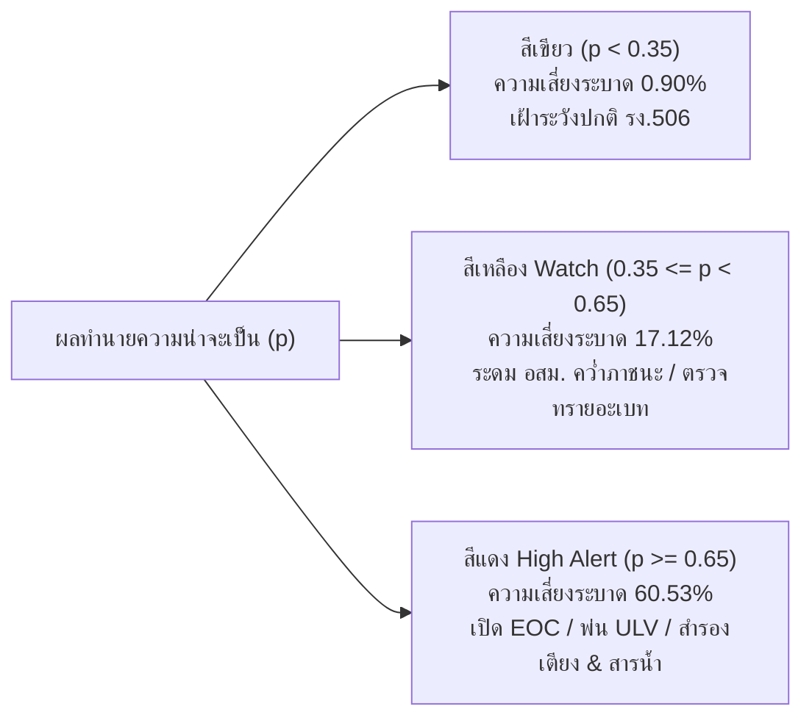

# เนื้อหาโปสเตอร์งานวิจัยโครงงานวิทยาการข้อมูล (A2 Poster Content)
**วิชา:** CPE312 Data Science Capstone (ภาคการศึกษา 2569)  
**เป้าหมายการพัฒนาที่ยั่งยืน:** SDG 3 — Good Health and Well-being (สุขภาพและความเป็นอยู่ที่ดี, เป้าประสงค์ 3.3 ยุติโรคเขตร้อนที่ถูกละเลย)  
**รูปแบบเอกสาร:** เอกสารต้นฉบับภาษาไทยแบ่งกล่องตามโครงสร้าง R1–R7 พร้อมตารางและตัวเลขที่ตรวจสอบได้จริง 100% (ตรงกับ Colab Notebook) สำหรับนำไปจัดวางใน Canva / Figma / PowerPoint ขนาด A2 (420 × 594 มม.)

---

## 📌 Poster Header (ส่วนหัวของโปสเตอร์)

### ชื่อโครงงาน
# เดือนหน้าไข้เลือดออกระบาดไหม?
### ระบบพยากรณ์การระบาดของโรคไข้เลือดออกล่วงหน้า 1 เดือน รายจังหวัดในประเทศไทย (1993–2022)
**Machine Learning-Based 1-Month Early Warning System for Dengue Outbreak Prevention in Thailand**

- **เป้าหมายระดับสากล:** SDG 3 — Good Health and Well-being (Target 3.3: ยุติการแพร่กระจายของโรคติดต่อที่มีแมลงเป็นพาหะ)
- **กลุ่มเป้าหมายผู้ใช้งาน:** สำนักงานสาธารณสุขจังหวัด (สสจ.) ทั้ง 77 จังหวัดทั่วประเทศไทย
- **สมาชิกและบทบาทความรับผิดชอบ:**
  1. **นาย ก. [รหัสนักศึกษา]** — *Data Engineer / Custodian:* รับผิดชอบ T01–T03, R2 (ดึงข้อมูล OpenDengue & Open-Meteo, ทำความสะอาด, รวมตาราง 77 จังหวัด)
  2. **นาย ข. [รหัสนักศึกษา]** — *ML Engineer / Modeler:* รับผิดชอบ T05–T08, R4 (วิศวกรรมฟีเจอร์, พัฒนาโมเดล LR, RF, HistGradientBoosting และการจูนเกณฑ์ตัดสิน)
  3. **นาย ค. [รหัสนักศึกษา]** — *Storyteller & QA Specialist:* รับผิดชอบ T04, T09, T11, R1/R3/R5/R6 (วิเคราะห์ EDA, วิเคราะห์ความผิดพลาด, นโยบาย Two-Tier, ตรวจสอบตัวเลข)

---

## 🏛️ Box R1 — ที่มาและความสำคัญของปัญหา (Sensible Problem & Framing)
*(คะแนนความสำคัญของโจทย์: 30% ตามเกณฑ์การประเมิน R1)*

ตอบครบ 5 คำถามหลักในการตั้งโจทย์ Data Science ภาคปฏิบัติ:

1. **ใครคือผู้ใช้งาน และใช้ตัดสินใจอะไร? (User & Decision):**
   - ผู้ใช้งานหลักคือ **สำนักงานสาธารณสุขจังหวัด (สสจ.)** ร่วมกับเครือข่ายโรงพยาบาลและ อสม.
   - ตัดสินใจบริหารจัดการ 3 มาตรการล่วงหน้า 1 เดือน: (1) อนุมัติงบพ่นหมอกควัน/สารเคมี ULV ในพื้นที่เสี่ยง, (2) ระดม อสม. รณรงค์เคาะประตูบ้านคว่ำภาชนะกำจัดลูกน้ำยุงลายและแจกทรายอะเบท, (3) สำรองเตียงผู้ป่วย สารน้ำ Ringer's lactate และเกล็ดเลือดในโรงพยาบาลประจำจังหวัด/อำเภอ
2. **ทำนายเมื่อไร และมีข้อมูลพร้อมใช้งานหรือไม่? (Prediction Time & No Leakage):**
   - ทำนาย ณ **วันสุดท้ายของเดือน $t$** เพื่อพยากรณ์สถานะการระบาดใน **เดือน $t+1$** (ให้เวลาเตรียมการล่วงหน้า 1 เดือนเต็ม)
   - ข้อมูลเข้าใช้เฉพาะยอดผู้ป่วยสะสมและสภาพอากาศถึงสิ้นเดือน $t$ เท่านั้น **ไม่มีการใช้สภาพอากาศล่วงหน้าในอนาคต** เพื่อป้องกันการรั่วไหลของข้อมูล (Zero Data Leakage)
3. **1 แถวข้อมูลแทนอะไร? (Row Definition):**
   - **จังหวัด × เดือน** (77 จังหวัด × 360 เดือน ในช่วง 30 ปี พ.ศ. 2536–2565 / ค.ศ. 1993–2022)
4. **นิยามเป้าหมายที่วัดผลได้ในทางคณิตศาสตร์คืออะไร? (Measurable Target):**
   - นิยามการระบาด: $\text{outbreak}_{p, t+1} = 1$ เมื่อจำนวนผู้ป่วยในเดือน $t+1$ สูงเกินเกณฑ์ทางระบาดวิทยา:
     $$\text{cases}_{p, t+1} > \mu_p + 1.0 \cdot \sigma_p$$
   - โดยค่าเฉลี่ย ($\mu_p$) และส่วนเบี่ยงเบนมาตรฐาน ($\sigma_p$) คำนวณจำเพาะของแต่ละจังหวัด จาก **ปีชุดฝึกสอน (Train 1993–2015) เท่านั้น**
5. **ความผิดพลาดแบบใดสร้างความเสียหายรุนแรงกว่ากัน? (Costly Error & Metric):**
   - **False Negative (ไม่เตือน แต่เกิดการระบาดจริง):** สร้างความเสียหายรุนแรงที่สุด เพราะทำให้ สสจ. ไม่ได้เตรียมการ เกิดการระบาดลุกลาม โรงพยาบาลขาดแคลนเตียงและสารน้ำฉุกเฉิน และนำไปสู่การเสียชีวิตของผู้ป่วยที่ป้องกันได้
   - **False Positive (เตือน แต่ไม่ถึงเกณฑ์ระบาด):** เสียหายเฉพาะงบสำรวจลูกน้ำยุงลาย ซึ่งการลงพื้นที่กำจัดยุงลายก็ยังมีผลดีต่อสุขอนามัยชุมชน
   - **ตัวชี้วัดหลัก (Primary Metric):** จึงเลือกใช้ **Recall บนเดือนที่ระบาด (Recall on Outbreak Months)** เป็นเป้าหมายสูงสุด โดยต้องรักษา Precision, F1-score และ PR-AUC ให้อยู่ในระดับที่ยอมรับได้ทางปฏิบัติ

---

## 📊 Box R2 — แหล่งข้อมูลเปิดและการเตรียมข้อมูลที่ตรวจสอบได้ (Verifiable Data & Prep)

### 1. แหล่งข้อมูลเปิดและสัญญาอนุญาต (Open Data & Licenses)
- **สถิติผู้ป่วยไข้เลือดออก:** OpenDengue V1.3.1 (ใบอนุญาต CC BY 4.0; Clarke et al., *Scientific Data* 2024) ข้อมูลรายจังหวัด-รายเดือนของประเทศไทย 1993–2022
- **สภาพอากาศย้อนหลัง:** Open-Meteo ERA5 Historical Reanalysis Archive (ใบอนุญาต CC BY 4.0) ดึงข้อมูลอุณหภูมิ (°C), ฝนสะสม (mm), ความชื้นสัมพัทธ์ (%) ณ พิกัดศูนย์กลางภูมิศาสตร์ของ 77 จังหวัด

### 2. มิติข้อมูลและปัญหาคุณภาพข้อมูลที่ค้นพบ (Data Cleaning & Quality Audit)
- **ขนาดข้อมูลรวม (Panel):** 27,720 แถว (77 จังหวัด × 360 เดือน)
- **ตารางสำหรับฝึกโมเดล (Modeling Table):** 26,100 แถว (ตัด lag 12 เดือนแรกของประวัติศาสตร์ และตัดช่วงก่อนตั้งจังหวัดใหม่)
- **การจัดการชื่อจังหวัดที่ 78:** ตรวจพบชื่อเกินใน OpenDengue คือ `PRACHIN BURI` (1993–2002) และ `PHACHINBURI` (2003–2022) ซึ่งคือจังหวัดปราจีนบุรีเดียวกัน ทำการรวมประวัติศาสตร์เหลือ 77 จังหวัดที่สมบูรณ์
- **จังหวัดตั้งใหม่ 5 จังหวัด:** อำนาจเจริญ, มุกดาหาร, หนองบัวลำภู, สระแก้ว (ตั้งช่วงปี 1993 ข้อมูลเริ่ม 2003) และบึงกาฬ (ตั้งปี 2011) ขาดข้อมูลช่วงต้นรวม 696 จังหวัด-เดือน ทางกลุ่มไม่ทำ Imputation เท็จ แต่ตัดแถวก่อนจัดตั้งจังหวัดออกจากการสร้างตารางโมเดล
- **การเปลี่ยนแปลงนิยามรายงานโรคปี 2021–2022:** เปลี่ยนมาใช้ยอดรวม `dengue_total` ที่ครอบคลุมทั้ง DF, DHF และ DSS อย่างสม่ำเสมอตลอด 30 ปี

### 3. การแบ่งชุดข้อมูลตามลำดับเวลาอย่างเคร่งครัด (Chronological Split)
*ห้ามใช้ Random Split โดยเด็ดขาดเพื่อป้องกัน Look-ahead Leakage*

| ชุดข้อมูล (Split) | ช่วงปี (Years) | จำนวนแถว | เดือนที่ระบาดจริง | สัดส่วนการระบาด (%) | วัตถุประสงค์การใช้งาน |
|---|---|---|---|---|---|
| **Train** | 1994–2015 | 19,632 | 1,923 | 9.80% | ฝึกสอนโมเดลและคำนวณ $\mu_p, \sigma_p$ |
| **Validation** | 2016–2017 | 1,848 | 70 | 3.79% | จูน Hyperparameters และ Threshold |
| **Test (รวม)** | 2018–2022 | 4,620 | 392 | 8.48% | ประเมินผลครั้งเดียวตอนท้ายสุด |
| *• Test ปกติ* | 2018–2019 | 1,848 | 269 | 14.56% | ประเมินผลสภาวะระบาดปกติ |
| *• Test โควิด* | 2020–2022 | 2,772 | 123 | 4.44% | ประเมินผลสภาวะวิกฤตล็อกดาวน์ |

---

## 🔍 Box R3 — ข้อค้นพบจากการสำรวจข้อมูล (EDA Key Findings)
*(อ้างอิงรูปประกอบ: `eda_seasonality.png`, `eda_lag_correlation.png`, `eda_province_heterogeneity.png`, `eda_annual_trend_covid.png`)*

### 1. วงจรฤดูกาลและตัวนำทางสภาพอากาศ (Seasonality & Climate Drivers)
- **อุณหภูมิชี้นำ 2–3 เดือน:** อุณหภูมิเฉลี่ยทั่วประเทศขึ้นสู่จุดสูงสุดในเดือนเมษายน (เดือน 4, **28.60°C**) ซึ่งนำหน้าการระบาดสูงสุดของไข้เลือดออกในเดือนกรกฎาคม (เดือน 7, **114.31 ราย/จังหวัด**) อยู่ 2–3 เดือน สอดคล้องกับค่าสหสัมพันธ์ภายในจังหวัดที่สูงสุดที่ lag 3 (**$r = 0.3940$**) เนื่องจากความร้อนเร่งวงจรฟักตัวของเชื้อไวรัสในยุง (Extrinsic Incubation Period)
- **ฝนชี้นำ 0–1 เดือน:** มรสุมเริ่มตกชุกในเดือนพฤษภาคม (เดือน 5, **189.84 mm**) นำหน้าการระบาด 0–1 เดือน ($r = 0.2853$) ทำให้เกิดน้ำขังในภาชนะเพาะพันธุ์ลูกน้ำ

### 2. ความเหลื่อมล้ำสุดขั้วระหว่างจังหวัด (Extreme Spatial Heterogeneity)
- อัตราผู้ป่วยเฉลี่ยต่อเดือนระหว่างจังหวัดต่างกันถึง **49.78 เท่า** (กรุงเทพฯ สูงสุด **354.45 ราย/เดือน** vs หนองบัวลำภู ต่ำสุด **7.12 ราย/เดือน**)
- **ทำไมเกณฑ์ระดับประเทศจึงล้มเหลว:** หากใช้เกณฑ์ระบาดค่าเดียวทั่วประเทศ จะมีถึง **11 จังหวัด**ที่ไม่เคยได้รับสัญญาณเตือนภัยเลยตลอด 30 ปี ส่งผลให้การกำหนดเกณฑ์เฉพาะรายจังหวัด ($\mu_p + \sigma_p$) เป็นหัวใจสำคัญของความแม่นยำ

### 3. ผลกระทบจากมาตรการล็อกดาวน์ยุคโควิด-19 (COVID-19 Anomaly)
- ในช่วงโควิด-19 (2020–2022) ยอดผู้ป่วยลดฮวบลงถึง **11.30 เท่า** (จาก **87,866 ราย** ในปี 2019 เหลือเพียง **7,778 ราย** ในปี 2021) และสัดส่วนจังหวัดที่ไม่มีผู้ป่วยเลยพุ่งขึ้นเป็น 24.13% เนื่องจากการปิดโรงเรียนและการเดินทางข้ามจังหวัดหยุดชะงัก

---

## 🏆 Box R4 — การเปรียบเทียบโมเดลกับ Baseline (Model vs. Baseline)
*(อ้างอิงรูปประกอบ: `r4_model_vs_baseline.png`)*

ประเมินบนชุดข้อมูลทดสอบจริง (**Test Set 2018–2022, 4,620 จังหวัด-เดือน, มีการระบาดจริง 392 ครั้ง**):

| โมเดล / เกณฑ์เปรียบเทียบ | เกณฑ์ตัดสิน (Threshold) | Recall (จับระบาด) | Precision (แม่นยำ) | F1-Score | PR-AUC | พลาดเตือน (FN) |
|---|---|---|---|---|---|---|
| **1. Majority Class (ไม่เตือนเลย)** | — | 0.0% (0/392) | 0.0% | 0.0000 | 0.0848 | 392 ครั้ง |
| **2. Seasonal Last Year (เดือนเดียวกันปีก่อน)** | — | 28.32% (111/392) | 29.84% | 0.2906 | 0.1453 | 281 ครั้ง |
| **3. Persistence (เดือนที่แล้วระบาดไหม)** | — | 62.24% (244/392) | 63.21% | 0.6272 | 0.4255 | 148 ครั้ง |
| **4. Logistic Regression** | 0.54 | 85.97% (337/392) | 58.92% | 0.6992 | 0.7702 | 55 ครั้ง |
| **5. Random Forest** | 0.45 | 82.91% (325/392) | 58.98% | 0.6893 | 0.7698 | 67 ครั้ง |
| **6. HistGradientBoosting (โมเดลที่ดีที่สุด)** | **0.49** | **88.27% (346/392)** | **53.98%** | **0.6699** | **0.7657** | **46 ครั้ง** |

### สรุปผลความเหนือชั้นของ Machine Learning
- **Recall พุ่งสูงถึง 88.27%:** เหนือกว่า Persistence Baseline ถึง **+26.02 percentage points**
- **ลดการหลุดเตือนลง 68.9%:** ลดจำนวนเดือนที่ระบาดโดยไม่รู้ตัวจาก 148 ครั้งเหลือเพียง 46 ครั้ง ช่วยให้บุคลากรสาธารณสุขมีเวลาตั้งรับล่วงหน้า
- **ทนทานต่อวิกฤตข้ามยุค:** รักษา Recall สูงทั้งในยุคปกติ 2018–2019 (**89.22%**) และยุคโควิด 2020–2022 (**86.18%**)

---

## 🎯 Box R5 — การวิเคราะห์ความผิดพลาดของโมเดล (Know Where Model Fails)
*(อ้างอิงรูปประกอบ: `r5_error_analysis.png`)*

### 1. จุดบอดของ Baseline vs ความสามารถของ ML ในการเตือน "เริ่มระบาดใหม่"
ในการระบาดจริง 392 ครั้ง แบ่งเป็น **ระบาดต่อเนื่อง (Ongoing)** 244 ครั้ง และ **เริ่มระบาดใหม่ (Onset)** 148 ครั้ง:
- **Persistence บอดสนิทต่อการเริ่มระบาดใหม่:** ทำ Onset Recall ได้ **0.0% (0/148)** ไม่สามารถเตือนล่วงหน้าได้แม้แต่ครั้งเดียว
- **HistGradientBoosting เตือนการเริ่มระบาดล่วงหน้าได้ถึง 73.0% (108/148):** ป้องกันโรงพยาบาลไม่ให้ถูกจู่โจมฉับพลัน

### 2. กายวิภาคของ False Negatives (46 ครั้งที่โมเดลหลุดเตือน)
- **87.0% (40/46 ครั้ง)** คือกรณี Onset ที่ยอดผู้ป่วยพุ่งกระโดดฉับพลันแบบก้าวกระโดดเฉลี่ย **3.35 เท่า** ในเดือนเดียว โดยไม่มีสัญญาณเตือนจากยอดผู้ป่วยเดือนก่อนหน้า
- **กรณีตัวอย่างจริง:**
  - *บึงกาฬ (พ.ค. 2019):* ผู้ป่วยกระโดด **14.1 เท่า** (จาก 7.0 สู่ 99.0 ราย เกณฑ์ 53.3 ราย) ช่วงลมมรสุมเข้าฉับพลัน
  - *สิงห์บุรี (มิ.ย. 2019):* ผู้ป่วยกระโดด **10.5 เท่า** (จาก 4.0 สู่ 42.0 ราย เกณฑ์ 24.8 ราย) ข้ามเกณฑ์ขนาดเล็ก
  - *อุดรธานี (ก.ค. 2020):* ผู้ป่วยกระโดด **10.4 เท่า** (จาก 28.0 สู่ 291.0 ราย) แหวกกระแสช่วงโควิด-19

### 3. กายวิภาคของ False Positives (295 ครั้งที่โมเดลเตือนเกิน)
ถึง **93.6% (276/295 ครั้ง)** เป็นสัญญาณเตือนที่มีประโยชน์ทางสาธารณสุขสูง (Actionable Near-Miss):
1. **เฉียดเกณฑ์ระบาด (Elevated Near-Miss):** 41.0% (121 ครั้ง) ผู้ป่วยสูงเฉียดเกณฑ์ เช่น *สมุทรสาคร (มิ.ย. 2018)* มีผู้ป่วย 64.0 ราย พลาดเกณฑ์ 64.5 ราย ไปเพียง **0.5 ราย**
2. **หางคลื่นระบาด (Post-Outbreak Tail):** 36.9% (109 ครั้ง) เดือนก่อนระบาดหนัก ยอดกำลังลดลง เช่น *เลย (ส.ค. 2019)* มี 141.0 ราย (เกณฑ์ 148.2)
3. **เตือนล่วงหน้า 2 เดือน (Pre-Outbreak $t+2$):** 15.6% (46 ครั้ง) เดือน $t+1$ ยังไม่ระบาด แต่ระบาดหนักในเดือน $t+2$ เช่น *ชัยภูมิ (พ.ค. 2019)* เตือนที่ 159 ราย ก่อนระบาดหนัก 389 รายในเดือนถัดไป
- มีเพียง **6.4% (19/295 ครั้ง)** เท่านั้นที่เป็นการเตือนผิดพลาดแท้จริง (Pure False Alarm)

---

## 💡 Box R6 — ข้อเสนอแนะเชิงปฏิบัติการและความคุ้มค่า (Practical Policy & Limits)
*(อ้างอิงรูปประกอบ: `r6_threshold_policy.png`)*

### 1. ระบบเตือนภัย 2 ระดับสำหรับ สสจ. (Two-Tier Early Warning Protocol)
เพื่อขจัดปัญหาเตือนพร่ำเพรื่อ (Alert Fatigue) ออกแบบแนวทางปฏิบัติการจำแนกตามระดับความน่าจะเป็น ($p$):



- **สีเขียว (Green, $p < 0.35$):** ครอบคลุม **83.8% ของเดือนทั้งหมด** มีความเสี่ยงระบาดเพียง **0.90%** (<1 ใน 100 เดือน) ไม่ต้องเสียงบประมาณฉุกเฉิน
- **สีเหลือง Tier-1 Watch ($0.35 \le p < 0.65$):** ครอบคลุม **4.8% ของเดือน** (เฉลี่ย 0.58 ครั้ง/จังหวัด/ปี) ความเสี่ยง **17.12%** ใช้มาตรการต้นทุนต่ำ (0.3x) ระดม อสม. สำรวจลูกน้ำยุงลาย
- **สีแดง Tier-2 High Alert ($p \ge 0.65$):** ครอบคลุม **11.4% ของเดือน** (เฉลี่ย 1.37 ครั้ง/จังหวัด/ปี) ความเสี่ยงสูงถึง **60.53%** (>6 ใน 10 เดือนระบาดจริง) สั่งเปิด EOC พ่นหมอกควัน และสำรองเตียง/สารน้ำ Ringer's lactate
- **ผลลัพธ์รวม:** เขตเตือนภัย ($p \ge 0.35$) ตรวจจับการระบาดได้ถึง **91.07% (357/392 ครั้ง)**

### 2. การวิเคราะห์ความคุ้มค่าเชิงตัวเลข (Parametric Cost Dominance)
- เมื่ออัตราส่วนความเสียหายของการหลุดเตือน $R = C_{\text{missed}} / C_{\text{alert}} \ge 3$ ระบบ ML Two-Tier ประหยัดต้นทุนรวมเหนือกว่าทุก Baseline อย่างสมบูรณ์ (Mathematical Dominance)
- **ประหยัดต้นทุน 65.9% – 69.7%** เมื่อเทียบกับการรณรงค์เหวี่ยงแหช่วงหน้าฝน 6 เดือน (Blanket Campaign)
- **ลดภาระงานแจ้งเตือนลง 72.2%** และ **ลดการเตือนเก้อลง 85.0%** ที่เกณฑ์เดี่ยว 0.49
- **ปรับลดการเตือนอัตโนมัติ 56.0% ในช่วงโควิด-19** ป้องกันการสิ้นเปลืองทรัพยากรภาครัฐ

### 3. ข้อจำกัดที่ข้อมูลยังพิสูจน์ไม่ได้ 4 ประการ (Limits the Data Cannot Prove)
1. **ข้อมูลเฝ้าระวังไม่เท่ากับผลลัพธ์เชิงสาเหตุ (Surveillance ≠ Causal Effect):** โมเดลบอกความเสี่ยงล่วงหน้า แต่ไม่สามารถพิสูจน์ว่าเมื่อพ่นสารเคมีแล้วจะลดยอดผู้ป่วยได้กี่เปอร์เซ็นต์ (ต้องใช้การทดลองแบบ Stepped-Wedge Cluster Trial)
2. **ความละเอียดระดับจังหวัด (Admin1) vs รัศมียุงบิน 100–400 เมตร:** โมเดลบอกว่าจังหวัดใดเสี่ยง แต่ สสจ. ต้องใช้ข้อมูล รง.506 รายสัปดาห์ระดับตำบล/หมู่บ้านเพื่อชี้เป้าพ่นสารเคมีในชุมชน
3. **ปัจจัยไวรัสสายพันธุ์ย่อย (DENV-1..4) และภูมิคุ้มกันหมู่:** ฐานข้อมูลเปิดไม่มีข้อมูล Serotype การเปลี่ยนสายพันธุ์หลักอาจเร่งการระบาดนอกเหนือสถิติในอดีต
4. **สภาพอากาศจากดาวเทียม vs พฤติกรรมการกักเก็บน้ำในครัวเรือน:** สภาพอากาศระบุความเหมาะสมทางชีววิทยา แต่ไม่สามารถแทนที่การตรวจตุ่มน้ำและโอ่งมังกรในบ้านได้

---

## 🤖 Box R7 — บันทึกการทำงานร่วมกับ AI และการตรวจสอบแก้ไข (AI-Use Log)
*(ข้อกำหนด R7: แสดงการมีวิจารณญาณและตรวจพบจุดบกพร่องของ AI อย่างน้อย 1 กรณี)*

| ลำดับงาน | เครื่องมือ AI | คำแนะนำ/ผลลัพธ์แรกเริ่มของ AI | ข้อผิดพลาดที่กลุ่มตรวจพบ | การตัดสินใจแก้ไขของกลุ่ม (Human-in-the-Loop) |
|---|---|---|---|---|
| **T02** | Claude / Gemini | เสนอให้เขียนโค้ดคำนวณจุดกึ่งกลางจังหวัดด้วย LAEA Projection และ Shapely | **Hallucination:** ไม่มีไลบรารี shapely ติดตั้งในเครื่อง และไฟล์ `provinces.geojson` มีพิกัด lat/lon อยู่แล้วใน Properties | ปฏิเสธโค้ด AI และเขียนฟังก์ชันอ่านค่าพิกัดตรงจาก geojson ช่วยลดเวลาและไม่ต้องลงแพ็กเกจเพิ่ม |
| **T07** | Copilot / Claude | เรียกใช้ `.feature_importances_` บนโมเดล `HistGradientBoostingClassifier` | **API Incompatibility:** โมเดลตระกูล HistGradientBoosting ของ scikit-learn ไม่มี attribute ดังกล่าว ทำให้เกิด Error | สั่งแก้เป็นการคำนวณ Validation Permutation Importance แทน ซึ่งได้ผลวิเคราะห์ฟีเจอร์ที่น่าเชื่อถือกว่า |
| **T04/07/08/09** | Gemini Assistant | สร้างกราฟแสดงผลโดยวางตำแหน่ง Label / Legend ซ้อนทับแท่งกราฟและเส้นข้อมูล | **Visual Defect:** ป้ายตัวเลขทับข้อมูลสำคัญในรูป Lag Correlation, R4, R5 และ R6 | ปรับโค้ด matplotlib กำหนด `ylim`, ปรับตำแหน่ง Callout box และแยก Legend 2 คอลัมน์ให้อ่านง่าย |
| **T05/T07** | Claude Assistant | เสนอให้แบ่ง Train/Test ด้วย `train_test_split(shuffle=True)` และคำนวณเกณฑ์ระบาดจากข้อมูลทั้งหมด | **Data Leakage:** ข้อมูลอนาคตรั่วไหล และผิดธรรมชาติของข้อมูลอนุกรมเวลาทางระบาดวิทยา | ปฏิเสธทันที และล็อกกฎใน SSOT ให้แบ่งตามปีปฏิทินเคร่งครัด พร้อมคำนวณ $\mu_p, \sigma_p$ จากปี Train เท่านั้น |
| **T10/T11** | Claude Assistant | เสนอให้ติดตั้ง `tabulate` และ `qrcode` เพิ่มเติมเพื่อจัดตารางและสร้างภาพ QR | **Dependency Violation:** ขัดกับกฎข้อ 5 ใน `AGENTS.md` (ห้ามติดตั้งแพ็กเกจใหม่โดยไม่จำเป็น) | เขียนฟังก์ชันจัดตารางด้วยสตริงมาตรฐาน และสร้าง QR Code ด้วยตัวแปลงมาตรฐานร่วมกับ PIL/cv2 |

---

## 🔗 Footer & QR Codes (ส่วนท้ายและรหัสคิวอาร์)

```
[QR Code 1: Colab Notebook]      [QR Code 2: OpenDengue Dataset]      [QR Code 3: Open-Meteo Weather]
     (poster/qr_colab.png)            (poster/qr_opendengue.png)            (poster/qr_weather.png)
https://colab.research.google.com/drive/1ZFD4hoCQNAjVg_cOlb4Wbb63Lx7TdEGS
https://opendengue.org · https://open-meteo.com/en/docs/historical-weather-api
```

- **เอกสารอ้างอิงข้อมูล:**
  1. Clarke, J., Lim, A., Gupte, P., Pigott, D. M., van Panhuis, W. G., & Brady, O. J. (2024). A global dataset of publicly available dengue case count data. *Scientific Data*, 11(1), 296. (OpenDengue V1.3.1)
  2. Open-Meteo ERA5 Historical Weather API (European Centre for Medium-Range Weather Forecasts - ECMWF reanalysis).
  3. กรมควบคุมโรค กระทรวงสาธารณสุข ประเทศไทย (รายงานการเฝ้าระวังโรคทางระบาดวิทยา รง.506).

---

## 📐 Visual Layout Blueprint (ผังการจัดวางบน Canva / Figma A2)
- **ขนาดกระดาษ:** A2 แนวตั้ง (Portrait) 420 × 594 มิลลิเมตร (300 DPI: 4961 × 7016 พิกเซล)
- **ระบบกริด:** 3 คอลัมน์โมดูลาร์ (Modular 3-Column Grid, Margin 15 มม., Gutter 10 มม.)
  - **ส่วนบนสุด (Full Width):** Poster Header (ชื่อเรื่องโดดเด่น, ตราสัญลักษณ์ SDG 3, รายชื่อผู้จัดทำและบทบาท)
  - **คอลัมน์ซ้าย (Column 1):**
    - Box R1: ที่มาและความสำคัญ (5 Framing Questions)
    - Box R2: ข้อมูลและการแบ่งชุดข้อมูล (ตาราง Chronological Split)
    - Box R7: บันทึกการใช้ AI และการกำกับดูแลโดยมนุษย์ (AI Oversight Table)
  - **คอลัมน์กลาง (Column 2):**
    - Box R3: ข้อค้นพบจากการสำรวจข้อมูล (ใส่รูป `eda_seasonality.png` และ `eda_province_heterogeneity.png`)
    - Box R4: โมเดล vs Baseline (ใส่รูป `r4_model_vs_baseline.png` + ตารางเปรียบเทียบผล Test Set)
  - **คอลัมน์ขวา (Column 3):**
    - Box R5: การวิเคราะห์ความผิดพลาด (ใส่รูป `r5_error_analysis.png` + ตาราง Onset vs Ongoing)
    - Box R6: ข้อเสนอแนะเชิงนโยบาย Two-Tier & ข้อจำกัด 4 ข้อ (ใส่รูป `r6_threshold_policy.png`)
  - **ส่วนล่างสุด (Full Width):** Footer & QR Codes 3 จุด พร้อมลิงก์เข้าถึงโค้ดและข้อมูล
- **ชุดสี (Color Palette):**
  - สีกรมท่าสุขาภิบาล (Navy `#1B365D`): สีพื้นหัวข้อหลักและกรอบเน้นความน่าเชื่อถือ
  - สีแดงเตือนภัยไข้เลือดออก (Crimson Alert `#D9381E`): ใช้เน้นเดือนที่เกิดการระบาดและจุดผิดพลาด
  - สีเหลืองอำพันระวังภัย (Amber Watch `#E69F00`): ใช้แสดงสถานะเตือนภัย Tier-1
  - สีเขียวปลอดภัย (Forest Green `#2E7D32`): ใช้แสดงสถานะเฝ้าระวังปกติ Green Tier
