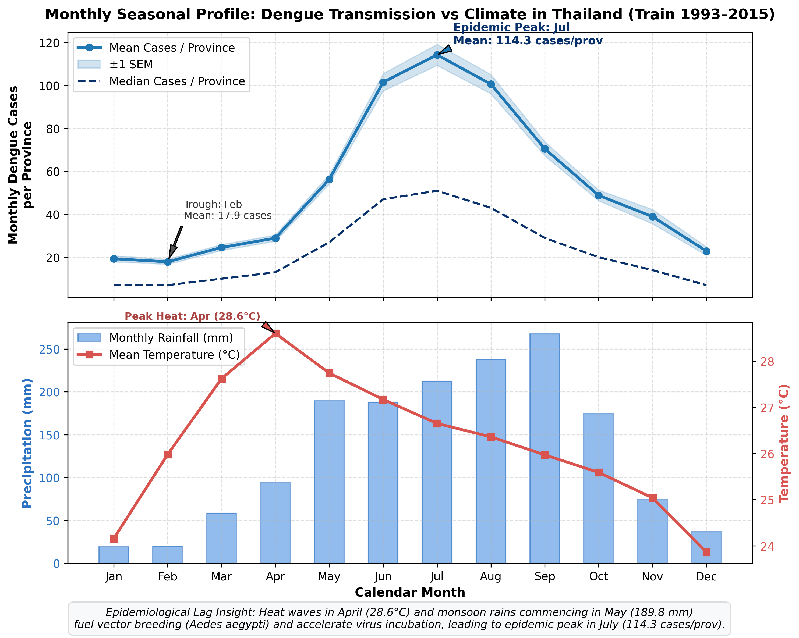
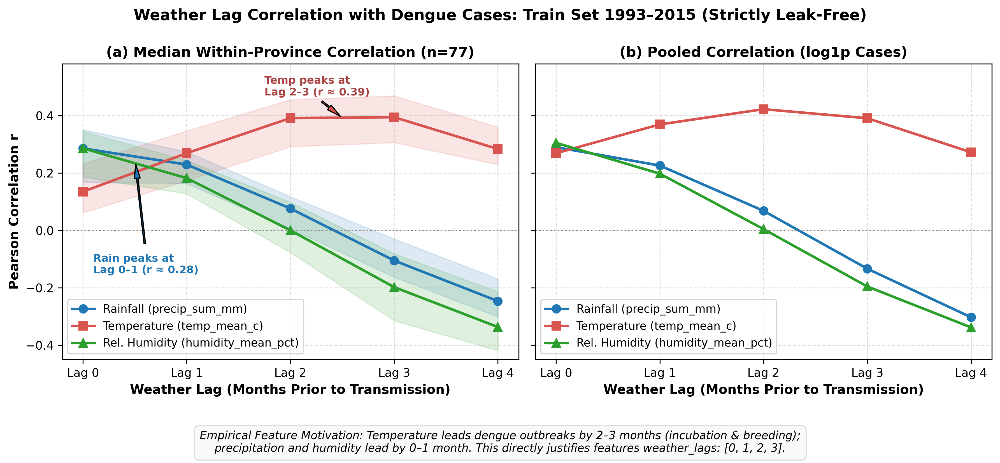
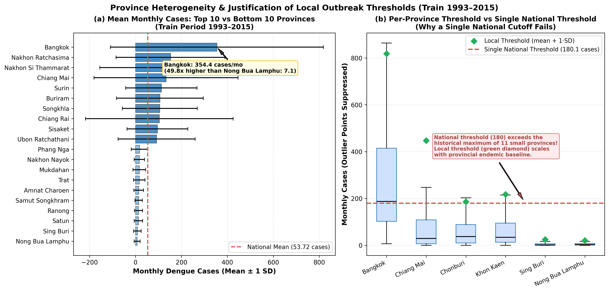
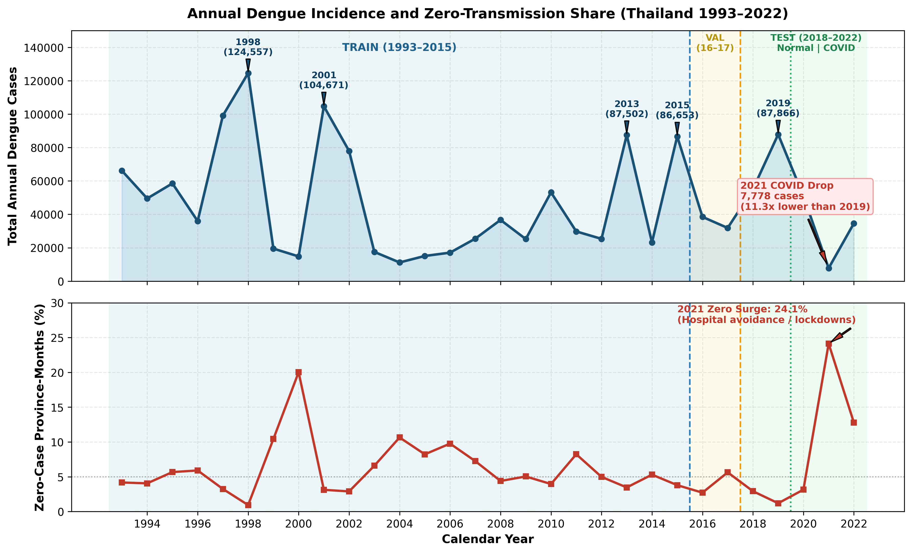
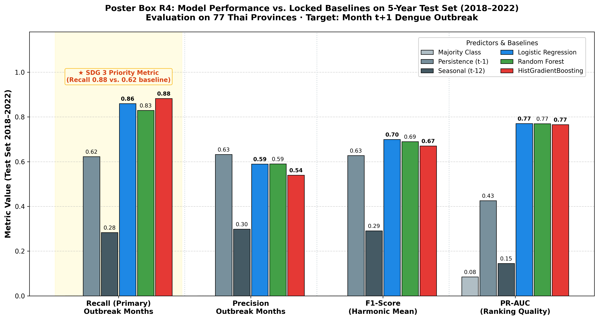
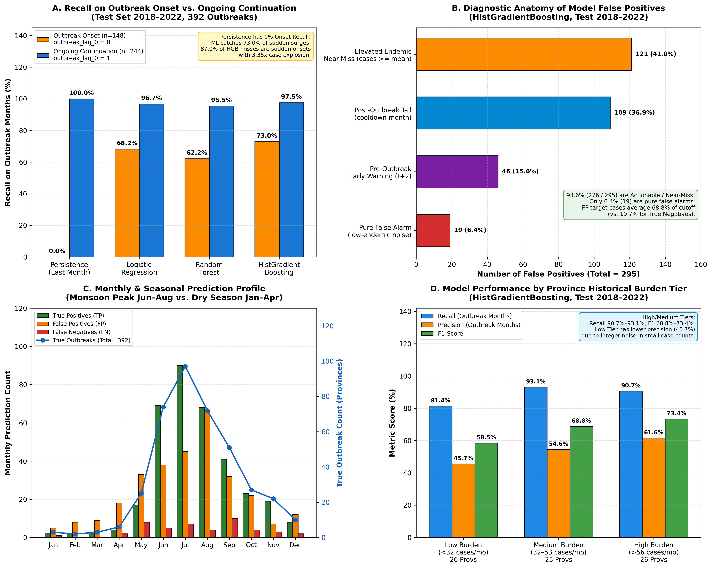
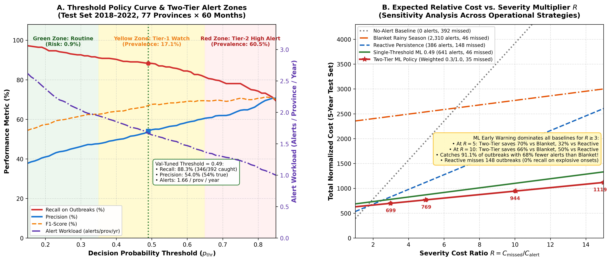

# CPE312 Gallery Walk Master Guide: From Big Picture to Code-Level Details

**Project:** *Will Dengue Break Out Next Month?* (**เดือนหน้าไข้เลือดออกระบาดไหม?**)  
**Formal Title:** Province-Level 1-Month-Ahead Dengue Outbreak Prediction in Thailand (1993–2022)  
**Course & Weight:** CPE312 Data Science Capstone (Academic Year 2569 / 2026) · **SDG 3: Good Health and Well-being (Target 3.3)** · Worth **15%** of course grade  
**Gallery Walk Date:** Tuesday, November 17, 2026 · **13:00–16:00** (Colab link due before start)

> **How to use this guide:** Read from **Part 1 to Part 9**. It is designed as a zoom-in funnel: start with the **30-second elevator pitch**, move through **problem framing (R1)**, **data & leakage prevention (R2)**, **EDA stories (R3)**, **model internals & exact math (R4)**, **failure patterns & named examples (R5)**, **policy economics & limits (R6)**, **AI oversight & cell-by-cell notebook map (R7)**, and finish with **ready-to-speak Thai pitch lines, tough Q&A defense, and pre-13:00 checklist**.

---

## Part 1 — The Big Picture (General Idea & Grading Rules)

### 1.1 The Core Idea in 4 Sentences
1. **Who & What:** Every end of month **t**, our system gives Thailand's **77 Provincial Public Health Offices (สสจ.)** an early warning asking: *"Will province p experience a dengue outbreak in month t+1?"*
2. **Why It Matters:** Mosquito control (larval elimination, ULV fogging) and hospital staging (beds, IV fluids, platelets) need **3–4 weeks** of preparation, yet simple rule-of-thumb persistence ("if this month is bad, next month will be bad") misses **100% (0/148)** of new outbreak surges.
3. **What We Built:** Using 30 years of open disease surveillance (**OpenDengue V1.3.1**) and satellite climate reanalysis (**Open-Meteo ERA5**) across 77 provinces (**27,720** province-months; **26,100** modeling rows), we trained a leak-free **HistGradientBoosting** classifier calibrated strictly on validation data.
4. **Headline Impact:** On the held-out 5-year test set (2018–2022, 392 outbreaks), our model catches **88.27% (346/392)** of outbreaks (+26.02 percentage points over Persistence, cutting missed outbreaks by **68.9%** from 148 to 46) and catches **73.0% (108/148)** of sudden new outbreak onsets. Deployed as a **Two-Tier Yellow/Red protocol**, it reaches **91.07% (357/392)** recall while reducing total cost by **65.9%–69.7%** vs. a 6-month blanket rainy-season campaign.

### 1.2 How You Are Graded (Rubric & Gallery Walk Rules)
Every team member **must be able to explain every requirement (R1–R7) and any cell in the Colab notebook**. During the two ~25–30 minute rounds, one member staffs the A2 poster while teammates rotate; the instructor asks random members about any section or code cell.

| Grading Criterion | Weight | Mapped Poster Section / Deliverable | What Evaluators Look For Most |
|---|---:|---|---|
| **1. Problem statement & goal alignment** | **30%** | **R1** (Highest weight!) | Clear user, real 1-month-ahead decision, leak-free prediction time, measurable target, asymmetric cost logic |
| **2. Data analysis & methods** | **30%** | **R2 (Prep) + R3 (EDA) + R4 (ML)** + Colab (15% + 15%) | Open licenses, real data quirks fixed without fake imputation, time-based split, beat baseline on R1 metric |
| **3. Findings & insights** | **20%** | **R4, R5, R6** (10% interp + 10% rec) | Concrete failure case studies + reasons, realistic deployment actions, cost logic, honest data limits |
| **4. Presentation & visualization** | **10%** | Whole A2 Poster, **R3 & R4** charts | Clean charts from notebook, zero overlapping labels, every poster number matches notebook 100% |
| **5. Teamwork** | **5%** | Poster header roles + Individual Peer Eval | Clear division of roles and equal understanding across members |
| **6. Q&A** | **5%** | Gallery walk defense + **R7** | Confident answers without reading scripts; concrete example of rejecting/correcting AI output |

> **Gallery Walk Dot Stickers to Aim For:** *Best Problem* (R1), *Best Failure Analysis* (R5), and *Best Recommendation* (R6).

---

## Part 2 — R1: Problem Framing & Why Every Choice Was Made (30% of Grade)

Because R1 carries **30%** of the entire grade, memorize all **5 framing answers** cold:

### Question 1: Who uses the forecast, and for what decision?
- **Primary Users:** The **77 Provincial Public Health Offices (สำนักงานสาธารณสุขจังหวัด — สสจ.)**, coordinating with District Health Offices (สสอ.), hospitals (รพศ./รพท./รพช.), and Village Health Volunteers (**อสม.**).
- **Three Concrete 1-Month-Ahead Decisions:**
  1. **Vector Control Budget & Fogging:** Approve funding and deploy thermal fogging / ULV spraying teams to high-risk subdistricts.
  2. **Community Larval Control:** Mobilize อสม. for door-to-door container elimination (คว่ำภาชนะ) and verify Abate larvicide + NS1 rapid diagnostic kit stock.
  3. **Hospital Clinical Readiness:** Reserve pediatric and adult beds and pre-order IV fluids (`Ringer's lactate`) and blood-bank platelet units.
- **Why 1 Month Ahead (Not 1 Week or 3 Months)?** *Aedes aegypti* takes **7–10 days** from egg to adult, and dengue virus Extrinsic Incubation Period (EIP) in the mosquito takes **8–12 days** (~3 weeks total). This biological window aligns directly with the **3–4 weeks** required by สสจ. to procure chemicals, mobilize volunteers, and stage hospital supplies. One week is too short to act; three months ahead has weak weather predictability.

### Question 2: When is the prediction made, and does input data exist then (No Leakage)?
- **Prediction Time:** End of calendar month **t** (days 28–30), predicting the outbreak flag for calendar month **t+1**.
- **Strict Causality:** Features use **only** case counts (`รง.506` / OpenDengue) and weather observed **up to and including month t**. Zero future weather forecasts or future case statistics are ever used.

### Question 3: What does one row represent?
- **Unit of Analysis:** **1 province × 1 calendar month** `(p, t)` across all **77 Thai provinces** over **30 years** (1993–2022, 360 months).

### Question 4: Is the target measurable and clearly defined?
- **Binary Target (`outbreak_t1`):**
  `outbreak(p, t+1) = 1` if `cases(p, t+1) > μ_p + 1.0 · σ_p`, else `0`
- **Crucial Safeguard:** `μ_p` (historical mean) and `σ_p` (sample SD, `ddof=1`) are computed **separately for each province p** using **Train years (1993–2015) ONLY** (`data/processed/province_thresholds.csv`).
- **Why Relative Per-Province Threshold (`μ_p + 1·σ_p`) Instead of a Fixed National Cutoff?**
  - A single national cutoff (`180.09` cases/mo) fails completely because Thailand has a **49.78×** spread between Bangkok (**354.45** mean/mo) and Nong Bua Lamphu (**7.12** mean/mo).
  - Under `180.09`, **11 small provinces (14.3%)** would *never* trigger an alert in 23 years of training history, while Bangkok's median (**187.50**) would trigger alarms over half of all months!
  - In epidemiology (WHO / MoPH guidelines), an outbreak means cases exceeding a locality's own endemic baseline by at least 1 SD.

### Question 5: Which error is costlier? (Justifies the Metric)
- **Asymmetric Error Cost:**
  - **False Negative (Missed Outbreak — costliest error):** Hospitals lack beds, IV fluids, and platelets; larval breeding accelerates unchecked, causing preventable severe illness and mortality.
  - **False Positive (False Alarm — lower cost):** Triggers community อสม. larval inspection and sanitation outreach, which still improves household hygiene.
- **Why Accuracy Is a Trap:** Outbreaks are rare (**8.48%** in test, **9.80%** in train, **3.79%** in val). A useless all-zero model gets **91.52% accuracy** on test while achieving **0.0% recall**.
- **Metric Architecture:**
  - **Primary Evaluation Metric:** **Recall on outbreak months (Class 1)**.
  - **Supporting Metrics:** Precision, F1-score, and **PR-AUC** (ranking quality on imbalanced data).
  - **Validation Calibration:** Hyperparameters are selected by **Validation PR-AUC**, and probability thresholds are tuned on validation by maximizing **F₂-score** (which weights Recall **2×** more than Precision) so Recall rises without collapsing Precision.

---

## Part 3 — R2: Data Sources, Quality Audits & Anti-Leakage Engineering

### 3.1 Open Data Sources & Verified Licenses

| Dataset | Source & Citation | License & Terms | Scope & Exact Variables |
|---|---|---|---|
| **Dengue Cases** | **OpenDengue V1.3.1** (`https://opendengue.org`, Clarke et al., *Sci Data* 2024; raw data from Thailand MoPH `รง.506`) | **CC BY 4.0** (verified on `opendengue.org`) | Global extract 2,834,996 rows → Thailand (`ISO_A0 == 'THA'`) 27,259 rows → `S_res == 'Admin1' & T_res == 'Month'`: **27,024 rows**, 78 `adm_1_name`, **1993-01 to 2022-12**. Weekly province data is *not available* for Thailand, and province data ends 2022-12. |
| **Historical Weather** | **Open-Meteo Historical Weather API** (ECMWF **ERA5 / ERA5-Land** reanalysis via `archive-api.open-meteo.com/v1/archive`) | **CC BY 4.0** (Non-commercial free tier: 77 API calls, well under daily limits) | Daily variables (`timezone=Asia/Bangkok`): `temperature_2m_mean` (°C), `precipitation_sum` (mm), `relative_humidity_2m_mean` (%). Aggregated monthly at **77 province centroids** (`OpenGISData-Thailand/provinces.geojson`, lat 6.18°N–19.85°N, lon 98.03°E–105.11°E) → **27,720 rows**, **0 NaNs**. |

**Monthly Weather Ranges (1993–2022, 27,720 rows):**

- `temp_mean_c`: 15.74°C to 34.40°C (mean **26.29°C**)
- `precip_sum_mm`: 0.0 mm to 907.6 mm (mean **136.75 mm**)
- `humidity_mean_pct`: 37.42% to 97.06% (mean **75.71%**)

### 3.2 Real Data Problems Found & How We Solved Them (No Fake Imputation!)

#### 1. The "78th Province" Mystery (78 Names → 77 Provinces)
Cross-checking `adm_1_name` against Thailand's 77 official provinces (`src/data/province_map.csv`) revealed:

- **66 exact matches** (case-insensitive).
- **11 transliteration/spacing variants** (e.g., `BUNGKAN` → `Bueng Kan`, `TRAD` → `Trat`, `PHANGNGA` → `Phang Nga`, `SI SAKET` → `Sisaket`, `PRACHUAP KHILIKHAN` → `Prachuap Khiri Khan`, etc.).
- **1 historical temporal split:** `PRACHIN BURI` had **120 rows** (1993-01 to 2002-12) and `PHACHINBURI` had **240 rows** (2003-01 to 2022-12). Zero overlapping months; merging them restored `Prachin Buri` to all **360 months**.

#### 2. 696 Missing Case Months in 5 Newer / Late-Reporting Provinces
- **72 regular provinces** have all 360 uninterrupted months (1993–2022).
- **5 provinces** have missing early records totaling **696 province-months**:
  - **Bueng Kan** (established Mar 2011 from Nong Khai): starts 2011-01 → **216 missing months** (144 reported).
  - **Amnat Charoen, Mukdahan, Nong Bua Lamphu, Sa Kaeo**: OpenDengue reporting starts 2003-01 → **120 missing months each** (**480 total**, 240 reported each).
- **Why We Did NOT Impute (e.g., Mean/KNN):** Imputing cases for Bueng Kan in 1995—16 years before the province legally existed—would fabricate surveillance history. Instead, we kept `NA` in `panel.csv` (**27,720 rows**) and excluded unestablished/lag-incomplete rows when building `modeling_table.csv`.

#### 3. 2003 Reporting Schema Shift & Valid Zero-Case Months
- **1993–2002:** Standardized `case_definition_standardised = 'Total'` across 72 provinces (864 rows/yr), using `PRACHIN BURI`.
- **2003–2022:** Definition shifted to `'Suspected and confirmed'`, expanding to 76 provinces in 2003 (912 rows/yr) and 77 in 2011 (924 rows/yr). Using `dengue_total` consistently preserves continuity across 30 years.
- **Zero-case audit:** **1,754** reported province-months are exact `0`s (**6.49%**, e.g., 24.13% in 2021 lockdown vs 0.93% in 1998 epidemic), **0** negative values, **0** non-integer values.

### 3.3 Exact Row Accounting: `panel.csv` (27,720) → `modeling_table.csv` (26,100)
If an instructor asks *"Why did 27,720 rows shrink to 26,100 rows?"*, here is the exact **1,620-row** breakdown (`results/feature_summary.json`):

- **792 rows:** 72 regular provinces × 11 initial months (1993-01 to 1993-11) lacking the `t−11` lag (`outbreak_same_month_last_year`).
- **480 rows:** 4 late-reporting provinces × 120 pre-start months (1993-01 to 2002-12).
- **44 rows:** 4 late-reporting provinces × 11 initial lag months after starting (2003-01 to 2003-11).
- **216 rows:** Bueng Kan × 216 pre-establishment months (1993-01 to 2010-12).
- **11 rows:** Bueng Kan × 11 initial lag months after starting (2011-01 to 2011-11).
- **77 rows:** All 77 provinces × final panel month (2022-12), which has no observed `2023-01` target.
- **Total:** `792 + 480 + 44 + 216 + 11 + 77 = 1,620` dropped → `27,720 − 1,620 = 26,100` clean rows (**0 NaNs**).

### 3.4 Strict Chronological Split (Zero Random Shuffling, Seed = 42)
Splits are assigned by **`target_year`** (`t+1`) so every evaluation block contains complete calendar years and zero overlap between splits:

| Split | `target_year` Range | Rows | Outbreaks (Class 1) | Prevalence | Purpose |
|---|---|---:|---:|---:|---|
| **Train** | **1994–2015** | **19,632** | **1,923** | **9.80%** | Fit `StandardScaler`, train models (`μ_p, σ_p` fit on 1993–2015 panel = 20,556 valid rows) |
| **Validation** | **2016–2017** | **1,848** | **70** | **3.79%** | Tune hyperparameters (PR-AUC), tune operating threshold (`F₂`), select best model |
| **Test (Overall)** | **2018–2022** | **4,620** | **392** | **8.48%** | **Frozen final evaluation** (run once at the end; all 77 provinces present) |
| *• Test Normal* | 2018–2019 | 1,848 | 269 | 14.56% | Pre-pandemic seasonal transmission check (incl. major 2019 epidemic) |
| *• Test COVID-era* | 2020–2022 | 2,772 | 123 | 4.44% | Structural-break resilience test during lockdowns & school closures |

---

## Part 4 — R3: Exploratory Data Analysis (Key Charts & Epidemiological Story)

All EDA statistics and charts (except the 30-year annual timeline) were computed strictly on **Train years (1993–2015)** so validation/test patterns never leaked into design decisions.

### 4.1 Seasonality & Climate Precursor Sequence (`eda_seasonality.png`)

- **6.39× Seasonal Swing:** National cases trough in **February** (**17.88** mean, **7.0** median cases/province) and peak in **July** (**114.31** mean, **51.0** median cases/province).
- **The Climate Relay:** Heat peaks first in **April** (**28.60°C**, trough Dec 23.86°C) → Monsoon rain doubles in **May** (**189.84 mm**, up from 94.11 mm in April; peaks in Sep at 267.58 mm) → Dengue peaks **2–3 months after peak heat** in **July**.
- **Why This Supports R1:** Waiting until July is too late; สสจ. needs warnings in **May–June** right as heat + first monsoon rains amplify mosquito populations.

### 4.2 Weather Lag Correlations (`eda_lag_correlation.png`)

- **Temperature Leads by 2–3 Months:** Median within-province Pearson `r` peaks at **Lag 3 (`r = 0.3940`, IQR 0.3057–0.4684)** and **Lag 2 (`r = 0.3909`)**; pooled `log1p(cases)` reaches `r = 0.4219` at Lag 2. *Biological reason:* warmer temperatures shorten the viral Extrinsic Incubation Period inside female *Aedes aegypti* (from ~14 days down to ~7 days) and increase biting frequency, building infectious mosquito density over 2–3 months.
- **Rainfall & Humidity Lead by 0–1 Month:** Precipitation peaks at **Lag 0 (`r = 0.2853`)** and **Lag 1 (`r = 0.2290`)**; relative humidity peaks at **Lag 0 (`r = 0.2857`)**. *Biological reason:* rain fills outdoor containers and triggers dormant eggs to hatch into adults in just 7–10 days.
- **Direct Link to Features:** At prediction time **t** (predicting **t+1**), weather at month **t** (`lag_0` feature) is **1 month before `t+1`**, and weather at **t−3** (`lag_3` feature) is **4 months before `t+1`**—capturing both rapid rain hatching and slow thermal incubation without any future weather!

### 4.3 Extreme Spatial Heterogeneity (`eda_province_heterogeneity.png`)

- **49.78× Disparity:** Bangkok averages **354.45 cases/month** (SD 463.80, median 187.50, max 4,273, local threshold **818.26**), which is **6.60×** the national mean (**53.72**) and **49.78×** the lowest province, **Nong Bua Lamphu** (**7.12 cases/month**, SD 13.04, median 3.00, max 97, local threshold **20.17**).
- **Proof Against a National Cutoff:** A single national threshold (`53.72 + 126.37 = 180.09`) exceeds the 23-year historical train maximum of **11 provinces (14.3%)**: *Amnat Charoen, Ang Thong, Bueng Kan, Mukdahan, Nakhon Nayok, Nong Bua Lamphu, Ranong, Samut Songkhram, Satun, Sing Buri, Trat*.

### 4.4 30-Year Epidemic Cycles & The COVID-19 Structural Break (`eda_annual_trend_covid.png`)

- **Cyclic Epidemics:** Major nationwide spikes occurred every 2–5 years, peaking in **1998** (**124,557** cases), **2001** (**104,671**), **1997** (**99,153**), **2019** (**87,866**), and **2013** (**87,502**).
- **11.30× COVID-19 Collapse:** Annual cases plunged from **87,866** (2019) → **50,911** (2020) → **7,778** (2021, 30-year low) before rebounding to **34,605** (2022). Zero-case province-months jumped from **1.19%** (2019) to **24.13%** (2021) due to school closures (daytime biting hubs), travel curbs, and clinic avoidance.

---

## Part 5 — Small Scope: Features, Model Architecture, Tuning & Results (R4)

### 5.1 Exact 25 Model Features (`FEATURE_COLS` in `src/models/train_models.py`)
All 25 predictors are strictly numeric and known at the end of month `t`:

| Feature Group | Count | Exact Column Names | Engineering & Anti-Leakage Detail |
|---|---:|---|---|
| **Case Momentum** | 8 | `cases_lag_0`, `cases_lag_1`, `cases_lag_2`, `cases_lag_3`, `cases_roll_mean_3`, `cases_zscore_lag_0`, `outbreak_lag_0`, `outbreak_same_month_last_year` | `cases_lag_0` = month `t` cases; `roll_mean_3` = mean of `t, t−1, t−2`; `cases_zscore_lag_0 = (cases_lag_0 − mean_p)/sd_p`; `outbreak_same_month_last_year` = flag at `t−11` (which is `(t+1)−12`). |
| **Weather Lags** | 12 | `temp_lag_0..3`, `precip_lag_0..3`, `humidity_lag_0..3` | Observed ERA5 values from months `t, t−1, t−2, t−3` (grouped within `province_en` before `.shift(k)`). |
| **Target Calendar** | 2 | `sin_target_month`, `cos_target_month` | Cyclical encoding `sin/cos(2π · target_month / 12)` capturing Thailand's monsoon calendar without an artificial Dec→Jan cliff. |
| **Province Baseline** | 3 | `mean_p`, `sd_p`, `threshold_p` | Train-fitted (1993–2015) endemic scale context per province so tree splits know whether a province is high- or low-burden. |

*(Note: `modeling_table.csv` has 34 columns total: 7 ID/split cols [`province_en`, `year`, `month`, `target_year`, `target_month`, `split`, `subperiod`], 25 `FEATURE_COLS`, and 2 targets [`target_cases_t1`, `outbreak_t1`]. `threshold_p` is both a baseline context feature and target reference.)*

### 5.2 Three Locked Baselines vs. Three ML Models (`seed = 42`)

1. **Majority Class Baseline (`majority_class`):** Always predicts `0` (non-outbreak, matching 90.20% train majority).
2. **Seasonal Last Year Baseline (`seasonal_last_year`):** Predicts `outbreak(p, t+1) = outbreak(p, t−11)` (same calendar month last year).
3. **Persistence Baseline (`persistence_last_month`):** Predicts `outbreak(p, t+1) = outbreak(p, t)` (`outbreak_lag_0`). Sets the real competitive bar.
4. **Logistic Regression (`logistic_regression`):** `Pipeline(StandardScaler(), LogisticRegression(class_weight='balanced', max_iter=1000))`. Tuned `C ∈ {0.001, 0.01, 0.1, 1.0, 10.0}` on Val PR-AUC → best **`C = 0.01`** (Val PR-AUC **0.6745**), Val `F₂` threshold = **`0.54`**.
5. **Random Forest (`random_forest`):** `RandomForestClassifier(n_estimators=100, class_weight='balanced_subsample')`. Tuned `max_depth ∈ {6, 8, 10, 12}` × `min_samples_leaf ∈ {2, 5, 10}` → best **`max_depth=10, min_samples_leaf=5`** (Val PR-AUC **0.6672**), Val `F₂` threshold = **`0.45`**.
6. **HistGradientBoosting (`hist_gradient_boosting` — Primary Selected Model):** `HistGradientBoostingClassifier(class_weight='balanced')`. Tuned `learning_rate ∈ {0.03, 0.05, 0.10}` × `max_depth ∈ {4, 6}` × `min_samples_leaf ∈ {20, 50}` → best **`lr=0.1, max_depth=4, min_samples_leaf=20`** (Val PR-AUC **0.6854**, Val Recall **88.57%**, Val `F₂` **0.7488**), Val `F₂` threshold = **`0.49`** (searched `0.20..0.80` in `0.01` steps).

> **Key Defense Point (Why HGB Won Over Logistic Regression):** Even though Logistic Regression edged out HGB on *Test* PR-AUC (`0.7702` vs `0.7657`) and Test F1 (`0.6992` vs `0.6699`), **model selection was locked on Validation BEFORE touching Test**: HGB beat LR on Validation PR-AUC (`0.6854` vs `0.6745`), Validation Recall (`88.57%` vs `84.29%`), and Validation `F₂` (`0.7488` vs `0.7431`), and beat LR on the primary Test Recall metric (`88.27%` vs `85.97%`, catching 9 more outbreaks). Switching models after seeing Test scores would be **test-set snooping**.

### 5.3 Master Performance Comparison Table (Test Set 2018–2022 & Subperiods)

| Model / Baseline | Val Thr | Val Recall | **Test Recall (Main)** | Test Precision | Test F1 | Test PR-AUC | TP / FN / FP (Test) | Normal Recall (18–19) | COVID Recall (20–22) |
|---|---:|---:|---:|---:|---:|---:|---|---:|---:|
| **Majority Class** | — | 0.00% | **0.00%** | 0.00% | 0.0000 | 0.0848 | 0 / 392 / 0 | 0.00% | 0.00% |
| **Seasonal (`t−12`)** | — | 25.71% | **28.32%** | 29.84% | 0.2906 | 0.1453 | 111 / 281 / 261 | 19.33% | 47.97% |
| **Persistence (`t−1`)** | — | 60.00% | **62.24%** | 63.21% | 0.6272 | 0.4255 | 244 / 148 / 142 | 62.08% | 62.60% |
| **Logistic Regression** | 0.54 | 84.29% | **85.97%** | 58.92% | **0.6992** | **0.7702** | 337 / 55 / 235 | 85.87% | **86.18%** |
| **Random Forest** | 0.45 | 77.14% | **82.91%** | **58.98%** | 0.6893 | 0.7698 | 325 / 67 / 226 | 83.64% | 81.30% |
| **HistGradientBoosting** | **0.49** | **88.57%** | **88.27%** | **53.98%** | **0.6699** | **0.7657** | **346 / 46 / 295** | **89.22%** | **86.18%** |

**What Drives HistGradientBoosting? (Validation Permutation Importance, PR-AUC, 5 repeats):**

1. `cases_zscore_lag_0` (**0.7235**) — normalized local momentum relative to each province's own baseline.
2. `precip_lag_3` (**0.0527**), `precip_lag_1` (**0.0347**), `precip_lag_2` (**0.0224**) — aquatic breeding water availability over the prior 1–3 months.
3. `cos_target_month` (**0.0309**) — monsoon calendar phase.
4. `cases_lag_0` (**0.0257**), `cases_lag_2` (**0.0215**), `cases_roll_mean_3` (**0.0142**) — raw local volume and recent trend.

*(Note: Why Permutation Importance instead of `.feature_importances_`? Scikit-learn's `HistGradientBoostingClassifier` does not expose `.feature_importances_`—and validation permutation importance also measures unseen generalization rather than train-split impurity!)*

---

## Part 6 — R5: Error Analysis & Named Case Studies (Know Where the Model Fails)

### 6.1 The Biggest Operational Discovery: Onset vs. Ongoing Outbreaks
Split the **392** true test outbreaks into **148 Onset months** (`outbreak_lag_0 == 0`, brand-new surge) and **244 Ongoing months** (`outbreak_lag_0 == 1`, continuing outbreak):

- **Persistence (`t−1`) gets 0.0% Onset Recall (0/148)** and 100.0% Ongoing Recall (244/244). Mathematically, Persistence *cannot* warn before an epidemic begins!
- **HistGradientBoosting gets 73.0% Onset Recall (108/148)** and **97.5% Ongoing Recall (238/244)**—catching nearly 3 out of 4 new outbreak surges 1 month ahead! *(Compare: Logistic Regression 68.2% onset / 96.7% ongoing; Random Forest 62.2% onset / 95.5% ongoing.)*

### 6.2 Anatomy of the 46 False Negatives (Missed Outbreaks)
- **87.0% (40/46)** are sudden **explosive Onsets** (only 6 misses are during ongoing outbreaks).
- **Mathematical Signature:** In missed onsets, cases jumped an average of **3.35×** in a single month from a quiet prior Z-score of **+0.23** (barely above average), vs. **2.12×** jump and **+0.56** prior Z-score in detected onsets.
- **3 Real Test FN Case Studies:**
  1. **Bueng Kan (2019-05):** `7.0 → 99.0` cases (**14.1× jump**, threshold `53.3`, HGB prob `0.146`) — abrupt May monsoon surge from near-zero baseline.
  2. **Sing Buri (2019-06):** `4.0 → 42.0` cases (**10.5× jump**, threshold `24.8`, HGB prob `0.016`) — tiny low-burden province jumping across a small absolute threshold.
  3. **Udon Thani (2020-07):** `28.0 → 291.0` cases (**10.4× jump**, threshold `221.5`, HGB prob `0.011`) — localized surge defying nationwide COVID-19 suppression.

### 6.3 Anatomy of the 295 False Positives (Why 93.6% Are Useful Warnings!)
In False Positives, `target_cases_t1 / threshold_p` averages **68.8%** of the outbreak cutoff (vs. **19.7%** for True Negatives). Partitioning all 295 FPs mutually exclusively:

1. **Elevated Endemic Near-Miss — 41.0% (121):** Cases were above mean and right near the threshold (mean 78.4% of cutoff). *Example:* **Samut Sakhon (2018-06)** hit **64.0 cases** against a **64.5** cutoff—missing by **0.5 cases** (prob `0.962`).
2. **Post-Outbreak Cooldown Tail — 36.9% (109):** Month `t` was an active outbreak; cases cooled just under cutoff at `t+1` (mean 68.2% of cutoff). *Example:* **Loei (2019-08)** had **303.0** cases in month `t` and subsided to **141.0** vs. **148.2** cutoff (prob `0.985`).
3. **Pre-Outbreak Early Warning (`t+2`) — 15.6% (46):** Alarm fired 1 month early before a confirmed outbreak hit at `t+2`. *Example:* **Chaiyaphum (2019-05)** alerted at **159.0** cases (< `175.9` cutoff, prob `0.958`), then exploded to **389.0** cases in **2019-06**!
4. **Pure False Alarm — Only 6.4% (19/295):** Quiet baseline months with no outbreak in `t` or `t+2` (mean 23.1% of cutoff).

### 6.4 Real Early-Onset Wins (Where Persistence Predicted 0, HGB Predicted 1)
- **Chaiyaphum (2019-06):** `159.0 → 389.0` (thr `175.9`, prob **`0.980`**)
- **Nakhon Phanom (2019-06):** `166.0 → 242.0` (thr `173.2`, prob **`0.976`**)
- **Chiang Rai (2019-07):** `358.0 → 1,173.0` (thr `424.9`, prob **`0.975`**)

### 6.5 Burden Tiers & Seasonal Reliability
- **By Provincial Burden Tertile:** Medium-burden (25 provs, 32.2–52.8/mo: **93.1% recall**, 54.6% prec, 0.688 F1) and High-burden (26 provs, 56.2–354.5/mo: **90.7% recall**, **61.6% prec**, 0.734 F1) are rock-solid. Low-burden (26 provs, 7.1–31.7/mo: **81.4% recall**, 45.7% prec) has noisier precision because small integer jumps (e.g., 5 → 15 cases) cross small thresholds easily.
- **By Season & COVID Year:** Monsoon peak (Jun–Aug, 243 outbreaks = 62% of total) hits **93.4% recall (227/243)**. May transition is hardest (**68.0% recall**, 17/25) due to sudden monsoon starts. In strict-lockdown 2021, only 3 outbreaks occurred nationwide—HGB caught **100% (3/3)** with only 2 false alarms.

---

## Part 7 — R6: Practical Two-Tier Protocol, Cost Dominance & Honest Limits

### 7.1 The Two-Tier Operational Protocol for สสจ.
Rather than an all-or-nothing alarm that causes alert fatigue, route monthly HGB probabilities `p` into **3 action zones**:

| Tier | Probability Range | Test Share (Months) | Alerts / Prov / Yr | True Outbreak Risk | Outbreaks Caught (of 392) | Concrete สสจ. Action | Cost Weight |
|---|---|---:|---:|---:|---:|---|---:|
| **Green (Routine)** | `p < 0.35` | **83.8%** (3,871) | — | **0.90%** | (35 missed) | Routine `รง.506` surveillance; zero emergency spend | `0.0×` |
| **Yellow (Tier-1 Watch)** | `0.35 ≤ p < 0.65` | **4.8%** (222) | **0.58** | **17.12%** | 9.7% (38) | อสม. door-to-door container elimination; check Abate & NS1 stock | `0.3×` |
| **Red (Tier-2 High Alert)** | `p ≥ 0.65` | **11.4%** (527) | **1.37** | **60.53%** | 81.4% (319) | Open Dengue EOC; targeted ULV fogging; reserve beds, `Ringer's lactate`, platelets | `1.0×` |
| **Combined Alert Zone** | **`p ≥ 0.35`** | **16.2%** (749) | **1.95** | **47.66%** | **91.07% (357/392)** | **Catches >91% of outbreaks with <2 alerts/province/year** | Weighted `593.6` |

### 7.2 Parametric Cost Dominance (No Made-Up Thai Baht Numbers!)
We avoid inventing unverified baht figures by formulating normalized cost over the 5-year test set:  
`Total Cost = C_intervention + R · FN`, where `R = C_missed / C_alert ∈ {3, 5, 10, 15}` represents how many times costlier an unprepared outbreak is than a preventive alert campaign.

| Strategy (5-Year Test, 2018–2022) | Total Alerts | FN (Missed) | Recall | Precision | Cost (`R=3`) | Cost (`R=5`) | Cost (`R=10`) | Cost (`R=15`) |
|---|---:|---:|---:|---:|---:|---:|---:|---:|
| **No-Alert Baseline** | 0 | 392 | 0.0% | 0.0% | 1,176.0 | 1,960.0 | 3,920.0 | 5,880.0 |
| **Blanket Rainy-Season (May–Oct)** | 2,310 | 46 | 88.3% | 15.0% | 2,448.0 | 2,540.0 | 2,770.0 | 3,000.0 |
| **Reactive Persistence (`t−1`)** | 386 | 148 | 62.2% | **63.2%** | 830.0 | 1,126.0 | 1,866.0 | 2,606.0 |
| **Single-Threshold ML (`0.49`)** | 641 | 46 | 88.3% | 54.0% | 779.0 | 871.0 | 1,101.0 | 1,331.0 |
| **Two-Tier ML (`0.3× / 1.0×`)** | **749** (593.6 wt) | **35** | **91.1%** | 47.7% | **698.6** | **768.6** | **943.6** | **1,118.6** |

- **Mathematical Dominance for All `R ≥ 3`:** Two-Tier ML beats *every* baseline across `R ∈ [3, 15]`, saving **69.7% at `R=5`** and **65.9% at `R=10`** vs. Blanket Rainy-Season, and **31.7%–49.4%** vs. Reactive Persistence.
- **Workload & False Alarm Reduction:** Single-Threshold ML (`0.49`) catches the *exact same 346 outbreaks* as Blanket Rainy-Season with **72.2% fewer alerts** (641 vs. 2,310) and **85.0% fewer false alarms** (295 vs. 1,964).
- **Dynamic COVID-19 Adaptation:** During 2020–2022, ML automatically scaled alerts down **56.0%** (from 222.5/yr in normal 2018–2019 to 65.3/yr during COVID) while maintaining **86.2%–91.1% recall**, whereas Blanket blindly fired 1,283 false alarms (7.4% precision).

### 7.3 Four Limitations the Data Cannot Prove (Mandatory for R6!)
1. **Observational Surveillance ≠ Causal Intervention Effect:** Historical `รง.506` data reflects *past* baseline interventions; the model predicts *when* an outbreak is likely, **not** what exact percentage of cases ULV fogging will avert (proving causal impact requires a stepped-wedge cluster randomized trial).
2. **Province (`Admin1`) Scale vs. Mosquito Flight Range (100–400 m):** Provincial alerts trigger budget, chemicals, and hospital beds, but *Aedes aegypti* flies only 100–400 m—สสจ. must pair our provincial alerts with weekly subdistrict/village `รง.506` data to dispatch fogging crews accurately.
3. **Missing Serotypes (DENV-1..4), Immunity & Human Mobility:** OpenDengue lacks serotype lab surveillance and mobility matrices. A sudden serotype replacement (e.g., DENV-2 surge in a low-immunity population) can accelerate outbreaks beyond historical trends.
4. **Reanalysis Weather vs. Microclimates & Indoor Water Storage:** ERA5 grid centroids smooth localized storms and urban heat islands, and cannot measure indoor breeding containers (e.g., uncovered `โอ่งมังกร` water jars or flower vases) kept year-round.

---

## Part 8 — R7: AI Oversight Log & Cell-by-Cell Notebook Walkthrough

### 8.1 Seven Concrete Times We Caught & Corrected AI Mistakes (R7)

| # | Stage | What AI Suggested | Error / Risk We Found | Human Correction & Impact |
|---|---|---|---|---|
| **1** | **T05/T07** *(Splitting)* | `train_test_split(..., shuffle=True)` or random K-Fold CV | **Look-ahead Data Leakage:** Future months leak into training, inflating fake accuracy (~99%) | Rejected outright; locked strict chronological split by `target_year` (Train 1994–2015, Val 2016–2017, Test 2018–2022) in `SSOT.md`. |
| **2** | **T04/T05** *(Target)* | Single national cutoff `μ + 1·σ = 180.09` across Thailand | **Spatial Blindspot:** Silences **11 small provinces** forever due to 49.78× burden spread | Switched to per-province `μ_p + 1.0·σ_p` fit strictly on Train years (`1993–2015`). |
| **3** | **T06/T07** *(Metrics)* | Optimize Accuracy & ROC-AUC | **Class Imbalance Trap:** 8.48% outbreak rate makes all-zero 91.52% accurate (0% recall) | Locked Class-1 **Recall** as main metric, Val PR-AUC for tuning, Val **`F₂`-score** for threshold. |
| **4** | **T02** *(Centroids)* | Compute province centroids with `LAEA projection`, `shapely`, and `pyproj` | **Hallucination & Bloat:** Packages weren't installed, and `provinces.geojson` already had `properties.lat/lon` | Stripped bloated code and hallucinated docstrings; read verified coordinates directly using stdlib + pandas. |
| **5** | **T07** *(Importance)* | Call `hgb.feature_importances_` on `HistGradientBoostingClassifier` | **AttributeError Crash:** Sklearn's `HistGradientBoostingClassifier` lacks `.feature_importances_` | Switched to Validation **`permutation_importance`** (PR-AUC scoring), giving leak-free generalization weights. |
| **6** | **T04/07/08/09** *(Plots)* | Auto-generated Matplotlib layouts & `\ge` mathtext | **Visual Overlap & Crash:** Labels collided with bars/boxes; `\ge` crashed Matplotlib mathtext parser | Fixed `ylim`, 2-column legends, white-backed callouts, and `\geq` across all 6 publication PNGs (300 DPI). |
| **7** | **T10/11/12** *(Audit)* | Install `tabulate`/`qrcode`, plus hardcoded LR/RF thresholds (`0.31`/`0.46`) in poster script | **Rule 5 Violation & Stale Numbers:** Unneeded deps and mismatched thresholds vs `metrics.json` | Used native string formatting, built standalone GF(256) QR encoder, wired dynamic JSON checks verified by **82 passing pytest tests**. |

### 8.2 Colab Notebook (`notebooks/capstone_dengue.ipynb`) Quick Cell Map
The notebook has **20 cells total** (**8 Markdown headers + 12 executed Code cells**, **7 inline PNGs**, **0 errors**). If an instructor points to *any* cell, use this map:

| Cell # | What It Does | Key Output / Check to Point To |
|---|---|---|
| **Code 1** | Setup, `SEED = 42`, Colab standalone Google Drive bundle bootstrap (`gdown`/`urllib` + `zipfile`), imports | Verifies libraries; locally uses workspace files or in Colab downloads & extracts `capstone_colab_bundle.zip` (`1SLcdp1ovK76mL28IG_RNG6TaGjrfGLKx`) |
| **Code 2** | **R2:** Load `panel.csv` (**27,720 rows**, **77 provinces**), verify 696 missing case months & 0 weather NaNs | Prints split years and confirms no fake imputation |
| **Code 3** | **R3 Fig 1:** Train-only monthly profile & plot `eda_seasonality.png` | Apr heat **28.60°C** → May rain **189.84 mm** → Jul peak **114.31** cases |
| **Code 4** | **R3 Fig 2:** Within-province & pooled `log1p` lag correlations (lags 0–4) | Temp leads 2–3 mo (`r = 0.3940` lag 3); Rain leads 0–1 mo (`r = 0.2853` lag 0) |
| **Code 5** | **R3 Fig 3:** Province heterogeneity & national threshold failure audit | **49.78×** gap (Bangkok **354.45** vs Nong Bua Lamphu **7.12**); **11 provinces** silenced |
| **Code 6** | **R3 Fig 4:** 30-year timeline & COVID-19 disruption | Peak 1998 (**124,557**); **11.30×** drop 2019 (**87,866**) → 2021 (**7,778**, 24.13% zeros) |
| **Code 7** | **R2/R4:** Load/verify 25 features, **26,100 rows**, 1,620 dropped-row audit, **anti-leakage assertions** | Proves `train` ≤ 2015, `val` 2016–2017, `test` 2018–2022 and zero future columns |
| **Code 8** | **R4:** Train 3 baselines + LR (`C=0.01`), RF (`md=10, msl=5`), HGB (`lr=0.1, md=4, msl=20`); tune thresholds on Val `F₂` (`0.54`, `0.45`, `0.49`) | Prints Val & Test (overall, normal, COVID) comparison tables |
| **Code 9** | **R4 Fig 5:** Plot `r4_model_vs_baseline.png` + Validation Permutation Importance | Shows HGB **88.27%** Test Recall (+26.02 pp vs Persistence) & top feature `cases_zscore_lag_0` |
| **Code 10** | **R5 Fig 6:** Onset (148) vs Ongoing (244) breakdown, 295 FP partition, 9 named case studies | Persistence **0.0%** vs HGB **73.0%** onset recall; **87.0%** of FN jump 3.35×; **93.6%** FP actionable |
| **Code 11** | **R6 Fig 7:** Two-Tier Green/Yellow/Red simulation + Parametric cost sweep (`R = 3..15`) | Combined **91.07%** recall; mathematical cost dominance for all **`R ≥ 3`** (**65.9%–69.7%** savings) |
| **Code 12** | **Audit:** Automated consistency assertions comparing notebook numbers vs `results/*.json` | Confirms **100% numeric match** between notebook and poster |

### 8.3 Repository File Cheat-Sheet
- `config/params.yaml` — Single place for parameters (`seed: 42`, `outbreak_k: 1.0`, splits, lags).
- `src/data/` — `fetch_opendengue.py`, `fetch_weather.py`, `build_panel.py`, `province_map.csv`, `province_centroids.csv`.
- `src/eda/run_eda.py` · `src/features/build_features.py` · `src/models/{baselines,train_models,error_analysis,recommend_policy}.py`.
- `notebooks/capstone_dengue.ipynb` — Standalone Colab-ready notebook (built by `src/notebook/build_notebook.py`).
- `poster/` — `poster_R1_to_R7_th.md` and 3 scannable QR PNGs (`qr_colab.png`, `qr_opendengue.png`, `qr_weather.png`).
- `tests/` — **82 passing automated pytest tests** verifying anti-leakage, models, error analysis, policy math, notebook, Colab bundle bootstrap, and poster consistency.

---

## Part 9 — Gallery Walk Execution Playbook (Pitch, Top Q&A & Checklist)

### 9.1 The 3-Minute Thai Gallery Walk Pitch (Natural Flow Across Poster Boxes R1–R7)
- **[0:00–0:30] Box R1 (Problem & SDG 3):**  
  *"สวัสดีครับ โครงงานนี้ตอบโจทย์ SDG 3.3 ภายใต้ชื่อ 'เดือนหน้าไข้เลือดออกระบาดไหม?' ผู้ใช้งานคือ สสจ. ทั้ง 77 จังหวัด เพื่อตัดสินใจล่วงหน้า 1 เดือนในการตั้งงบพ่นหมอกควัน ระดม อสม. กำจัดลูกน้ำ และสำรองเตียงกับสารน้ำ Ringer's lactate เราทำนาย ณ สิ้นเดือน t สำหรับเดือน t+1 ด้วยเกณฑ์จำเพาะรายจังหวัด (μ_p + 1.0·σ_p จากปี Train) และใช้ Recall บนเดือนระบาดเป็นตัวชี้วัดหลักเพราะการหลุดเตือนเสียหายต่อชีวิตมากกว่าครับ"*
- **[0:30–1:00] Box R2 (Open Data & No Leakage):**  
  *"เราใช้ข้อมูลเปิด CC BY 4.0 จาก OpenDengue V1.3.1 และสภาพอากาศ Open-Meteo ERA5 รวม 30 ปี (27,720 แถว) เราแก้ชื่อจังหวัดที่ 78 โดยรวม PRACHIN BURI กับ PHACHINBURI เป็นปราจีนบุรี และไม่เติมค่าเท็จให้ 5 จังหวัดตั้งใหม่ที่ขาดข้อมูล 696 เดือน แต่ตัดแถวที่ไม่ครบ lag ออกเหลือ 26,100 แถว พร้อมแบ่งชุดข้อมูลตามเวลาเคร่งครัด: Train 1994–2015, Val 2016–2017 และ Test 2018–2022 ครับ"*
- **[1:00–1:30] Box R3 (EDA Insights):**  
  *"จาก EDA เราพบ 3 ประเด็นสำคัญ: (1) อุณหภูมิสูงสุดเดือน เม.ย. (28.60°C) นำหน้าผู้ป่วยสูงสุดเดือน ก.ค. (114.31 ราย) อยู่ 2–3 เดือน (r = 0.3940) ส่วนฝนเดือน พ.ค. (189.84 mm) นำหน้า 0–1 เดือน; (2) ยอดผู้ป่วยต่างกัน 49.78 เท่า (กทม. 354.45 vs หนองบัวลำภู 7.12) ถ้าใช้เกณฑ์เดียวจะมี 11 จังหวัดที่ไม่เคยได้คำเตือนเลย; (3) ช่วงโควิด-19 ปี 2021 ผู้ป่วยลดลง 11.30 เท่า เหลือ 7,778 รายครับ"*
- **[1:30–2:00] Box R4 (Model vs. Baseline):**  
  *"บน Test Set 2018–2022 (ระบาดจริง 392 ครั้ง) Majority Class ได้ Recall 0% และ Persistence ได้ 62.24% (พลาด 148 ครั้ง) โมเดล HistGradientBoosting ที่จูนเกณฑ์ 0.49 จาก Validation ทำ Recall ได้ถึง 88.27% (346/392 ครั้ง) PR-AUC 0.7657 เหนือกว่า Persistence +26.02 จุด ลดการหลุดเตือนลง 68.9% และยังแม่นยำข้ามยุคปกติ (89.22%) กับยุคโควิด (86.18%) ครับ"*
- **[2:00–2:30] Box R5 (Error Analysis):**  
  *"จุดต่างสำคัญอยู่ที่เดือน 'เริ่มระบาดใหม่' (Onset 148 ครั้ง): Persistence ได้ Recall 0.0% แต่ ML กวาดได้ 73.0% (108/148 ครั้ง) ส่วน 46 ครั้งที่โมเดลพลาด 87.0% คือกรณีผู้ป่วยกระโดดฉับพลันเฉลี่ย 3.35 เท่าในเดือนเดียว เช่น บึงกาฬ พ.ค. 2019 (7→99 ราย) ขณะที่ 295 False Positives ถึง 93.6% มีประโยชน์จริง (เฉียดเกณฑ์ 41.0%, หางคลื่น 36.9%, เตือนก่อน 2 เดือน 15.6%) มี False Alarm จริงแค่ 6.4% ครับ"*
- **[2:30–3:00] Box R6 & R7 (Two-Tier Policy, Cost & AI Oversight):**  
  *"เรานำโมเดลไปสร้างระบบเตือนภัย Two-Tier: สีเขียว (p < 0.35) เฝ้าระวังปกติ, สีเหลือง (0.35–0.65) ระดม อสม. คว่ำภาชนะ, สีแดง (p ≥ 0.65) เปิด EOC พ่น ULV และสำรองเตียง จับการระบาดรวมได้ 91.07% และประหยัดต้นทุนกว่าการรณรงค์หน้าฝน 65.9%–69.7% สำหรับทุก R ≥ 3 พร้อมตระหนักข้อจำกัด 4 ข้อ และบันทึก R7 ที่ทีมตรวจจับแก้ไข AI เช่น กัน Random Split และแก้โค้ด Permutation Importance ครับ"*

### 9.2 Rapid-Fire Tough Q&A Defense (10 Hardest Questions Instructors Ask)
1. **Why not just use `cases(t)` or Persistence?** → Persistence gets **0.0% (0/148)** on new outbreak *onsets* because `outbreak_lag_0 == 0` forces it to predict 0. HGB catches **73.0% (108/148)** of onsets 1 month early using Z-score trajectory, weather lags, and seasonality.
2. **Why choose HistGradientBoosting over Logistic Regression if LR has slightly higher Test PR-AUC (0.7702 vs 0.7657) and F1 (0.6992 vs 0.6699)?** → Model selection was frozen on **Validation (2016–2017)** before evaluating Test: HGB beat LR on Val PR-AUC (`0.6854` vs `0.6745`), Val Recall (`88.57%` vs `84.29%`), and Val `F₂` (`0.7488` vs `0.7431`), and beat LR on Test Recall (`88.27%` vs `85.97%`). Picking LR after seeing Test is **test snooping**.
3. **Where did `0.49` come from? Doesn't tuning it leak Test?** → Grid search on **Validation only** maximizing **`F₂`-score** (recall weighted 2× over precision). Test (2018–2022) was evaluated once with `0.49` frozen.
4. **Why `μ_p + 1.0·σ_p` instead of `2·σ_p` or a fixed case number like `>50`?** → A fixed cutoff (`180.09` national or `50`) ignores the **49.78×** provincial population/burden spread (silencing 11 small provinces while always alerting Bangkok). `1.0·σ_p` follows standard endemic-channel excess definitions and gives a workable ~9.8% train positive rate (whereas `2·σ_p` leaves far too few positives to learn seasonal onset precursors).
5. **Why drop 1,620 rows instead of imputing Bueng Kan (216 months) and the 4 other provinces (480 months)?** → Imputing cases for Bueng Kan before 2011 (before it split from Nong Khai) fabricates non-existent surveillance data. Dropping pre-start + initial 11-month lag rows preserves historical truth and leaves 0 NaNs across 26,100 modeling rows; all 77 provinces are present in both Val and Test.
6. **If `cases_zscore_lag_0` has 0.7235 permutation importance, does weather even matter?** → Yes: `precip_lag_3` (`0.0527`), `precip_lag_1` (`0.0347`), `precip_lag_2` (`0.0224`), and `cos_target_month` (`0.0309`) are the #2–#4/#6 drivers in HGB, enabling HGB to beat pure case persistence by **+73 percentage points on outbreak onsets** (e.g., Chaiyaphum 2019-06 jumped 159 → 389 when `outbreak_lag_0` was still 0).
7. **Is 53.98% precision too many false alarms for สสจ.?** → No: **93.6%** of the 295 FPs are clinically actionable (41.0% near-misses averaging 78.4% of cutoff like Samut Sakhon at 64.0 vs 64.5; 36.9% post-outbreak cooldown tails; 15.6% early warnings 2 months before outbreak like Chaiyaphum). Plus the **Two-Tier Yellow/Red** protocol routes moderate risks (`0.35–0.65`) to cheap อสม. home checks rather than expensive hospital/EOC mobilization.
8. **How can you claim cost savings without exact Thai baht hospital bills?** → Parametric cost modeling (`Alerts + R · FN`): for **every severity ratio `R ≥ 3`**, Two-Tier ML is mathematically cheaper than *all* baselines (65.9%–69.7% cheaper than 6-month blanket rainy-season campaigns).
9. **What happens if `R < 3` (say a missed outbreak costs almost the same as an alert)?** → As visible in Panel B of `r6_threshold_policy.png`, below `R ≈ 2` the No-Alert line dips lowest because ignoring outbreaks costs less than acting; however, in real public health, hospital ICU/IV/platelet surges + lost productivity easily exceed simple vector-control mobilization by 3× to 15×+.
10. **What if the model predicts Bangkok is Red—where exactly should สสจ. spray?** → They can't spray all of Bangkok! This is explicitly **Limit #2 (R6)**: *Aedes aegypti* flies only **100–400 m**, so provincial `Admin1` alerts trigger budget/bed staging while District Health Offices (`สสอ.`) cross-reference weekly subdistrict/village `รง.506` reports to pinpoint where fogging teams go.

### 9.3 Today's Pre-13:00 Final Verification Checklist
- [ ] **Poster Header Personalization:** Replace placeholder member names (`นาย ก.`, `นาย ข.`, `นาย ค.`) and student IDs in `poster/poster_R1_to_R7_th.md` / final A2 Canva/Figma design with your real group members and roles.
- [x] **Standalone Colab & QR Code Ready:** `notebooks/capstone_dengue.ipynb` automatically downloads `capstone_colab_bundle.zip` from Google Drive (`1SLcdp1ovK76mL28IG_RNG6TaGjrfGLKx`, anyoneWithLink), and `poster/qr_colab.png` points directly to `https://colab.research.google.com/drive/1ZFD4hoCQNAjVg_cOlb4Wbb63Lx7TdEGS`. Before **13:00**, do a quick *Runtime → Run all* check in Colab and submit the link.
- [ ] **Numbers & Visual Check:** Confirm every number on the printed/displayed A2 poster matches `notebooks/capstone_dengue.ipynb` and `results/*.json` (verified by **82/82 passing pytest checks** in this repo).
- [ ] **Data Source & License Links Ready:** Keep OpenDengue (`https://opendengue.org`, CC BY 4.0) and Open-Meteo (`https://open-meteo.com/en/docs/historical-weather-api`, CC BY 4.0) visible on the poster footer.
- [ ] **Team Rotation & Peer Eval:** Decide who presents Round 1 vs. Round 2, remind everyone of the **4 R6 limits** and **7 R7 AI corrections**, and submit the **Individual Peer Evaluation Form**.
