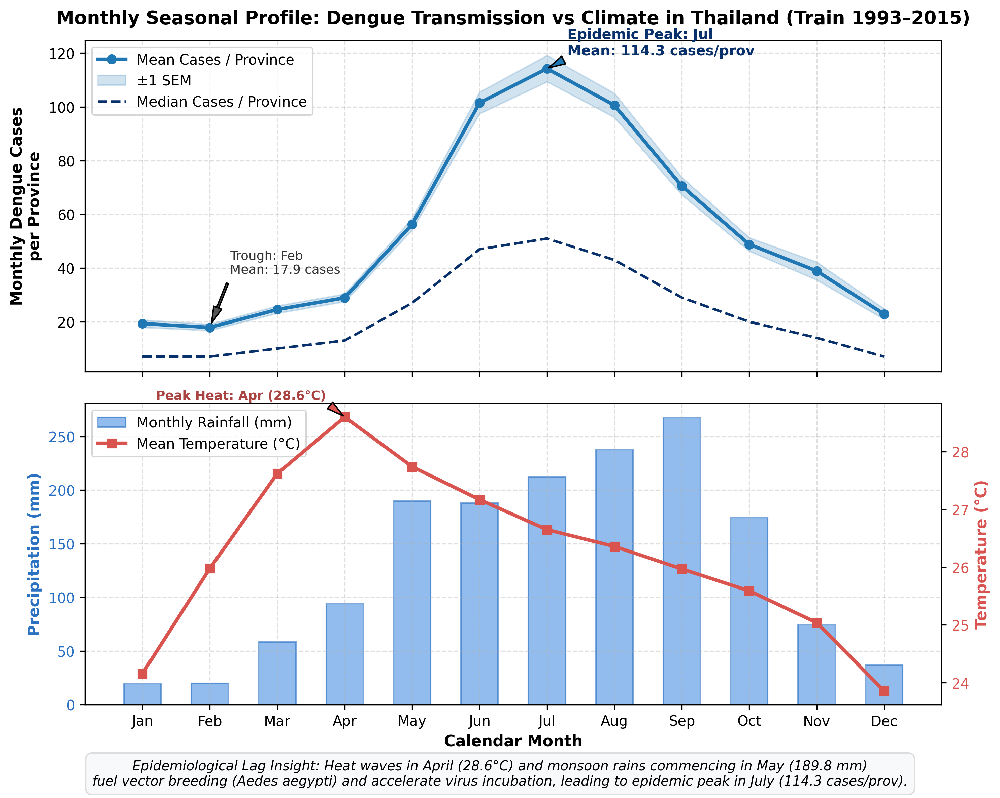
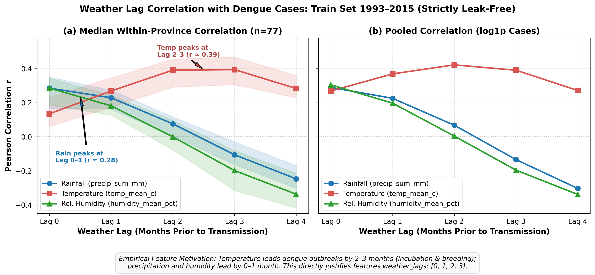
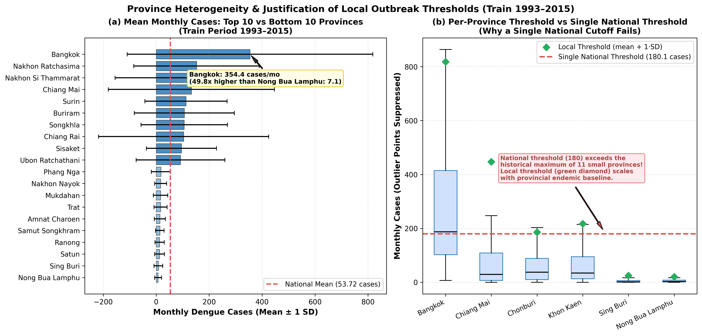
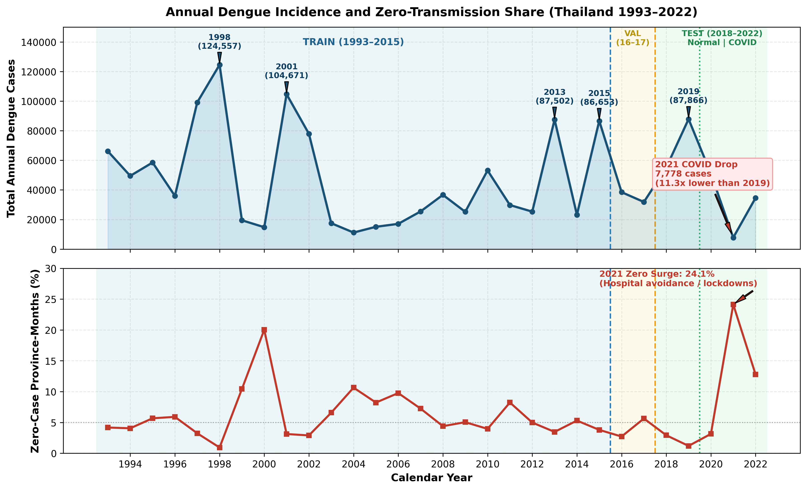
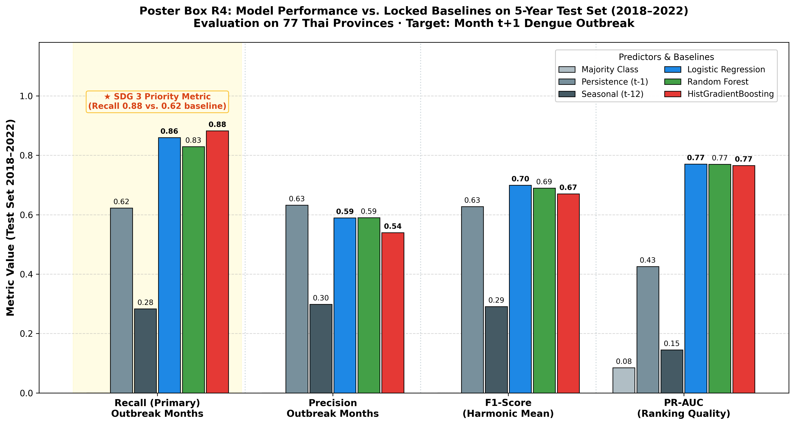
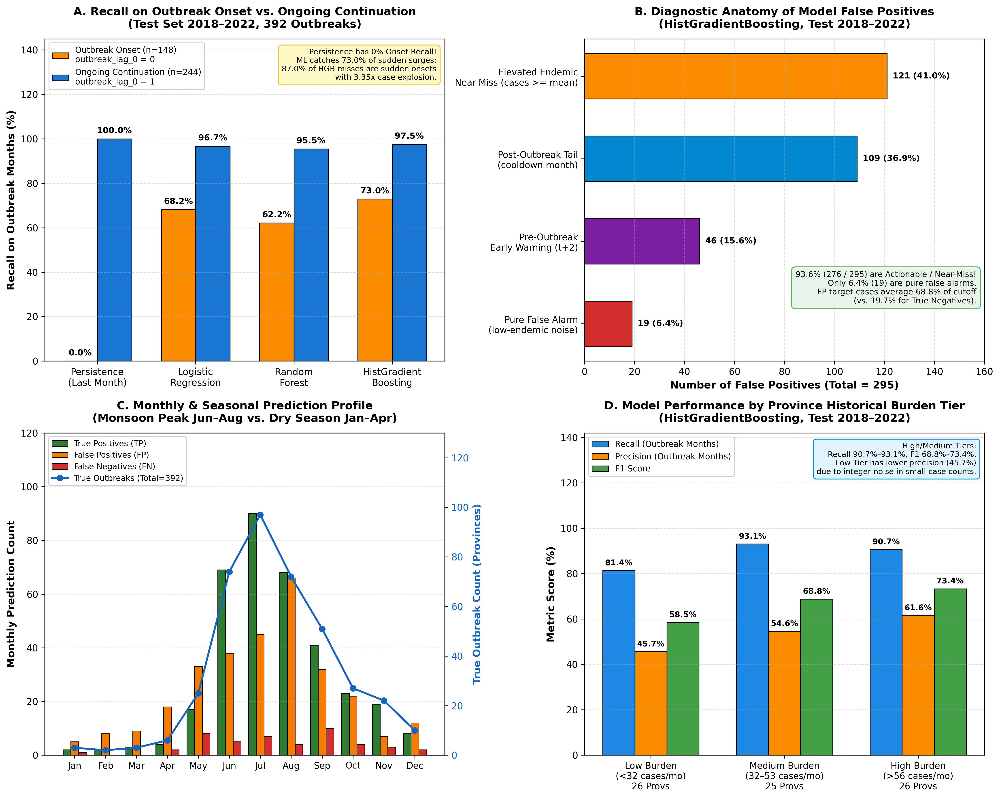
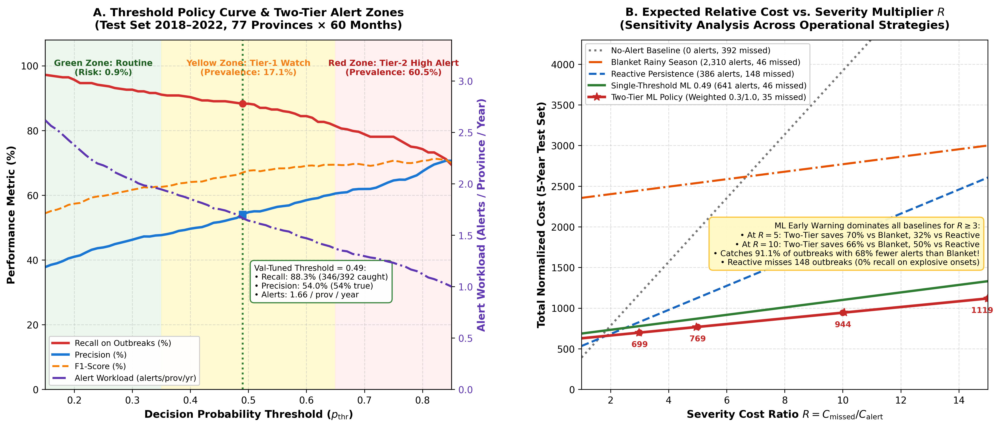

# คู่มือเตรียมนำเสนอ Gallery Walk ฉบับภาษาไทย: จากภาพรวมระดับกว้างสู่รายละเอียดเชิงโค้ด

**ชื่อโครงงาน:** **เดือนหน้าไข้เลือดออกระบาดไหม?** (*Will Dengue Break Out Next Month?*)  
**ชื่อเต็ม:** ระบบพยากรณ์การระบาดของโรคไข้เลือดออกล่วงหน้า 1 เดือน รายจังหวัดในประเทศไทย (1993–2022)  
**รายวิชาและน้ำหนักคะแนน:** CPE312 Data Science Capstone (ปีการศึกษา 2569) · **SDG 3: Good Health and Well-being (เป้าประสงค์ 3.3)** · น้ำหนัก **15%** ของเกรดรายวิชา  
**วันนำเสนอ Gallery Walk:** วันอังคารที่ 17 พฤศจิกายน 2569 · เวลา **13:00–16:00 น.** (ส่งลิงก์ Colab ก่อนเริ่มงาน)  
**ลิงก์ Colab ที่พร้อมรันอัตโนมัติ:** `https://colab.research.google.com/drive/1ZFD4hoCQNAjVg_cOlb4Wbb63Lx7TdEGS`

> **วิธีใช้คู่มือนี้:** อ่านเรียงจาก **ส่วนที่ 1 ถึงส่วนที่ 9** เอกสารนี้ออกแบบเป็นลำดับขั้นแบบกรวย (Zoom-in Funnel) เริ่มจาก **ไอเดียภาพรวม 30 วินาที** → **กรอบปัญหา R1** → **ข้อมูลและการกันรั่วไหล R2** → **ข้อค้นพบ EDA R3** → **รายละเอียดฟีเจอร์และโมเดล R4** → **จุดล้มเหลวและกรณีศึกษา R5** → **นโยบาย Two-Tier และความคุ้มค่า R6** → **บันทึกกำกับดูแล AI และแผนที่โค้ด Colab รายเซลล์ R7** → ปิดท้ายด้วย **บทพูด 3 นาที ถาม-ตอบ 10 ข้อ และเช็กลิสต์ก่อน 13:00 น.**

---

## ส่วนที่ 1 — ภาพรวมระดับกว้าง (The Big Picture & เกณฑ์การให้คะแนน)

### 1.1 สรุปแนวคิดหลักของโครงงานใน 4 ประโยค
1. **ใครคือผู้ใช้และทำนายอะไร:** ณ วันสิ้นเดือน **t** ระบบของเราช่วยเตือนภัยให้ **สำนักงานสาธารณสุขจังหวัด (สสจ.) ทั้ง 77 จังหวัด** โดยตอบคำถามว่า *"เดือน t+1 จังหวัด p จะเกิดการระบาดของโรคไข้เลือดออกหรือไม่?"*
2. **ทำไมต้องทำนายล่วงหน้า:** การควบคุมพาหะ (กำจัดลูกน้ำ พ่นหมอกควัน ULV) และการเตรียมโรงพยาบาล (เตียงผู้ป่วย สารน้ำ เกล็ดเลือด) ต้องใช้เวลาเตรียมการล่วงหน้า **3–4 สัปดาห์** แต่กฎง่ายๆ แบบ Persistence (*"ถ้าเดือนนี้ระบาด เดือนหน้าก็ระบาด"*) กลับ **พลาดเดือนเริ่มระบาดใหม่ 100% (0/148 ครั้ง)**
3. **เราสร้างอะไร:** เรานำข้อมูลเปิดระยะเวลา 30 ปีจาก **OpenDengue V1.3.1** ผสานสภาพอากาศย้อนหลังจาก **Open-Meteo ERA5** ครบ 77 จังหวัด (**27,720** แถวในตารางหลัก, **26,100** แถวในตารางโมเดล) มาฝึกโมเดล **HistGradientBoosting** ที่ปลอด Data Leakage และจูนเกณฑ์ตัดสินบน Validation เท่านั้น
4. **ผลลัพธ์สำคัญที่สร้างผลกระทบ:** บนชุดทดสอบ 5 ปีที่ไม่เคยเห็นมาก่อน (Test Set 2018–2022, ระบาดจริง 392 ครั้ง) โมเดลจับการระบาดได้ **88.27% (346/392 ครั้ง)** สูงกว่า Persistence **+26.02 จุดเปอร์เซ็นต์** (ลดการหลุดเตือนลง **68.9%** จาก 148 เหลือ 46 ครั้ง) และจับเดือนเริ่มระบาดใหม่ได้ถึง **73.0% (108/148 ครั้ง)** เมื่อนำไปใช้ในระบบ **Two-Tier เหลือง/แดง** จะจับการระบาดรวมได้ **91.07% (357/392 ครั้ง)** พร้อมประหยัดต้นทุน **65.9%–69.7%** เมื่อเทียบกับการรณรงค์ปูพรมหน้าฝน 6 เดือน

### 1.2 เกณฑ์การให้คะแนนและกติกา Gallery Walk
**กฎเหล็ก:** *สมาชิกทุกคนในกลุ่มต้องสามารถอธิบายได้ครบทุกข้อกำหนด (R1–R7) และอธิบายโค้ดได้ทุกเซลล์ใน Colab Notebook* ระหว่างการนำเสนอ 2 รอบ (รอบละ ~25–30 นาที) สมาชิก 1 คนประจำอยู่ที่โปสเตอร์ A2 ส่วนเพื่อนร่วมทีมเดินชมกลุ่มอื่น และอาจารย์จะสุ่มถามสมาชิกคนใดก็ได้

| เกณฑ์การประเมิน (Rubric) | น้ำหนัก | กล่องโปสเตอร์ / ผลงานที่เชื่อมโยง | สิ่งที่กรรมการให้ความสำคัญมากที่สุด |
|---|---:|---|---|
| **1. การตั้งโจทย์และความสอดคล้องกับเป้าหมาย** | **30%** | **R1** *(น้ำหนักสูงสุด!)* | ผู้ใช้ชัดเจน การตัดสินใจล่วงหน้า 1 เดือน เวลาทำนายปลอด Leakage เป้าหมายวัดผลได้ และเหตุผลต้นทุนไม่สมมาตร |
| **2. การวิเคราะห์ข้อมูลและวิธีการ** | **30%** | **R2 (เตรียมข้อมูล) + R3 (EDA) + R4 (ML)** + Colab *(15% + 15%)* | อ้างอิงสัญญาอนุญาตข้อมูลเปิด แก้ปัญหาข้อมูลจริงโดยไม่ Impute เท็จ แบ่งข้อมูลตามเวลา และชนะ Baseline บนตัวชี้วัด R1 |
| **3. ข้อค้นพบและข้อเสนอแนะเชิงลึก** | **20%** | **R4, R5, R6** *(ตีความ 10% + เสนอแนะ 10%)* | กรณีศึกษาที่โมเดลพลาดพร้อมเหตุผล มาตรการที่ใช้ได้จริง การวิเคราะห์ต้นทุน และข้อจำกัดที่ข้อมูลพิสูจน์ไม่ได้ |
| **4. การนำเสนอและกราฟสื่อสาร** | **10%** | โปสเตอร์ A2 ทั้งแผ่น, กราฟ **R3 & R4** | กราฟคมชัดดึงจาก Notebook ตัวเลขบนกราฟไม่ซ้อนทับ และตัวเลขทุกจุดตรงกับ Notebook 100% |
| **5. การทำงานเป็นทีม (Teamwork)** | **5%** | บทบาทบนส่วนหัวโปสเตอร์ + แบบประเมินรายบุคคล | แบ่งหน้าที่ชัดเจนและสมาชิกทุกคนเข้าใจภาพรวมเท่าเทียมกัน |
| **6. การตอบคำถาม (Q&A)** | **5%** | การตอบสดหน้าโปสเตอร์ + **R7** | ตอบมั่นใจเป็นธรรมชาติไม่อ่านโพย และมีตัวอย่างจริงของการปฏิเสธ/แก้ไขผลลัพธ์จาก AI |

> **เป้าหมายสติกเกอร์ Dot Stickers หน้างาน:** *Best Problem* (R1), *Best Failure Analysis* (R5) และ *Best Recommendation* (R6)

---

## ส่วนที่ 2 — R1: การตั้งกรอบปัญหา 5 คำถามหลัก (30% ของคะแนนทั้งหมด)

เนื่องจาก **R1 ครองสัดส่วนคะแนนถึง 30%** จึงต้องตอบคำถามทั้ง 5 ข้อนี้ได้อย่างแม่นยำโดยไม่ต้องดูสคริปต์:

### คำถามที่ 1: ใครคือผู้ใช้งาน และใช้พยากรณ์ไปตัดสินใจอะไร?
- **ผู้ใช้งานหลัก:** **สำนักงานสาธารณสุขจังหวัด (สสจ.) ทั้ง 77 จังหวัด** ทำงานร่วมกับสำนักงานสาธารณสุขอำเภอ (สสอ.) โรงพยาบาล (รพศ./รพท./รพช.) และอาสาสมัครสาธารณสุขประจำหมู่บ้าน (**อสม.**)
- **การตัดสินใจ 3 ด้านล่วงหน้า 1 เดือน:**
  1. **จัดสรรงบพ่นหมอกควัน/ULV:** อนุมัติงบประมาณ สารเคมี และส่งทีมพ่นหมอกควันลงตำบลเสี่ยง
  2. **ระดม อสม. กำจัดลูกน้ำยุงลาย:** รณรงค์เคาะประตูบ้านคว่ำภาชนะขังน้ำ ตรวจสต็อกทรายอะเบท และชุดตรวจ NS1
  3. **เตรียมความพร้อมโรงพยาบาล:** สำรองเตียงผู้ป่วยเด็ก/ผู้ใหญ่ สั่งสำรองสารน้ำทางหลอดเลือดดำ (`Ringer's lactate`) และเกล็ดเลือดล่วงหน้า
- **ทำไมต้องล่วงหน้า 1 เดือน (ไม่ใช่ 1 สัปดาห์ หรือ 3 เดือน)?** วงจรชีวิตยุงลาย (*Aedes aegypti*) จากไข่เป็นตัวเต็มวัยใช้เวลา **7–10 วัน** บวกกับระยะฟักตัวของไวรัสในตัวยุง (Extrinsic Incubation Period: EIP) อีก **8–12 วัน** รวมประมาณ **3 สัปดาห์** ซึ่งสอดคล้องกับเวลา **3–4 สัปดาห์** ที่ สสจ. ต้องใช้จัดซื้อสารเคมี ระดม อสม. และสำรองเตียง ล่วงหน้า 1 สัปดาห์กระชั้นชิดเกินไป ส่วน 3 เดือนสภาพอากาศผันผวนเกินไป

### คำถามที่ 2: พยากรณ์เมื่อไร และมีข้อมูลจริง ณ เวลานั้นหรือไม่ (ปลอด Leakage)?
- **เวลาที่ทำนาย:** ทำนาย ณ **วันสิ้นเดือน t** (วันที่ 28–30) เพื่อพยากรณ์สถานะการระบาดของ **เดือน t+1**
- **หลักประกันปลอด Leakage:** ฟีเจอร์ทุกตัวใช้เฉพาะยอดผู้ป่วย (`รง.506` / OpenDengue) และสภาพอากาศที่เกิดขึ้นจริง **จนถึงสิ้นเดือน t เท่านั้น** ไม่มีการใช้พยากรณ์อากาศในอนาคตหรือสถิติจากปีอนาคตโดยเด็ดขาด

### คำถามที่ 3: 1 แถวข้อมูลแทนอะไร?
- **หน่วยข้อมูล (Unit of Analysis):** **1 จังหวัด × 1 เดือนปฏิทิน** `(p, t)` ครอบคลุม 77 จังหวัด ตลอด 30 ปี (ค.ศ. 1993–2022 รวม 360 เดือน)

### คำถามที่ 4: เป้าหมายวัดผลได้ชัดเจนและนิยามอย่างไร?
- **ตัวแปรเป้าหมายทวิภาค (`outbreak_t1`):**
  `outbreak(p, t+1) = 1` เมื่อ `cases(p, t+1) > μ_p + 1.0 · σ_p` และเป็น `0` เมื่อไม่เกินเกณฑ์
- **จุดกัน Leakage สำคัญ:** ค่าเฉลี่ย `μ_p` และส่วนเบี่ยงเบนมาตรฐาน `σ_p` (`ddof=1`) คำนวณ **แยกทีละจังหวัด p** จาก **ข้อมูลปีฝึกสอน (Train 1993–2015) เท่านั้น** (`data/processed/province_thresholds.csv`)
- **ทำไมต้องใช้เกณฑ์รายจังหวัด (`μ_p + 1·σ_p`) แทนเกณฑ์เดียวทั้งประเทศ?**
  - เกณฑ์เดียวระดับประเทศ (`180.09` ราย/เดือน) ล้มเหลวเพราะความเหลื่อมล้ำระหว่างจังหวัดสูงถึง **49.78 เท่า** (กรุงเทพฯ เฉลี่ย **354.45** ราย vs หนองบัวลำภู **7.12** ราย)
  - หากใช้เกณฑ์ `180.09` จะมีถึง **11 จังหวัด (14.3% ของประเทศ)** ที่ยอดผู้ป่วยตลอด 23 ปีฝึกสอนไม่เคยถึงเกณฑ์เลยและไม่ได้รับคำเตือนสักครั้ง ขณะที่กรุงเทพฯ (ค่ามัธยฐาน **187.50**) จะขึ้นเตือนเกินครึ่งปีตลอดเวลา
  - นิยาม `μ + 1·σ` สอดคล้องกับหลักช่องทางระบาดวิทยา (Endemic Channel) ของ WHO และกรมควบคุมโรค

### คำถามที่ 5: ความผิดพลาดแบบใดแพงกว่า และใช้ตัวชี้วัดใด?
- **ต้นทุนความผิดพลาดไม่สมมาตร (Asymmetric Error Cost):**
  - **False Negative (หลุดเตือน — แพงที่สุด):** โรงพยาบาลเตรียมเตียง สารน้ำ และเกล็ดเลือดไม่ทัน เกิดการระบาดลุกลามและเสียชีวิตที่ป้องกันได้
  - **False Positive (เตือนเกิน — ถูกกว่า):** เป็นการส่ง อสม. ลงพื้นที่สำรวจลูกน้ำและให้ความรู้สุขาภิบาล ซึ่งยังเป็นประโยชน์ต่อชุมชน
- **กับดักของ Accuracy:** เดือนระบาดมีสัดส่วนน้อย (**8.48%** ใน Test, **9.80%** ใน Train, **3.79%** ใน Val) หากสร้างโมเดลหลอกที่ทาย `0` ทุกเดือนจะได้ Accuracy สูงถึง **91.52%** บน Test แต่ได้ **Recall = 0.0%**
- **สถาปัตยกรรมตัวชี้วัด:**
  - **ตัวชี้วัดหลัก (Primary Metric):** **Recall บนเดือนที่ระบาด (Class 1)**
  - **ตัวชี้วัดร่วม:** Precision, F1-Score และ **PR-AUC** (วัดคุณภาพการจัดอันดับในข้อมูลไม่สมดุล)
  - **การปรับเทียบเกณฑ์ตัดสินบน Validation:** เลือก Hyperparameters ด้วย **Validation PR-AUC** และจูน Threshold ด้วยการหาค่าสูงสุดของ **F₂-score** (ให้น้ำหนัก Recall เป็น **2 เท่า** ของ Precision) เพื่อให้ Recall สูงโดยไม่ทำให้ Precision พัง

---

## ส่วนที่ 3 — R2: แหล่งข้อมูลเปิด การ Audit คุณภาพ และการป้องกันการรั่วไหล

### 3.1 แหล่งข้อมูลเปิดและสัญญาอนุญาตที่ตรวจสอบแล้ว

| ชุดข้อมูล | แหล่งที่มาและการอ้างอิง | สัญญาอนุญาต | ขอบเขตและตัวแปรที่ใช้จริง |
|---|---|---|---|
| **ผู้ป่วยไข้เลือดออก** | **OpenDengue V1.3.1** (`https://opendengue.org`, Clarke et al., *Sci Data* 2024; ต้นทางจาก `รง.506` กรมควบคุมโรค) | **CC BY 4.0** *(ตรวจยืนยันบน opendengue.org)* | ไฟล์โลกรวม 2,834,996 แถว → กรองไทย (`ISO_A0 == 'THA'`) ได้ 27,259 แถว → กรอง `S_res == 'Admin1' & T_res == 'Month'`: **27,024 แถว**, 78 `adm_1_name`, ช่วง **1993-01 ถึง 2022-12** *(ไม่มีข้อมูลรายสัปดาห์ระดับจังหวัดสำหรับไทย และข้อมูลระดับจังหวัดสิ้นสุด 2022-12)* |
| **สภาพอากาศย้อนหลัง** | **Open-Meteo Historical Weather API** (ECMWF **ERA5 / ERA5-Land** reanalysis ผ่าน `archive-api.open-meteo.com/v1/archive`) | **CC BY 4.0** *(Free Tier เพื่อการศึกษา 77 API calls อยู่ในโควตา)* | ตัวแปรรายวัน (`timezone=Asia/Bangkok`): `temperature_2m_mean` (°C), `precipitation_sum` (mm), `relative_humidity_2m_mean` (%) รวมเป็นรายเดือน ณ **จุดกึ่งกลาง 77 จังหวัด** (`OpenGISData-Thailand/provinces.geojson`, lat 6.18°N–19.85°N, lon 98.03°E–105.11°E) → **27,720 แถว, 0 NaNs** |

**ช่วงค่าสภาพอากาศรายเดือน (1993–2022, 27,720 แถว):**

- `temp_mean_c`: 15.74°C ถึง 34.40°C (เฉลี่ย **26.29°C**)
- `precip_sum_mm`: 0.0 mm ถึง 907.6 mm (เฉลี่ย **136.75 mm**)
- `humidity_mean_pct`: 37.42% ถึง 97.06% (เฉลี่ย **75.71%**)

### 3.2 ปัญหาคุณภาพข้อมูลที่ค้นพบและวิธีจัดการ (ไม่เติมค่าเท็จ!)

#### 1. ปริศนาชื่อจังหวัดที่ 78 (78 ชื่อ → 77 จังหวัดจริง)
จากการตรวจสอบ `adm_1_name` เทียบกับรายชื่อ 77 จังหวัดอย่างเป็นทางการ (`src/data/province_map.csv`) พบว่า:

- **66 ชื่อตรงกันพอดี** (case-insensitive)
- **11 ชื่อที่ถอดอักษร/เว้นวรรคต่างกัน** (เช่น `BUNGKAN` → `Bueng Kan`, `TRAD` → `Trat`, `PHANGNGA` → `Phang Nga`, `SI SAKET` → `Sisaket`, `PRACHUAP KHILIKHAN` → `Prachuap Khiri Khan` เป็นต้น)
- **1 จังหวัดถูกแยกตามช่วงเวลา:** `PRACHIN BURI` มี **120 แถว** (1993-01 ถึง 2002-12) และ `PHACHINBURI` มี **240 แถว** (2003-01 ถึง 2022-12) โดยไม่มีเดือนใดทับซ้อนกันเลย เมื่อรวมทั้งสองช่วงจะได้จังหวัดปราจีนบุรี (`Prachin Buri`) ครบ **360 เดือนบริบูรณ์**

#### 2. ข้อมูลผู้ป่วยขาดหาย 696 เดือนใน 5 จังหวัดตั้งใหม่/เริ่มรายงานช้า
- **72 จังหวัดปกติ** มีข้อมูลต่อเนื่องครบ 360 เดือน (1993–2022)
- **5 จังหวัด** มีข้อมูลขาดหายช่วงต้นรวม **696 จังหวัด-เดือน**:
  - **บึงกาฬ** (แยกจากหนองคาย มี.ค. 2011): เริ่มรายงาน 2011-01 → ขาด **216 เดือน** (มีข้อมูล 144 เดือน)
  - **อำนาจเจริญ, มุกดาหาร, หนองบัวลำภู, สระแก้ว:** ใน OpenDengue เริ่มรายงาน 2003-01 → ขาด **จังหวัดละ 120 เดือน** (รวม **480 เดือน**, มีข้อมูลจังหวัดละ 240 เดือน)
- **เหตุผลที่ไม่ทำ Imputation (เช่น ค่าเฉลี่ยหรือ KNN):** การเติมยอดผู้ป่วยให้บึงกาฬในปี 1995 ซึ่งเป็นช่วงเวลา 16 ปีก่อนที่จังหวัดจะถูกจัดตั้งตามกฎหมาย จะเป็นการ *"สร้างข้อมูลเฝ้าระวังเท็จ"* เราจึงคงค่า `NA` ไว้ใน `panel.csv` (**27,720 แถว**) และคัดกรองเฉพาะแถวที่มีข้อมูลและ lag ครบในการสร้าง `modeling_table.csv`

#### 3. การเปลี่ยนนิยามรายงานโรคปี 2003 และเดือนที่ผู้ป่วยเป็นศูนย์
- **1993–2002:** นิยาม `case_definition_standardised = 'Total'` ครอบคลุม 72 จังหวัด (864 แถว/ปี) ใช้ชื่อ `PRACHIN BURI`
- **2003–2022:** นิยามเปลี่ยนเป็น `'Suspected and confirmed'` ขยายเป็น 76 จังหวัดในปี 2003 (912 แถว/ปี) และ 77 จังหวัดในปี 2011 (924 แถว/ปี) เราใช้ยอด `dengue_total` ต่อเนื่องทั้ง 30 ปี
- **การตรวจสอบค่าศูนย์และค่าผิดปกติ:** มี **1,754** เดือนที่รายงานผู้ป่วยเป็น `0` จริง (**6.49%**, เช่น สูงถึง 24.13% ช่วงโควิด 2021 vs 0.93% ช่วงระบาดใหญ่ 1998), มีค่าติดลบ **0** แถว และไม่ใช่จำนวนเต็ม **0** แถว

### 3.3 บัญชีตัวเลขแถวที่ถูกคัดออก: `panel.csv` (27,720) → `modeling_table.csv` (26,100)
หากกรรมการถามว่า *"ทำไมข้อมูลจาก 27,720 แถวถึงเหลือ 26,100 แถว?"* นี่คือบัญชีของ **1,620 แถว** ที่คัดออก (`results/feature_summary.json`):

- **792 แถว:** 72 จังหวัดปกติ × 11 เดือนแรก (1993-01 ถึง 1993-11) ที่ยังไม่มีค่า lag `t−11` (`outbreak_same_month_last_year`)
- **480 แถว:** 4 จังหวัดเริ่มรายงานช้า × 120 เดือนก่อนเริ่มรายงาน (1993-01 ถึง 2002-12)
- **44 แถว:** 4 จังหวัดเริ่มรายงานช้า × 11 เดือนแรกหลังเริ่มรายงาน (2003-01 ถึง 2003-11) ที่ยังไม่มี lag 11 เดือน
- **216 แถว:** บึงกาฬ × 216 เดือนก่อนจัดตั้งจังหวัด (1993-01 ถึง 2010-12)
- **11 แถว:** บึงกาฬ × 11 เดือนแรกหลังเริ่มรายงาน (2011-01 ถึง 2011-11) ที่ยังไม่มี lag 11 เดือน
- **77 แถว:** ทั้ง 77 จังหวัด × เดือนสุดท้ายของชุดข้อมูล (2022-12) ซึ่งไม่มีข้อมูลเดือนเป้าหมาย `2023-01`
- **รวมทั้งหมด:** `792 + 480 + 44 + 216 + 11 + 77 = 1,620` แถว → `27,720 − 1,620 = 26,100` แถวสะอาด (**0 NaNs**)

### 3.4 การแบ่งชุดข้อมูลตามเวลาอย่างเคร่งครัด (ห้ามสุ่มเด็ดขาด, Seed = 42)
แบ่งชุดข้อมูลตามปีเป้าหมาย **`target_year`** (`t+1`) เพื่อให้แต่ละชุดมีข้อมูลครบทั้ง 12 เดือนปฏิทินและไม่มีรอยรั่วข้ามชุด:

| ชุดข้อมูล (Split) | ช่วง `target_year` | จำนวนแถว | เดือนระบาด (Class 1) | สัดส่วนระบาด | หน้าที่การใช้งาน |
|---|---|---:|---:|---:|---|
| **Train** | **1994–2015** | **19,632** | **1,923** | **9.80%** | Fit `StandardScaler` และฝึกโมเดล *(เกณฑ์ `μ_p, σ_p` คำนวณจาก panel ปี 1993–2015 รวม 20,556 แถว)* |
| **Validation** | **2016–2017** | **1,848** | **70** | **3.79%** | จูน Hyperparameters (PR-AUC), จูน Threshold (`F₂`) และคัดเลือกโมเดลที่ดีที่สุด |
| **Test (รวม)** | **2018–2022** | **4,620** | **392** | **8.48%** | **ประเมินผลครั้งเดียวตอนท้ายสุด** *(มีข้อมูลครบทั้ง 77 จังหวัด)* |
| *• Test ยุคปกติ* | 2018–2019 | 1,848 | 269 | 14.56% | ทดสอบสภาวะระบาดตามฤดูกาลปกติ (รวมระบาดใหญ่ปี 2019) |
| *• Test ยุคโควิด* | 2020–2022 | 2,772 | 123 | 4.44% | ทดสอบความทนทานต่อการเปลี่ยนแปลงเชิงโครงสร้างช่วงล็อกดาวน์ |

---

## ส่วนที่ 4 — R3: ข้อค้นพบจากการสำรวจข้อมูล (EDA & 4 กราฟสำคัญ)

สถิติและกราฟ EDA ทั้งหมด (ยกเว้นแนวโน้ม 30 ปี) คำนวณจาก **ชุด Train (1993–2015) เท่านั้น** เพื่อไม่ให้ข้อมูล Validation/Test รั่วไหลมาชี้นำการออกแบบฟีเจอร์

### 4.1 วงจรฤดูกาลและลำดับเวลาสภาพอากาศ (`eda_seasonality.png`)

- **แกว่งตัวตามฤดูกาล 6.39 เท่า:** ยอดผู้ป่วยต่ำสุดในเดือน **กุมภาพันธ์** (เฉลี่ย **17.88**, มัธยฐาน **7.0** ราย/จังหวัด) และสูงสุดในเดือน **กรกฎาคม** (เฉลี่ย **114.31**, มัธยฐาน **51.0** ราย/จังหวัด)
- **ลำดับการส่งไม้ต่อของสภาพอากาศ:** อุณหภูมิสูงสุดในเดือน **เมษายน** (**28.60°C**, ต่ำสุด ธ.ค. 23.86°C) → ฝนเริ่มตกชุกเพิ่มขึ้นเท่าตัวในเดือน **พฤษภาคม** (**189.84 mm** จาก 94.11 mm ใน เม.ย.; ฝนสูงสุด ก.ย. 267.58 mm) → ยอดผู้ป่วยปะทุสูงสุดตามหลังความร้อน **2–3 เดือน** ในเดือน **กรกฎาคม**
- **ความเชื่อมโยงกับ R1:** การรอเตือนภัยในเดือนกรกฎาคมสายเกินไป สสจ. ต้องได้สัญญาณเตือนตั้งแต่ **พฤษภาคม–มิถุนายน** ขณะที่อากาศร้อนและฝนแรกกำลังเร่งจำนวนยุงลาย

### 4.2 สหสัมพันธ์แบบหน่วงเวลาของสภาพอากาศ (`eda_lag_correlation.png`)

- **อุณหภูมินำหน้า 2–3 เดือน:** ค่าสหสัมพันธ์ Pearson `r` ภายในจังหวัด (ค่ามัธยฐาน) สูงสุดที่ **Lag 3 (`r = 0.3940`, IQR 0.3057–0.4684)** และ **Lag 2 (`r = 0.3909`)** ส่วนค่า Pooled `log1p(cases)` สูงสุดที่ Lag 2 (`r = 0.4219`) *กลไกชีววิทยา:* ความร้อนย่นระยะฟักตัวของไวรัสในตัวยุงตัวเมีย (EIP) จาก ~14 วันเหลือ ~7 วัน และกระตุ้นความถี่ในการกัด ทำให้เชื้อสะสมในประชากรยุงในอีก 2–3 เดือนถัดมา
- **ฝนและความชื้นนำหน้า 0–1 เดือน:** ปริมาณฝนสูงสุดที่ **Lag 0 (`r = 0.2853`)** และ **Lag 1 (`r = 0.2290`)** ส่วนความชื้นสัมพัทธ์สูงสุดที่ **Lag 0 (`r = 0.2857`)** *กลไกชีววิทยา:* น้ำฝนขังในภาชนะรอบบ้านทำให้ไข่ยุงลายที่ทนแล้งฟักเป็นยุงตัวเต็มวัยได้ภายใน 7–10 วัน
- **เชื่อมโยงสู่ฟีเจอร์:** ณ เวลาทำนายสิ้นเดือน **t** (เพื่อทายเดือน **t+1**) สภาพอากาศของเดือน **t** (`lag_0` ในตารางโมเดล) คือสภาพอากาศล่วงหน้า **1 เดือนก่อน `t+1`** และ `lag_3` (`t−3`) คือ **4 เดือนก่อน `t+1`** จึงดักจับได้ทั้งวงจรน้ำฝนระยะสั้นและวงจรความร้อนระยะกลางโดยไม่ใช้ข้อมูลอนาคต

### 4.3 ความเหลื่อมล้ำสุดขั้วระหว่างจังหวัด (`eda_province_heterogeneity.png`)

- **ความต่าง 49.78 เท่า:** กรุงเทพฯ มีผู้ป่วยเฉลี่ย **354.45 ราย/เดือน** (SD 463.80, มัธยฐาน 187.50, สูงสุด 4,273, เกณฑ์ท้องถิ่น **818.26**) สูงกว่าค่าเฉลี่ยประเทศ (**53.72**) ถึง **6.60 เท่า** และสูงกว่าจังหวัดต่ำสุดคือ **หนองบัวลำภู** (**7.12 ราย/เดือน**, SD 13.04, มัธยฐาน 3.00, สูงสุด 97, เกณฑ์ท้องถิ่น **20.17**) ถึง **49.78 เท่า**
- **หลักฐานหักล้างเกณฑ์เดียวระดับประเทศ:** เกณฑ์เฉลี่ยระดับประเทศจุดเดียว (`53.72 + 126.37 = 180.09` ราย) สูงกว่ายอดผู้ป่วยสูงสุดในรอบ 23 ปีฝึกสอนของ **11 จังหวัด (14.3% ของประเทศ)** ได้แก่ *อำนาจเจริญ, อ่างทอง, บึงกาฬ, มุกดาหาร, นครนายก, หนองบัวลำภู, ระนอง, สมุทรสงคราม, สตูล, สิงห์บุรี และตราด*

### 4.4 แนวโน้ม 30 ปีและวิกฤตโควิด-19 (`eda_annual_trend_covid.png`)

- **วงจรการระบาดหลายปี:** เกิดการระบาดใหญ่ทุก 2–5 ปี โดยสูงสุดในปี **1998** (**124,557** ราย), **2001** (**104,671**), **1997** (**99,153**), **2019** (**87,866**) และ **2013** (**87,502**)
- **โควิด-19 ลดลง 11.30 เท่า:** ยอดผู้ป่วยทั้งปีร่วงจาก **87,866** (2019) → **50,911** (2020) → **7,778** (2021 ต่ำสุดในรอบ 30 ปี) ก่อนฟื้นตัวเป็น **34,605** (2022) ขณะที่สัดส่วนจังหวัด-เดือนที่ไม่มีผู้ป่วยพุ่งจาก **1.19%** (2019) เป็น **24.13%** (2021) จากการปิดโรงเรียน (แหล่งแพร่เชื้อกลางวันของยุงลาย) การจำกัดการเดินทาง และการหลีกเลี่ยงโรงพยาบาล

---

## ส่วนที่ 5 — เจาะลึกสโคปเล็ก (Small Scope): ฟีเจอร์ 25 ตัว โมเดล การจูน และผลลัพธ์ (R4)

### 5.1 รายละเอียดฟีเจอร์ทั้ง 25 ตัว (`FEATURE_COLS` ใน `src/models/train_models.py`)
ฟีเจอร์ทั้ง 25 ตัวเป็นตัวเลขล้วนและมีค่าจริงครบ ณ สิ้นเดือน `t`:

| กลุ่มฟีเจอร์ | จำนวน | ชื่อคอลัมน์จริงในโค้ด | รายละเอียดการคำนวณและกัน Leakage |
|---|---:|---|---|
| **โมเมนตัมผู้ป่วย** | 8 | `cases_lag_0`, `cases_lag_1`, `cases_lag_2`, `cases_lag_3`, `cases_roll_mean_3`, `cases_zscore_lag_0`, `outbreak_lag_0`, `outbreak_same_month_last_year` | `cases_lag_0` = ยอดเดือน `t`; `roll_mean_3` = ค่าเฉลี่ยเดือน `t, t−1, t−2`; `cases_zscore_lag_0 = (cases_lag_0 − mean_p)/sd_p`; `outbreak_same_month_last_year` = สถานะเดือน `t−11` (ตรงกับ `(t+1)−12`) |
| **สภาพอากาศย้อนหลัง** | 12 | `temp_lag_0..3`, `precip_lag_0..3`, `humidity_lag_0..3` | ข้อมูล ERA5 จริงของเดือน `t, t−1, t−2, t−3` (ใช้ `.groupby("province_en").shift(k)` เพื่อไม่ให้ข้อมูลข้ามจังหวัด) |
| **ปฏิทินแบบวงกลม** | 2 | `sin_target_month`, `cos_target_month` | แปลง `sin/cos(2π · target_month / 12)` เพื่อจับฤดูกาลมรสุมโดยไม่เกิดรอยต่อกระโดดระหว่างเดือน ธ.ค. กับ ม.ค. |
| **ฐานอ้างอิงรายจังหวัด** | 3 | `mean_p`, `sd_p`, `threshold_p` | พารามิเตอร์จากชุด Train (1993–2015) เพื่อบอกสเกลขนาดภาระโรคของแต่ละจังหวัดให้โมเดลต้นไม้แยกแยะได้ |

*(หมายเหตุ: `modeling_table.csv` มีทั้งหมด 34 คอลัมน์ = 7 คอลัมน์ระบุตัวตน/ช่วงเวลา [`province_en`, `year`, `month`, `target_year`, `target_month`, `split`, `subperiod`] + 25 `FEATURE_COLS` + 2 เป้าหมาย [`target_cases_t1`, `outbreak_t1`])*

### 5.2 เปรียบเทียบ 3 Baselines กับ 3 โมเดล ML (`seed = 42`)
1. **Majority Class (`majority_class`):** ทาย `0` (ไม่ระบาด) ทุกเดือนตามสัดส่วนข้างมากใน Train (90.20%)
2. **Seasonal Last Year (`seasonal_last_year`):** ทาย `outbreak(p, t+1) = outbreak(p, t−11)` (เดือนเดียวกันปีที่แล้ว)
3. **Persistence (`persistence_last_month`):** ทาย `outbreak(p, t+1) = outbreak(p, t)` (`outbreak_lag_0`) เป็นคู่แข่งหลัก
4. **Logistic Regression (`logistic_regression`):** `Pipeline(StandardScaler(), LogisticRegression(class_weight='balanced', max_iter=1000))` จูน `C ∈ {0.001, 0.01, 0.1, 1.0, 10.0}` บน Val PR-AUC → ได้ **`C = 0.01`** (Val PR-AUC **0.6745**), เกณฑ์ Val `F₂` = **`0.54`**
5. **Random Forest (`random_forest`):** `RandomForestClassifier(n_estimators=100, class_weight='balanced_subsample')` จูน `max_depth ∈ {6, 8, 10, 12}` × `min_samples_leaf ∈ {2, 5, 10}` → ได้ **`max_depth=10, min_samples_leaf=5`** (Val PR-AUC **0.6672**), เกณฑ์ Val `F₂` = **`0.45`**
6. **HistGradientBoosting (`hist_gradient_boosting` — โมเดลหลักที่เลือกใช้):** `HistGradientBoostingClassifier(class_weight='balanced')` จูน `learning_rate ∈ {0.03, 0.05, 0.10}` × `max_depth ∈ {4, 6}` × `min_samples_leaf ∈ {20, 50}` → ได้ **`lr=0.1, max_depth=4, min_samples_leaf=20`** (Val PR-AUC **0.6854**, Val Recall **88.57%**, Val `F₂` **0.7488**), เกณฑ์ Val `F₂` = **`0.49`** (ค้นหาช่วง `0.20..0.80` ทีละ `0.01`)

> **ประเด็นป้องกันตัวสำคัญ (ทำไมเลือก HGB แทนที่จะเลือก LR ทั้งที่ LR มี Test PR-AUC 0.7702 vs 0.7657):** การคัดเลือกโมเดล **ถูกล็อกบน Validation (2016–2017) ก่อนเปิดดูผล Test Set**: บน Validation โมเดล HGB ชนะ LR ทุกด้าน ทั้ง Val PR-AUC (`0.6854` vs `0.6745`), Val Recall (`88.57%` vs `84.29%`) และ Val `F₂` (`0.7488` vs `0.7431`) และบน Test โมเดล HGB ก็ทำ **Recall (ตัวชี้วัดหลัก)** ได้สูงกว่า LR (`88.27%` vs `85.97%` จับเพิ่มได้อีก 9 ครั้ง) การเปลี่ยนโมเดลหลังจากเห็นผล Test ถือเป็น **Test-Set Snooping**

### 5.3 ตารางสรุปประสิทธิภาพบน Test Set (2018–2022) และช่วงย่อย

| โมเดล / Baseline | เกณฑ์ Val | Val Recall | **Test Recall (หลัก)** | Test Precision | Test F1 | Test PR-AUC | TP / FN / FP (Test) | Recall ยุคปกติ (18–19) | Recall ยุคโควิด (20–22) |
|---|---:|---:|---:|---:|---:|---:|---|---:|---:|
| **Majority Class** | — | 0.00% | **0.00%** | 0.00% | 0.0000 | 0.0848 | 0 / 392 / 0 | 0.00% | 0.00% |
| **Seasonal (`t−12`)** | — | 25.71% | **28.32%** | 29.84% | 0.2906 | 0.1453 | 111 / 281 / 261 | 19.33% | 47.97% |
| **Persistence (`t−1`)** | — | 60.00% | **62.24%** | 63.21% | 0.6272 | 0.4255 | 244 / 148 / 142 | 62.08% | 62.60% |
| **Logistic Regression** | 0.54 | 84.29% | **85.97%** | 58.92% | **0.6992** | **0.7702** | 337 / 55 / 235 | 85.87% | **86.18%** |
| **Random Forest** | 0.45 | 77.14% | **82.91%** | **58.98%** | 0.6893 | 0.7698 | 325 / 67 / 226 | 83.64% | 81.30% |
| **HistGradientBoosting** | **0.49** | **88.57%** | **88.27%** | **53.98%** | **0.6699** | **0.7657** | **346 / 46 / 295** | **89.22%** | **86.18%** |

**ปัจจัยหลักที่ขับเคลื่อน HistGradientBoosting (Validation Permutation Importance, PR-AUC, 5 repeats):**

1. `cases_zscore_lag_0` (**0.7235**) — ระดับการเบี่ยงเบนของยอดผู้ป่วยปัจจุบันเทียบกับฐานประวัติศาสตร์ของจังหวัดนั้นเอง
2. `precip_lag_3` (**0.0527**), `precip_lag_1` (**0.0347**), `precip_lag_2` (**0.0224**) — ปริมาณน้ำฝนสะสม 1–3 เดือนก่อนหน้าที่สร้างแหล่งเพาะพันธุ์ลูกน้ำ
3. `cos_target_month` (**0.0309**) — จังหวะฤดูกาลมรสุมของเดือนเป้าหมาย
4. `cases_lag_0` (**0.0257**), `cases_lag_2` (**0.0215**), `cases_roll_mean_3` (**0.0142**) — ปริมาณผู้ป่วยดิบและโมเมนตัมระยะสั้น

*(หมายเหตุ: ทำไมใช้ Permutation Importance แทน `.feature_importances_`? เพราะ `HistGradientBoostingClassifier` ของ scikit-learn ไม่มี attribute `.feature_importances_` และ Permutation Importance บนชุด Validation ยังสะท้อนพลังการทำนายจริงบนข้อมูลใหม่ ไม่ Overfit กับชุด Train)*

---

## ส่วนที่ 6 — R5: การวิเคราะห์ความผิดพลาดและกรณีศึกษาจริง (Know Where the Model Fails)

### 6.1 จุดค้นพบใหญ่ที่สุด: เดือน "เริ่มระบาดใหม่" (Onset) vs. "ระบาดต่อเนื่อง" (Ongoing)
แบ่งเดือนระบาดจริง **392 ครั้ง** ใน Test Set ออกเป็น **148 เดือนเริ่มระบาดใหม่ (Onset)** (`outbreak_lag_0 == 0`) และ **244 เดือนระบาดต่อเนื่อง (Ongoing)** (`outbreak_lag_0 == 1`):

- **Persistence (`t−1`) ได้ Onset Recall = 0.0% (0/148)** และ Ongoing Recall = 100.0% (244/244) โดยคณิตศาสตร์แล้ว Persistence *ไม่มีวันเตือนล่วงหน้าก่อนการระบาดเริ่มขึ้นได้*
- **HistGradientBoosting ทำ Onset Recall ได้ 73.0% (108/148)** และ **Ongoing Recall 97.5% (238/244)** จับการระบาดระลอกใหม่ได้เกือบ 3 ใน 4 ล่วงหน้า 1 เดือน *(เทียบกับ LR 68.2% / 96.7% และ RF 62.2% / 95.5%)*

### 6.2 กายวิภาคของ False Negatives 46 ครั้ง (การหลุดเตือน)
- **87.0% (40/46 ครั้ง)** คือเดือน **เริ่มระบาดใหม่ที่พุ่งกระโดดฉับพลัน** (พลาดในเดือนระบาดต่อเนื่องเพียง 6 ครั้ง)
- **พฤติกรรมตัวเลข:** ใน Onset ที่พลาด ยอดผู้ป่วยกระโดดเฉลี่ย **3.35 เท่า** ภายในเดือนเดียวจาก Z-score ก่อนหน้าเพียง **+0.23** (แทบไม่ต่างจากปกติ) เทียบกับ Onset ที่จับได้ที่กระโดด **2.12 เท่า** และมี Z-score นำร่องแล้วที่ **+0.56**
- **3 กรณีศึกษา FN ของจริงใน Test Set:**
  1. **บึงกาฬ (2019-05):** `7.0 → 99.0` ราย (**พุ่ง 14.1 เท่า**, เกณฑ์ `53.3`, ความน่าจะเป็น HGB `0.146`) — มรสุมพฤษภาคมมาแรงฉับพลันจากฐานต่ำมาก
  2. **สิงห์บุรี (2019-06):** `4.0 → 42.0` ราย (**พุ่ง 10.5 เท่า**, เกณฑ์ `24.8`, ความน่าจะเป็น HGB `0.016`) — จังหวัดขนาดเล็กที่ยอดเดิมสงบนิ่งมากก่อนข้ามเกณฑ์ต่ำ
  3. **อุดรธานี (2020-07):** `28.0 → 291.0` ราย (**พุ่ง 10.4 เท่า**, เกณฑ์ `221.5`, ความน่าจะเป็น HGB `0.011`) — การระบาดเฉพาะพื้นที่สวนกระแสช่วงล็อกดาวน์โควิด-19

### 6.3 กายวิภาคของ False Positives 295 ครั้ง (ทำไม 93.6% จึงมีประโยชน์ทางสาธารณสุข!)
ในกลุ่ม FP ค่า `target_cases_t1 / threshold_p` สูงเฉลี่ยถึง **68.8%** ของเกณฑ์ระบาด (เทียบกับเพียง **19.7%** ใน True Negative) เมื่อจำแนกแบบไม่ซ้ำซ้อน:

1. **เฉียดเกณฑ์ระบาด (Elevated Endemic Near-Miss) — 41.0% (121 ครั้ง):** ยอดผู้ป่วยสูงเกินค่าเฉลี่ยและจ่อเกณฑ์ระบาด (เฉลี่ย 78.4% ของเกณฑ์) *ตัวอย่าง:* **สมุทรสาคร (2018-06)** มี **64.0 ราย** ขาดจากเกณฑ์ **64.5** ไปเพียง **0.5 ราย** (`prob = 0.962`)
2. **หางคลื่นระบาด (Post-Outbreak Cooldown Tail) — 36.9% (109 ครั้ง):** เดือน `t` เพิ่งระบาดหนักและกำลังลดลงเฉียดเกณฑ์ที่ `t+1` (เฉลี่ย 68.2% ของเกณฑ์) *ตัวอย่าง:* **เลย (2019-08)** เดือน `t` มี **303.0** ราย ลดเหลือ **141.0** เทียบเกณฑ์ **148.2** (`prob = 0.985`)
3. **เตือนล่วงหน้า 2 เดือน (Pre-Outbreak Early Warning `t+2`) — 15.6% (46 ครั้ง):** เตือนเร็วขึ้น 1 เดือนก่อนระบาดจริงในเดือน `t+2` *ตัวอย่าง:* **ชัยภูมิ (2019-05)** เตือนที่ **159.0 ราย** (< เกณฑ์ `175.9`, `prob = 0.958`) แล้วเดือนถัดมา **2019-06** พุ่งเป็น **389.0 ราย**!
4. **False Alarm แท้จริง — เพียง 6.4% (19/295 ครั้ง):** ช่วงโรคสงบที่ไม่มีการระบาดในเดือน `t` หรือ `t+2` (เฉลี่ย 23.1% ของเกณฑ์)

### 6.4 ตัวอย่างชัยชนะ Onset จริง (Persistence ทาย 0 แต่ HGB ทาย 1)
- **ชัยภูมิ (2019-06):** `159.0 → 389.0` (เกณฑ์ `175.9`, `prob = 0.980`)
- **นครพนม (2019-06):** `166.0 → 242.0` (เกณฑ์ `173.2`, `prob = 0.976`)
- **เชียงราย (2019-07):** `358.0 → 1,173.0` (เกณฑ์ `424.9`, `prob = 0.975`)

### 6.5 ความน่าเชื่อถือแยกตามขนาดภาระโรคและฤดูกาล
- **ตามกลุ่มภาระโรคของจังหวัด (Tertiles):** จังหวัดภาระปานกลาง (25 จว., 32.2–52.8/ด.: **Recall 93.1%**, Prec 54.6%, F1 0.688) และภาระสูง (26 จว., 56.2–354.5/ด.: **Recall 90.7%**, **Prec 61.6%**, F1 0.734) แม่นยำและเสถียรสูง ส่วนจังหวัดภาระต่ำ (26 จว., 7.1–31.7/ด.: **Recall 81.4%**, Prec 45.7%) มี Precision ต่ำกว่าจากความผันผวนของจำนวนนับขนาดเล็ก (เช่น 5 → 15 ราย)
- **ตามฤดูกาลและปีโควิด:** ช่วงพีกฤดูฝน (มิ.ย.–ส.ค., 243 ครั้ง = 62% ของทั้งหมด) ทำ **Recall ได้ถึง 93.4% (227/243)** เดือนที่ยากสุดคือ พ.ค. (**68.0%**, 17/25) ช่วงเปลี่ยนผ่านฤดู ส่วนปีล็อกดาวน์เข้มข้น 2021 มีระบาดทั่วประเทศเพียง 3 ครั้ง โมเดลจับได้ **100% (3/3)** โดยเตือนเกินเพียง 2 ครั้ง

---

## ส่วนที่ 7 — R6: ระบบเตือนภัย Two-Tier ความคุ้มค่าเชิงเศรษฐศาสตร์ และข้อจำกัด 4 ประการ

### 7.1 ระบบเตือนภัย 2 ระดับสำหรับ สสจ. (Two-Tier Operational Protocol)
เพื่อหลีกเลี่ยงปัญหาเตือนพร่ำเพรื่อ (Alert Fatigue) จึงแบ่งค่าความน่าจะเป็น `p` จาก HistGradientBoosting ออกเป็น **3 โซนปฏิบัติการ**:

| ระดับสัญญาณเตือน | ช่วงความน่าจะเป็น `p` | สัดส่วนเดือน (Test) | เตือน / จว. / ปี | ความเสี่ยงระบาดจริง | จับการระบาดได้ (จาก 392) | มาตรการปฏิบัติการของ สสจ. | น้ำหนักต้นทุน |
|---|---|---:|---:|---:|---:|---|---:|
| **เขียว (Routine)** | `p < 0.35` | **83.8%** (3,871) | — | **0.90%** | (หลุด 35) | เฝ้าระวังปกติผ่าน `รง.506` ไม่ใช้งบฉุกเฉิน | `0.0×` |
| **เหลือง (Tier-1 Watch)** | `0.35 ≤ p < 0.65` | **4.8%** (222) | **0.58** | **17.12%** | 9.7% (38) | ระดม อสม. คว่ำภาชนะกำจัดลูกน้ำ ตรวจสต็อกทรายอะเบทและ NS1 | `0.3×` |
| **แดง (Tier-2 High Alert)** | `p ≥ 0.65` | **11.4%** (527) | **1.37** | **60.53%** | 81.4% (319) | เปิด EOC พ่นหมอกควัน ULV จุดเสี่ยง สำรองเตียง `Ringer's lactate` เกล็ดเลือด | `1.0×` |
| **รวมเขตเตือนภัย** | **`p ≥ 0.35`** | **16.2%** (749) | **1.95** | **47.66%** | **91.07% (357/392)** | **จับระบาด >91% ด้วยภาระงาน <2 ครั้ง/จังหวัด/ปี** | น้ำหนักรวม `593.6` |

### 7.2 การพิสูจน์ความคุ้มค่าเชิงพารามิเตอร์ (ไม่มโนตัวเลขเงินบาท)
แทนการเดาค่ารักษาพยาบาลเป็นเงินบาท เราใช้ฟังก์ชันต้นทุนมาตรฐานบน Test Set 5 ปี:  
`Total Cost = C_intervention + R · FN` โดย `R = C_missed / C_alert ∈ {3, 5, 10, 15}` แทนสัดส่วนความเสียหายจากการปล่อยให้ระบาดโดยไม่เตรียมการเทียบกับค่าใช้จ่ายแจ้งเตือน 1 ครั้ง:

| นโยบาย (Test Set 5 ปี, 2018–2022) | จำนวนเตือน | พลาด (FN) | Recall | Precision | ต้นทุน (`R=3`) | ต้นทุน (`R=5`) | ต้นทุน (`R=10`) | ต้นทุน (`R=15`) |
|---|---:|---:|---:|---:|---:|---:|---:|---:|
| **ไม่เตือนเลย (No-Alert)** | 0 | 392 | 0.0% | 0.0% | 1,176.0 | 1,960.0 | 3,920.0 | 5,880.0 |
| **รณรงค์ปูพรมหน้าฝน (พ.ค.–ต.ค.)** | 2,310 | 46 | 88.3% | 15.0% | 2,448.0 | 2,540.0 | 2,770.0 | 3,000.0 |
| **ทำตามเดือนก่อน (Persistence `t−1`)** | 386 | 148 | 62.2% | **63.2%** | 830.0 | 1,126.0 | 1,866.0 | 2,606.0 |
| **ML เกณฑ์เดี่ยว (`0.49`)** | 641 | 46 | 88.3% | 54.0% | 779.0 | 871.0 | 1,101.0 | 1,331.0 |
| **ML Two-Tier (`0.3× / 1.0×`)** | **749** (wt 593.6) | **35** | **91.1%** | 47.7% | **698.6** | **768.6** | **943.6** | **1,118.6** |

- **คุ้มค่าเหนือกว่าทุกวิธีสำหรับทุก `R ≥ 3`:** Two-Tier ML มีต้นทุนรวมต่ำที่สุดทุกค่า `R ∈ [3, 15]` ประหยัดกว่าการรณรงค์ปูพรมหน้าฝน **69.7% ที่ `R=5`** และ **65.9% ที่ `R=10`** และประหยัดกว่า Persistence **31.7%–49.4%**
- **ลดภาระงานและเตือนเก้อ:** ML เกณฑ์เดี่ยว (`0.49`) จับการระบาดได้เท่ากับการปูพรมหน้าฝนที่ 346 ครั้ง แต่ใช้จำนวนเตือนน้อยลง **72.2%** (641 vs 2,310) และลด False Alarm ลง **85.0%** (295 vs 1,964)
- **ปรับลดอัตโนมัติในยุคโควิด-19:** ช่วงปี 2020–2022 โมเดลลดการแจ้งเตือนลงเอง **56.0%** (จาก 222.5/ปี ช่วงปกติ เหลือ 65.3/ปี ช่วงโควิด) โดยยังรักษา Recall ที่ **86.2%–91.1%** ขณะที่การปูพรมหน้าฝนยิงเตือนเก้อไป 1,283 ครั้ง (Precision ร่วงเหลือ 7.4%)

### 7.3 ข้อจำกัด 4 ประการที่ข้อมูลยังพิสูจน์ไม่ได้ (ต้องตอบให้ครบใน R6!)
1. **ข้อมูลเฝ้าระวังเชิงสังเกต ≠ ผลลัพธ์เชิงสาเหตุ (Observational ≠ Causal Effect):** ข้อมูล `รง.506` บันทึกขึ้นภายใต้การควบคุมโรคในอดีต โมเดลบอกได้ว่า *เมื่อไร* จะระบาด แต่ **พิสูจน์ไม่ได้ว่าการพ่นหมอกควันจะลดผู้ป่วยลงได้กี่เปอร์เซ็นต์** (ต้องใช้ Stepped-Wedge Cluster Trial)
2. **ความละเอียดระดับจังหวัด (`Admin1`) vs. รัศมีบินของยุงลาย (100–400 เมตร):** สัญญาณเตือนระดับจังหวัดใช้ตั้งงบ ซื้อสารเคมี และสำรองเตียงได้ แต่ยุงลายบินได้ไม่เกิน 400 เมตร สสจ. จึงต้องนำคำเตือนไปจับคู่กับรายงาน `รง.506` รายสัปดาห์ระดับตำบล/หมู่บ้านของ สสอ. เพื่อชี้เป้าทีมพ่นสารเคมี
3. **ขาดข้อมูลสายพันธุ์ไวรัส (DENV-1..4) ภูมิคุ้มกันหมู่ และการเดินทาง:** OpenDengue ไม่มีผลตรวจ Serotype หรือข้อมูลการเคลื่อนย้ายประชากร การเปลี่ยนสายพันธุ์หลักฉับพลันอาจเร่งการระบาดเกินรูปแบบสถิติเดิม
4. **สภาพอากาศจากดาวเทียม vs. ปากโอ่งและภาชนะกักเก็บน้ำในบ้าน:** ค่าเฉลี่ยจุดกึ่งกลาง ERA5 มองไม่เห็นฝนตกเฉพาะจุด เกาะความร้อนในเมือง และพฤติกรรมกักเก็บน้ำในโอ่งมังกร/แจกันภายในบ้านซึ่งเป็นแหล่งเพาะพันธุ์ได้แม้ในหน้าแล้ง

---

## ส่วนที่ 8 — R7: บันทึกการกำกับดูแล AI & แผนที่โค้ด Colab Notebook รายเซลล์

### 8.1 บันทึก 7 กรณีที่ทีมตรวจพบและแก้ไขข้อผิดพลาดของ AI (R7)

| ลำดับ | ขั้นตอนงาน | สิ่งที่ AI เสนอ | ข้อผิดพลาด / ความเสี่ยงที่ตรวจพบ | การแก้ไขโดยทีมงานและผลลัพธ์ |
|---|---|---|---|---|
| **1** | **T05/T07** *(แบ่งข้อมูล)* | `train_test_split(..., shuffle=True)` หรือสุ่ม K-Fold CV | **Look-ahead Leakage:** ข้อมูลเดือนอนาคตรั่วเข้า Train ทำให้ความแม่นยำลวงตา (~99%) | ปฏิเสธทันทีและล็อกกฎแบ่งตาม `target_year` (Train 1994–2015, Val 2016–2017, Test 2018–2022) ใน `SSOT.md` |
| **2** | **T04/T05** *(เป้าหมาย)* | ใช้เกณฑ์เดียวทั้งประเทศ `μ + 1·σ = 180.09` | **จุดบอดเชิงพื้นที่:** ทำให้ **11 จังหวัดเล็ก** ไม่เคยได้รับคำเตือนเลยตลอด 23 ปี | เปลี่ยนเป็นเกณฑ์รายจังหวัด `μ_p + 1.0·σ_p` คำนวณจากปี Train (`1993–2015`) เท่านั้น |
| **3** | **T06/T07** *(ตัวชี้วัด)* | ใช้ Accuracy และ ROC-AUC เป็นเกณฑ์หลัก | **กับดักข้อมูลไม่สมดุล:** ระบาด 8.48% ทำให้ทาย 0 ตลอดได้ Accuracy 91.52% แต่ Recall 0% | ล็อก **Recall** เดือนระบาดเป็นหลัก ใช้ Val PR-AUC จูนโมเดล และ Val **`F₂`-score** จูนเกณฑ์ |
| **4** | **T02** *(พิกัดจังหวัด)* | เขียนโค้ดคำนวณจุดกึ่งกลางด้วย `LAEA`, `shapely`, `pyproj` | **Hallucination & Bloat:** ไม่มีแพ็กเกจเหล่านั้นในเครื่อง และ `provinces.geojson` มี `lat/lon` อยู่แล้ว | ตัดโค้ดส่วนเกินและข้อความอ้างอิงเท็จทิ้ง อ่านพิกัดตรงจาก geojson ด้วย Standard Library + pandas |
| **5** | **T07** *(ความสำคัญฟีเจอร์)* | เรียก `hgb.feature_importances_` บน `HistGradientBoostingClassifier` | **AttributeError:** `HistGradientBoostingClassifier` ใน sklearn ไม่มี attribute นี้ | เปลี่ยนมาใช้ Validation **`permutation_importance`** (PR-AUC) ซึ่งวัดผลบนข้อมูล Unseen ได้แม่นยำกว่า |
| **6** | **T04/07/08/09** *(กราฟ)* | วาง Label/Legend ทับแท่งกราฟ และใช้ `\ge` ใน Matplotlib | **Visual Defect & Parse Error:** ตัวหนังสือบังข้อมูล และ `\ge` ทำให้ Matplotlib error | ปรับ `ylim`, แยก Legend 2 คอลัมน์, ใส่กล่องพื้นหลังขาว และแก้เป็น `\geq` ครบทุกกราฟ (300 DPI) |
| **7** | **T10/11/12** *(ตรวจสอบ)* | เสนอลง `tabulate`/`qrcode` และฮาร์ดโค้ดเกณฑ์ LR/RF (`0.31`/`0.46`) ในสคริปต์โปสเตอร์ | **ผิด Rule 5 & ตัวเลขไม่ตรง JSON:** ลงแพ็กเกจเกินจำเป็นและตัวเลขคลาดเคลื่อนจาก `metrics.json` | จัดตารางด้วยสตริงมาตรฐาน เขียนตัวสร้าง QR GF(256) เอง และดึง JSON แบบไดนามิก ผ่าน **pytest 82 ข้อ** |

### 8.2 แผนที่ Colab Notebook (`notebooks/capstone_dengue.ipynb`) รายเซลล์
Notebook มีทั้งหมด **20 เซลล์** (**8 Markdown + 12 Code Cells**, มี **7 รูป Inline**, รันผ่าน **0 Errors**) หากอาจารย์ชี้ถามเซลล์ไหน ให้ดูตารางนี้:

| เซลล์ | หน้าที่การทำงาน | ผลลัพธ์สำคัญ / จุดชี้ตอบกรรมการ |
|---|---|---|
| **Code 1** | Setup, `SEED = 42`, ระบบดึงข้อมูล Standalone จาก Google Drive (`gdown`/`urllib` + `zipfile`), ตั้งค่า Matplotlib | ตรวจสภาพแวดล้อม; ถ้ารันบน Colab จะโหลด `capstone_colab_bundle.zip` (`1SLcdp1ovK76mL28IG_RNG6TaGjrfGLKx`) อัตโนมัติโดยไม่ต้องล็อกอิน |
| **Code 2** | **R2:** โหลด `panel.csv` (**27,720 แถว, 77 จังหวัด**), ตรวจ 696 เดือนขาดหาย และ 0 NaNs ในสภาพอากาศ | พิมพ์ตารางสรุป Splits และยืนยันไม่มีการ Impute เท็จ |
| **Code 3** | **R3 รูป 1:** สถิติฤดูกาลจาก Train และพล็อต `eda_seasonality.png` | เม.ย. ร้อนสุด **28.60°C** → พ.ค. ฝน **189.84 mm** → ก.ค. ผู้ป่วยสูงสุด **114.31** ราย |
| **Code 4** | **R3 รูป 2:** สหสัมพันธ์แบบหน่วงเวลา (lags 0–4) ภายในจังหวัดและ Pooled `log1p` | อุณหภูมินำ 2–3 เดือน (`r = 0.3940` lag 3); ฝนนำ 0–1 เดือน (`r = 0.2853` lag 0) |
| **Code 5** | **R3 รูป 3:** ความเหลื่อมล้ำระหว่างจังหวัดและพิสูจน์จุดบอดเกณฑ์ระดับประเทศ | ช่องว่าง **49.78×** (กทม. **354.45** vs หนองบัวลำภู **7.12**); **11 จังหวัด**ไม่ถึงเกณฑ์ประเทศ |
| **Code 6** | **R3 รูป 4:** แนวโน้ม 30 ปีและการหดตัวช่วงโควิด-19 | พีกปี 1998 (**124,557**); ลด **11.30×** จากปี 2019 (**87,866**) → 2021 (**7,778**, 24.13% ศูนย์) |
| **Code 7** | **R2/R4:** ตรวจฟีเจอร์ 25 ตัว, **26,100 แถว**, 0 NaNs, **Assertion ป้องกัน Leakage** | พิสูจน์ `target_year - year == 1 เดือน` และไม่มีคอลัมน์อนาคตปนเปื้อน |
| **Code 8** | **R4:** ฝึก 3 Baselines + LR (`C=0.01`), RF (`md=10, msl=5`), HGB (`lr=0.1, md=4, msl=20`) ที่เกณฑ์ Val `F₂` (`0.54`, `0.45`, `0.49`) | พิมพ์ตารางเปรียบเทียบผล Test Set (4,620 แถว, 392 ระบาด) |
| **Code 9** | **R4 รูป 5:** พล็อต `r4_model_vs_baseline.png` + คำนวณ Validation Permutation Importance | แสดง HGB Recall **88.27%** (+26.02 pp เหนือ Persistence) และฟีเจอร์อันดับ 1 `cases_zscore_lag_0` |
| **Code 10** | **R5 รูป 6:** แยก Onset (148) vs Ongoing (244), แยก 295 FP และกรณีศึกษาจริง | Persistence **0.0%** vs HGB **73.0%** Onset Recall; **87.0%** ของ FN พุ่ง 3.35×; **93.6%** FP มีประโยชน์ |
| **Code 11** | **R6 รูป 7:** จำลองนโยบาย Two-Tier เขียว/เหลือง/แดง + กราฟต้นทุนเทียบ `R = 3..15` | เขตเตือนภัยจับได้ **91.07%** และต้นทุนต่ำกว่าทุกวิธีสำหรับทุก **`R ≥ 3`** (**65.9%–69.7%** ประหยัดกว่าปูพรม) |
| **Code 12** | **Audit:** รัน Assertion >35 จุดเทียบตัวเลขจากโค้ดกับ `results/*.json` | ยืนยัน **ตรงกัน 100%** ระหว่าง Notebook, JSON และโปสเตอร์ |

### 8.3 สรุปโครงสร้างไฟล์สำคัญใน Repository
- `config/params.yaml` — ศูนย์กลางพารามิเตอร์ทั้งหมด (`seed: 42`, `outbreak_k: 1.0`, ช่วงปี Split, Lags)
- `src/data/` — `fetch_opendengue.py`, `fetch_weather.py`, `build_panel.py`, `province_map.csv`, `province_centroids.csv`
- `src/eda/run_eda.py` · `src/features/build_features.py` · `src/models/{baselines,train_models,error_analysis,recommend_policy}.py`
- `notebooks/capstone_dengue.ipynb` — ไฟล์ Colab Standalone (สร้างโดย `src/notebook/build_notebook.py`)
- `poster/` — `poster_R1_to_R7_th.md` และ QR Code 3 จุด (`qr_colab.png` ชี้ตรงไป Colab จริง, `qr_opendengue.png`, `qr_weather.png`)
- `tests/` — ชุดทดสอบอัตโนมัติ **82 ข้อผ่านทั้งหมด** ครอบคลุม Anti-leakage, โมเดล, Error Analysis, Policy Math, Notebook, Colab Bundle และความสอดคล้องของโปสเตอร์

---

## ส่วนที่ 9 — คู่มือปฏิบัติการหน้างาน Gallery Walk (บทพูด 3 นาที, ถาม-ตอบ 10 ข้อ และเช็กลิสต์)

### 9.1 บทพูดนำเสนอ 3 นาทีฉบับสมบูรณ์ (ชี้ตามกล่อง R1–R7 บนโปสเตอร์)
- **[0:00–0:30] กล่อง R1 (ปัญหาและเป้าหมาย SDG 3):**  
  *"สวัสดีครับ โครงงานนี้ตอบโจทย์ SDG 3.3 ภายใต้ชื่อ 'เดือนหน้าไข้เลือดออกระบาดไหม?' ผู้ใช้งานคือ สสจ. ทั้ง 77 จังหวัด เพื่อตัดสินใจล่วงหน้า 1 เดือนในการตั้งงบพ่นหมอกควัน ระดม อสม. กำจัดลูกน้ำ และสำรองเตียงกับสารน้ำ Ringer's lactate เราทำนาย ณ สิ้นเดือน t สำหรับเดือน t+1 ด้วยเกณฑ์จำเพาะรายจังหวัด (μ_p + 1.0·σ_p จากปี Train) และใช้ Recall บนเดือนระบาดเป็นตัวชี้วัดหลักเพราะการหลุดเตือนเสียหายต่อชีวิตมากกว่าครับ"*
- **[0:30–1:00] กล่อง R2 (ข้อมูลเปิดและการกันรั่วไหล):**  
  *"เราใช้ข้อมูลเปิด CC BY 4.0 จาก OpenDengue V1.3.1 และสภาพอากาศ Open-Meteo ERA5 รวม 30 ปี (27,720 แถว) เราแก้ชื่อจังหวัดที่ 78 โดยรวม PRACHIN BURI กับ PHACHINBURI เป็นปราจีนบุรี และไม่เติมค่าเท็จให้ 5 จังหวัดตั้งใหม่ที่ขาดข้อมูล 696 เดือน แต่ตัดแถวที่ไม่ครบ lag ออกเหลือ 26,100 แถว พร้อมแบ่งชุดข้อมูลตามเวลาเคร่งครัด: Train 1994–2015, Val 2016–2017 และ Test 2018–2022 ครับ"*
- **[1:00–1:30] กล่อง R3 (ข้อค้นพบ EDA):**  
  *"จาก EDA เราพบ 3 ประเด็นสำคัญ: (1) อุณหภูมิสูงสุดเดือน เม.ย. (28.60°C) นำหน้าผู้ป่วยสูงสุดเดือน ก.ค. (114.31 ราย) อยู่ 2–3 เดือน (r = 0.3940) ส่วนฝนเดือน พ.ค. (189.84 mm) นำหน้า 0–1 เดือน; (2) ยอดผู้ป่วยต่างกัน 49.78 เท่า (กทม. 354.45 vs หนองบัวลำภู 7.12) ถ้าใช้เกณฑ์เดียวจะมี 11 จังหวัดที่ไม่เคยได้คำเตือนเลย; (3) ช่วงโควิด-19 ปี 2021 ผู้ป่วยลดลง 11.30 เท่า เหลือ 7,778 รายครับ"*
- **[1:30–2:00] กล่อง R4 (โมเดล vs. Baseline):**  
  *"บน Test Set 2018–2022 (ระบาดจริง 392 ครั้ง) Majority Class ได้ Recall 0% และ Persistence ได้ 62.24% (พลาด 148 ครั้ง) โมเดล HistGradientBoosting ที่จูนเกณฑ์ 0.49 จาก Validation ทำ Recall ได้ถึง 88.27% (346/392 ครั้ง) PR-AUC 0.7657 เหนือกว่า Persistence +26.02 จุด ลดการหลุดเตือนลง 68.9% และยังแม่นยำข้ามยุคปกติ (89.22%) กับยุคโควิด (86.18%) ครับ"*
- **[2:00–2:30] กล่อง R5 (การวิเคราะห์จุดล้มเหลว):**  
  *"จุดต่างสำคัญอยู่ที่เดือน 'เริ่มระบาดใหม่' (Onset 148 ครั้ง): Persistence ได้ Recall 0.0% แต่ ML กวาดได้ 73.0% (108/148 ครั้ง) ส่วน 46 ครั้งที่โมเดลพลาด 87.0% คือกรณีผู้ป่วยกระโดดฉับพลันเฉลี่ย 3.35 เท่าในเดือนเดียว เช่น บึงกาฬ พ.ค. 2019 (7→99 ราย) ขณะที่ 295 False Positives ถึง 93.6% มีประโยชน์จริง (เฉียดเกณฑ์ 41.0%, หางคลื่น 36.9%, เตือนก่อน 2 เดือน 15.6%) มี False Alarm จริงแค่ 6.4% ครับ"*
- **[2:30–3:00] กล่อง R6 & R7 (นโยบาย Two-Tier, ต้นทุน และ AI Log):**  
  *"เรานำโมเดลไปสร้างระบบเตือนภัย Two-Tier: สีเขียว (p < 0.35) เฝ้าระวังปกติ, สีเหลือง (0.35–0.65) ระดม อสม. คว่ำภาชนะ, สีแดง (p ≥ 0.65) เปิด EOC พ่น ULV และสำรองเตียง จับการระบาดรวมได้ 91.07% และประหยัดต้นทุนกว่าการรณรงค์หน้าฝน 65.9%–69.7% สำหรับทุก R ≥ 3 พร้อมตระหนักข้อจำกัด 4 ข้อ และบันทึก R7 ที่ทีมตรวจจับแก้ไข AI เช่น กัน Random Split และแก้โค้ด Permutation Importance ครับ"*

### 9.2 10 คำถามยากยอดฮิตจากกรรมการพร้อมคำตอบสั้นกระชับ
1. **ทำไมไม่ใช้ยอดเดือนนี้หรือ Persistence ก็พอแล้ว?** → Persistence ได้ **0.0% (0/148)** ในเดือนเริ่มระบาดใหม่ (`outbreak_lag_0 == 0` บังคับให้ทาย 0 เสมอ) แต่ HGB จับได้ถึง **73.0% (108/148)** ล่วงหน้า 1 เดือนจากค่า Z-score สภาพอากาศย้อนหลัง และฤดูกาล
2. **ทำไมเลือก HistGradientBoosting ทั้งที่ Logistic Regression ได้ Test PR-AUC (0.7702 vs 0.7657) และ F1 (0.6992 vs 0.6699) สูงกว่า?** → เราล็อกการเลือกโมเดลบน **Validation (2016–2017)** ก่อนแตะ Test: HGB ชนะ LR ทั้ง Val PR-AUC (`0.6854` vs `0.6745`), Val Recall (`88.57%` vs `84.29%`) และ Val `F₂` (`0.7488` vs `0.7431`) และบน Test ก็ยังได้ Recall (ตัวชี้วัดหลัก) สูงกว่า (`88.27%` vs `85.97%`) การเปลี่ยนใจหลังเห็นผล Test คือ **Test Snooping**
3. **เกณฑ์ `0.49` มาจากไหน? รั่วไหลจาก Test หรือไม่?** → จูนแบบ Grid Search บน **Validation เท่านั้น** โดยหาค่าที่ทำให้ **`F₂`-score** สูงสุด (ให้น้ำหนัก Recall 2 เท่าของ Precision) แล้วล็อก `0.49` ไปทดสอบ Test ครั้งเดียว
4. **ทำไมใช้นิยาม `μ_p + 1.0·σ_p` แทน `2·σ_p` หรือเกณฑ์ตัวเลขตายตัว เช่น `>50` ราย?** → เกณฑ์คงที่ (`180.09` หรือ `50`) มองข้ามความเหลื่อมล้ำ **49.78 เท่า** ระหว่างจังหวัด (ปิดหูปิดตา 11 จังหวัดเล็ก แต่เตือน กทม. เกือบทุกเดือน) ส่วน `1.0·σ_p` สอดคล้องหลัก Endemic Channel และให้สัดส่วนบวก ~9.8% พอให้โมเดลเรียนรู้รูปแบบก่อนเกิดเหตุได้ (ถ้า `2·σ_p` จะมีตัวอย่างระบาดน้อยเกินไป)
5. **ทำไมตัดแถวออก 1,620 แถว แทนที่จะ Impute บึงกาฬ (216 เดือน) และอีก 4 จังหวัด (480 เดือน)?** → การเติมข้อมูลให้บึงกาฬก่อนปี 2011 (ก่อนแยกจากหนองคาย) คือการกุตัวเลขเท็จ การตัดช่วงก่อนจัดตั้งและช่วง lag 11 เดือนแรกคงความซื่อสัตย์ทางข้อมูลและได้ 26,100 แถวที่ไม่มี NaN เลย โดย Validation และ Test มีครบทั้ง 77 จังหวัด
6. **ถ้า `cases_zscore_lag_0` มีความสำคัญ 0.7235 แล้วสภาพอากาศยังจำเป็นไหม?** → จำเป็นครับ: `precip_lag_3` (`0.0527`), `precip_lag_1` (`0.0347`), `precip_lag_2` (`0.0224`) และ `cos_target_month` (`0.0309`) เป็นตัวขับเคลื่อนอันดับ 2–4 และ 6 ของ HGB ที่ช่วยให้จับ Onset ได้ถึง 73.0% เหนือกว่าการดูยอดผู้ป่วยเดือนเดียว (เช่น ชัยภูมิ มิ.ย. 2019 พุ่ง 159 → 389 ทั้งที่ `outbreak_lag_0 == 0`)
7. **Precision 53.98% ถือว่าเตือนเกินเยอะไปสำหรับ สสจ. ไหม?** → ไม่ครับ: **93.6%** ของ FP 295 ครั้งเป็นสัญญาณเตือนที่มีคุณค่า (เฉียดเกณฑ์ 41.0% เช่น สมุทรสาคร 64.0 vs 64.5; หางคลื่นหลังระบาด 36.9%; เตือนล่วงหน้า 2 เดือน 15.6% เช่น ชัยภูมิ) และระบบ **Two-Tier เหลือง/แดง** ก็คัดกรองความเสี่ยงปานกลาง (`0.35–0.65`) ไปสู่งาน อสม. ต้นทุนต่ำแทนการเปิด EOC เต็มรูปแบบ
8. **อ้างว่าประหยัดต้นทุนได้อย่างไรโดยไม่มีตัวเลขงบประมาณเป็นเงินบาท?** → ใช้ Parametric Cost Analysis (`Alerts + R · FN`): สำหรับ **ทุกอัตราส่วนความรุนแรง `R ≥ 3`** ระบบ Two-Tier ML มีต้นทุนรวมต่ำกว่าทุก Baseline (ประหยัด 65.9%–69.7% เทียบการรณรงค์ปูพรมหน้าฝน 6 เดือน)
9. **แล้วถ้า `R < 3` (เช่น การหลุดระบาดเสียหายน้อยกว่าหรือพอๆ กับค่าเตือน) ล่ะ?** → ดังเห็นในกราฟ Panel B ของ `r6_threshold_policy.png` ถ้า `R < 2` เส้น No-Alert จะต่ำสุดเพราะปล่อยระบาดถูกกว่าลงมือป้องกัน แต่ในความเป็นจริงทางการแพทย์ ค่ารักษา ICU/สารน้ำ/เกล็ดเลือด และการสูญเสียทางเศรษฐกิจสูงกว่างบ อสม./พ่นหมอกควันเกิน 3–15 เท่าแน่นอน
10. **ถ้าโมเดลเตือนสีแดงในกรุงเทพฯ สสจ./กทม. ต้องไปพ่นหมอกควันตรงไหนทั้งจังหวัด?** → นี่คือ **ข้อจำกัดข้อที่ 2 (R6)** โดยตรง: ยุงลายบินได้ **100–400 เมตร** คำเตือนระดับจังหวัด (`Admin1`) ใช้ตั้งงบและสำรองเตียงโรงพยาบาล จากนั้น สสอ. และสำนักอนามัยต้องใช้รายงาน `รง.506` รายสัปดาห์ระดับตำบล/เขต/หมู่บ้านเพื่อชี้เป้าชุมชนที่จะลงพ่นสารเคมี

### 9.3 เช็กลิสต์ตรวจสอบขั้นสุดท้ายก่อน 13:00 น. วันนี้
- [x] **Colab Notebook แบบ Standalone & QR Code พร้อมแล้ว:** `notebooks/capstone_dengue.ipynb` ดึง `capstone_colab_bundle.zip` (`1SLcdp1ovK76mL28IG_RNG6TaGjrfGLKx`, anyoneWithLink) จาก Google Drive อัตโนมัติ และ `poster/qr_colab.png` ชี้ตรงไปที่ `https://colab.research.google.com/drive/1ZFD4hoCQNAjVg_cOlb4Wbb63Lx7TdEGS` แล้ว
- [ ] **อัปเดตชื่อสมาชิกจริงบนโปสเตอร์ A2:** ตรวจสอบให้แน่ใจว่าไฟล์ออกแบบโปสเตอร์ A2 (Canva/Figma) ใส่ชื่อ-รหัสนักศึกษาจริงและบทบาทครบทุกคนแทนคำว่า `นาย ก.`, `นาย ข.`, `นาย ค.` และใส่ภาพ `qr_colab.png` ตัวใหม่ล่าสุดลงไป
- [ ] **ทดสอบ Run All บน Colab จริง 1 รอบและส่งลิงก์:** เปิดลิงก์ Colab ด้านบน กด *Runtime → Disconnect and delete runtime* แล้วกด *Runtime → Run all* เพื่อยืนยันว่ารันผ่าน 0 Error และส่งลิงก์ให้ผู้สอนก่อน **13:00 น.**
- [ ] **ตรวจสอบตัวเลขและลิงก์อ้างอิง:** ตรวจความตรงกันของตัวเลขบนโปสเตอร์กับ Notebook (ยืนยันแล้วด้วย **pytest 82/82 ข้อ**) และแสดงลิงก์ + สัญญาอนุญาต CC BY 4.0 ของ OpenDengue กับ Open-Meteo ครบถ้วน
- [ ] **ซ้อมสลับรอบนำเสนอและส่ง Peer Evaluation:** นัดแนะคนประจำโปสเตอร์รอบ 1 / รอบ 2 ทวนข้อจำกัด 4 ข้อ (R6) กับ AI Corrections 7 กรณี (R7) และส่งแบบฟอร์มประเมินรายบุคคลให้เรียบร้อย
