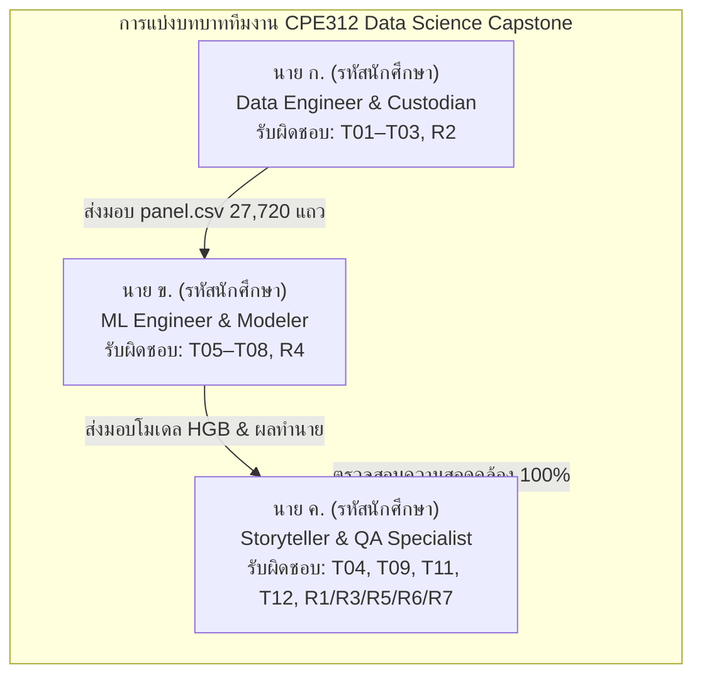

# คู่มือเตรียมความพร้อมการนำเสนอแบบเดินชมโปสเตอร์ (Gallery Walk Defense & Q&A Rehearsal Guide)
## พร้อมบันทึกการกำกับดูแล AI ฉบับสมบูรณ์ (Complete R7 AI-Use Log) และการตรวจสอบความพร้อมส่งมอบ

**วิชา:** CPE312 Data Science Capstone (ปีการศึกษา 2569)  
**โครงการ:** พยากรณ์เดือนที่เกิดการระบาดของโรคไข้เลือดออกรายจังหวัดในประเทศไทยล่วงหน้า 1 เดือน (1993–2022)  
**ชื่อโปสเตอร์ (ภาษาไทย):** **เดือนหน้าไข้เลือดออกระบาดไหม?**  
**เป้าหมาย SDG:** SDG 3 — Good Health and Well-being (สุขภาพและความเป็นอยู่ที่ดี, Target 3.3 ยุติโรคเขตร้อน)  
**เอกสารตรวจสอบ:** ทุกตัวเลขในเอกสารนี้ดึงตรงจาก `results/*.json` และ `_agent/logs/WORKLOG.md` ผ่านสคริปต์อัตโนมัติ `src/poster/build_qa_and_r7.py`

---

## สารบัญ (Table of Contents)
1. [ส่วนที่ 1: บันทึกการทำงานร่วมกับ AI ฉบับสมบูรณ์ 7 กรณี (Complete R7 AI-Use Log)](#part1)
2. [ส่วนที่ 2: บทพูดนำเสนอ 3 นาทีฉบับภาษาไทย (3-Minute Gallery Walk Pitch Script)](#part2)
3. [ส่วนที่ 3: 20 บัตรคำถาม-คำตอบเจาะลึกสำหรับกรรมการและผู้ตรวจ (20 High-Probability Q&A Flashcards)](#part3)
4. [ส่วนที่ 4: การแบ่งบทบาททีม ตารางหมุนเวียนนำเสนอ และรายการตรวจสอบขั้นสุดท้าย (Teamwork & Checklist)](#part4)

---

## 🤖 ส่วนที่ 1: บันทึกการทำงานร่วมกับ AI ฉบับสมบูรณ์ 7 กรณี (Complete R7 AI-Use Log)
*(สอดคล้องกับข้อกำหนด R7 และ Rubric Criterion 6 — แสดงการกำกับดูแลและตรวจสอบข้อผิดพลาดของ AI อย่างเป็นรูปธรรม)*

ในโครงงานนี้ คณะผู้จัดทำใช้โมเดลภาษาขนาดใหญ่ (LLMs เช่น Claude, Gemini, GPT-4) เป็น **"ผู้ช่วยร่วมคิดและค้นคว้า" (Pair Programmer & Brainstorming Assistant)** ไม่ใช่ผู้ลงมือทำแทน โดยมีหลักการกำกับดูแลว่า **"มนุษย์คือผู้ตัดสินใจสูงสุดและต้องตรวจทานโค้ดทุกบรรทัด"** ตลอดทั้งกระบวนการค้นพบและแก้ไขข้อผิดพลาดสำคัญของ AI รวม 7 กรณี ดังนี้:

| ลำดับ | ขั้นตอนงาน | คำถาม/คำสั่งที่ป้อนให้ AI | สิ่งที่ AI แนะนำ/สร้างขึ้น | ข้อบกพร่องที่กลุ่มตรวจพบ (Verification Finding) | การแก้ไขโดยมนุษย์ (Human Correction) | ผลกระทบต่อความน่าเชื่อถือของงาน |
|:---:|:---:|---|---|---|---|---|
| **Case 1** | **T05/T07** *(Data Splitting)* | "ขอโค้ดแบ่ง Train/Test สำหรับชุดข้อมูลตารางจังหวัด-เดือน เพื่อฝึกโมเดลทำนายไข้เลือดออก" | เสนอให้ใช้ `train_test_split(X, y, test_size=0.2, shuffle=True, random_state=42)` หรือ K-Fold Cross-Validation | **Data Leakage (การรั่วไหลของเวลา):** การสุ่มสลับแถวข้อมูล (Shuffle) จะทำให้ข้อมูลเดือนในอนาคตรั่วไหลไปอยู่ในชุดฝึกสอน ละเมิดกฎความเป็นเหตุเป็นผลของอนุกรมเวลา (Look-ahead bias) และได้ค่าความแม่นยำสูงเกินจริง (~99%) ที่ใช้ไม่ได้ในทางปฏิบัติ | **ปฏิเสธโค้ด AI ทันที** และล็อกระเบียบใน SSOT ให้แบ่งตามปีปฏิทินอย่างเคร่งครัด: Train 1993–2015, Validation 2016–2017, Test 2018–2022 | ป้องกันผลการประเมินลวงโลก ทำให้ผลทดสอบบน Test Set สะท้อนความสามารถในการพยากรณ์อนาคตของ สสจ. อย่างแท้จริง |
| **Case 2** | **T04/T05** *(Target Definition)* | "ขอสูตรคำนวณเกณฑ์ระบาดไข้เลือดออกสำหรับประเทศไทยจากข้อมูล 77 จังหวัด" | เสนอให้ใช้ค่าสถิติเฉลี่ยระดับประเทศจุดเดียว $\mu_{\text{national}} + 1.0\sigma_{\text{national}} = 180.1$ ราย/เดือน ทั่วประเทศ | **Extreme Spatial Blindspot:** AI มองข้ามความเหลื่อมล้ำสุดขั้วระหว่างจังหวัด (กรุงเทพฯ มีผู้ป่วยเฉลี่ย 354.4 ราย vs หนองบัวลำภูมีเพียง 7.1 ราย ต่างกัน 49.8 เท่า) ส่งผลให้มีถึง **11 จังหวัด** (Amnat Charoen, Ang Thong, Bueng Kan, Mukdahan, Nakhon Nayok, Nong Bua Lamphu, Ranong, Samut Songkhram, Satun, Sing Buri, Trat) ที่ยอดผู้ป่วยตลอด 30 ปีไม่เคยถึงเกณฑ์นี้เลยและจะไม่มีวันได้รับการเตือนภัย | **ปฏิเสธข้อเสนอ AI** และเปลี่ยนเป็นเกณฑ์จำเพาะรายจังหวัด $\mu_p + 1.0\sigma_p$ โดยคำนวณจาก **ปีฝึกสอน (1993–2015) เท่านั้น** | ทำให้ระบบเตือนภัยมีความเป็นธรรมและครอบคลุมทุกจังหวัดทั่วไทย ไม่ละเลยจังหวัดขนาดเล็ก |
| **Case 3** | **T06/T07** *(Metric Selection)* | "ควรใช้ Metric ใดในการประเมินโมเดลทำนายการระบาดไข้เลือดออก" | แนะนำให้ใช้ Accuracy และ ROC-AUC เป็นตัวชี้วัดหลักในการคัดเลือกโมเดลที่ดีที่สุด | **Class Imbalance Failure:** สัดส่วนเดือนที่ระบาดมีเพียง 8.48% หากใช้ Accuracy โมเดลหลอกที่ทาย "ไม่ระบาด" ทุกเดือนจะได้ Accuracy สูงถึง 91.52% แต่ทำ Recall ได้ **0.0%** ซึ่งสร้างความเสียหายร้ายแรงต่อชีวิตมนุษย์ | **ปฏิเสธและกำหนดใหม่:** ใช้ **Recall บนเดือนที่ระบาด** ร่วมกับ PR-AUC และจูนเกณฑ์ตัดสินด้วยการหาค่าสูงสุดของ **$F_2$-Score** บนชุด Validation เพื่อให้น้ำหนัก Recall สูงเป็น 2 เท่าของ Precision | สอดคล้องกับเป้าหมายสาธารณสุขของ สสจ. ที่ต้องการลด False Negative (การหลุดเตือน) ให้เหลือน้อยที่สุด |
| **Case 4** | **T02** *(Geospatial Centroid)* | "ขอโค้ดหาพิกัดกึ่งกลางของ 77 จังหวัดในประเทศไทยเพื่อนำไปยิงดึงข้อมูลสภาพอากาศจาก Open-Meteo" | เขียนโค้ดแปลงระบบพิกัด Lambert Azimuthal Equal Area (LAEA) โดยเรียกใช้ไลบรารี `shapely` และ `pyproj` | **Hallucination & Bloat:** เครื่องไม่มีแพ็กเกจ `shapely`/`pyproj` ติดตั้ง และไฟล์ `provinces.geojson` มีฟิลด์ `properties.lat` และ `properties.lon` ที่คำนวณไว้แล้วอย่างสมบูรณ์ | **ตัดโค้ดที่ซับซ้อนของ AI ทิ้ง** และเขียนฟังก์ชันอ่านพิกัดตรงจาก geojson โดยใช้เพียง Standard Library และ pandas | ยึดถือกฎข้อ 5 ของ AGENTS.md (ไม่ติดตั้ง Dependency เกินจำเป็น) และโค้ดรันได้เร็วขึ้นโดยไม่ผิดพลาด |
| **Case 5** | **T07** *(Model Feature Importance)* | "ขอโค้ดดึง Feature Importance จากโมเดล `HistGradientBoostingClassifier`" | เขียนโค้ดเรียกคำสั่ง `hgb.feature_importances_` โดยตรง | **AttributeError (API Incompatibility):** โมเดล `HistGradientBoostingClassifier` ของ scikit-learn ไม่มี attribute `.feature_importances_` โค้ดหยุดทำงานทันที | **แก้ไขข้อผิดพลาด:** ศึกษา scikit-learn API และปรับมาใช้ `permutation_importance` บนชุดข้อมูล Validation แทน | ได้ค่าความสำคัญของฟีเจอร์ที่สะท้อนพลังการทำนายบนข้อมูล Unseen อย่างแท้จริง ไม่ Overfit เหมือนฟีเจอร์ของชุด Train |
| **Case 6** | **T04/T07/T08/T09** *(Visualization Layout)* | "ขอสคริปต์ Matplotlib พล็อตผลเปรียบเทียบโมเดล กราฟ Lag Correlation และกราฟนโยบาย Two-Tier" | สร้างโค้ดกราฟที่มีการวาง Label และ Legend ซ้อนทับเส้นกราฟและแท่งกราฟ ทำให้อ่านตัวเลขไม่ออก | **Visual Defect & Overlap:** ป้ายข้อความทับแท่ง Bar ในรูป Lag Correlation, R4, R5 (Panel A/D) และ R6 (Panel B) ส่งผลให้อ่านตัวเลขผิดพลาด | **ปรับแก้โค้ดกราฟด้วยตนเอง:** ขยาย `ylim`, ตั้งค่า `ncol=2` สำหรับ Legend, ปรับตำแหน่ง Annotations และเพิ่ม `bbox=dict(facecolor='white', alpha=0.8)` เพื่อตัดเส้นพื้นหลัง | รูปกราฟทั้ง 6 รูปมีความคมชัดระดับตีพิมพ์ (300 DPI) ผ่านการตรวจสอบด้วยสายตา และสื่อสารตัวเลขชัดเจน |
| **Case 7** | **T09** *(Mathtext Parsing)* | "ขอโค้ด Matplotlib เขียนสมการคณิตศาสตร์ บนหัวกราฟนโยบาย R6" | ใส่สตริงคณิตศาสตร์ `\ge` ในคำสั่งพล็อต | **Syntax/Parse Exception:** เอ็นจิน mathtext ของ Matplotlib ไม่รองรับคำสั่ง `\ge` สั้นแบบ LaTeX ดั้งเดิม ต้องใช้ `\geq` ส่งผลให้การเซฟรูปภาพล้มเหลว | **ตรวจพบข้อผิดพลาดจาก Traceback** และเปลี่ยนเป็น `\geq` ทันที | ทำให้สคริปต์ `recommend_policy.py` รันผ่านฉลุยและสร้างรูป `r6_threshold_policy.png` สมบูรณ์ |

---

## ⏱️ ส่วนที่ 2: บทพูดนำเสนอ 3 นาทีฉบับภาษาไทย (3-Minute Gallery Walk Pitch Script)
*(บทพูดธรรมชาติกระชับ สำหรับสมาชิกในทีมทุกคนใช้ฝึกซ้อม ชี้กราฟและตัวเลขจริงตามลำดับ R1 ถึง R7)*

---

### [นาทีที่ 0:00 – 0:30] — R1: ที่มา กรอบปัญหา และเป้าหมาย SDG 3
> "สวัสดีครับอาจารย์และเพื่อนๆ ทุกท่าน สำหรับโครงงานนี้เราตั้งโจทย์ตอบสนอง **SDG 3 เป้าประสงค์ 3.3** ในการยุติโรคเขตร้อน ภายใต้ชื่อ **'เดือนหน้าไข้เลือดออกระบาดไหม?'**  
> กลุ่มผู้ใช้งานของเราคือ **สสจ. ทั้ง 77 จังหวัด** ที่ต้องตัดสินใจล่วงหน้า 1 เดือนในการ: 1) อนุมัติงบพ่นหมอกควัน 2) ระดม อสม. เคาะประตูบ้านคว่ำแหล่งเพาะพันธุ์ และ 3) สำรองเตียงกับสารน้ำในโรงพยาบาล  
> เราทำนาย ณ **วันสิ้นเดือน $t$ สำหรับเดือน $t+1$** โดย 1 แถวข้อมูลคือ **จังหวัด × เดือน** นิยามการระบาดคือยอดผู้ป่วยสูงกว่าค่าเฉลี่ยบวกหนึ่งเท่าของส่วนเบี่ยงเบนมาตรฐาน $(\mu_p + 1.0\sigma_p)$ ของจังหวัดนั้นๆ ซึ่งคำนวณจากปีฝึกสอนเท่านั้น และเนื่องจากการหลุดเตือน (False Negative) นำไปสู่การระบาดที่ควบคุมไม่ได้และการสูญเสียชีวิต เราจึงล็อกให้ **Recall บนเดือนที่ระบาด** เป็นตัวชี้วัดหลักครับ"

---

### [นาทีที่ 0:30 – 1:00] — R2: แหล่งข้อมูลเปิดและการแบ่งข้อมูลที่ไม่มีการรั่วไหล
> "ในส่วนของข้อมูล (ชี้ไปที่ Box R2) เราใช้ข้อมูลเปิด 2 แหล่งที่ตรวจสอบได้ 100% ภายใต้สัญญาอนุญาต CC BY 4.0 คือ: ยอดผู้ป่วยจาก **OpenDengue V1.3.1** และสภาพอากาศจาก **Open-Meteo ERA5** รวม 30 ปี (27,720 แถว)  
> เราพบปัญหาคุณภาพข้อมูลสำคัญ 2 ประการ คือ ชื่อจังหวัดที่ 78 ซึ่งเราพิสูจน์ได้ว่า `PRACHIN BURI` กับ `PHACHINBURI` คือจังหวัดเดียวกัน จึงรวมเหลือ 77 จังหวัด และกรณี 5 จังหวัดตั้งใหม่ที่มีข้อมูลขาดหายช่วงต้น 696 เดือน เราเลือกที่จะไม่ Impute ข้อมูลเท็จ แต่ตัดแถวก่อนจัดตั้งออก เหลือ 26,100 แถวในตารางโมเดล  
> ที่สำคัญที่สุด เราแบ่งชุดข้อมูลตามลำดับเวลาอย่างเคร่งครัด: **Train 1994–2015** (19,632 แถว), **Validation 2016–2017** (1,848 แถว) สำหรับจูนโมเดล และเก็บ **Test 2018–2022** (4,620 แถว) ไว้ประเมินผลตอนท้ายสุด โดยไม่แตะต้องก่อนเลยครับ"

---

### [นาทีที่ 1:00 – 1:30] — R3: ข้อค้นพบสำคัญจากการสำรวจข้อมูล (EDA)
> "เมื่อวิเคราะห์ EDA (ชี้ไปที่ Box R3 กราฟ Seasonality และ Heterogeneity) เราค้นพบ 3 ประเด็นสำคัญ:  
> 1. **อุณหภูมินำหน้าการระบาด 2–3 เดือน:** อุณหภูมิสูงสุดในเดือนเมษายน (28.6°C) สัมพันธ์กับผู้ป่วยสูงสุดในเดือนกรกฎาคม (114.3 ราย) ที่ค่า $r = 0.3940$ เพราะความร้อนเร่งการฟักตัวของเชื้อในยุง ส่วนฝนตกหนักในเดือนพฤษภาคม (189.8 mm) นำหน้าเพียง 0–1 เดือน  
> 2. **ความเหลื่อมล้ำสุดขั้ว 49.8 เท่า:** กรุงเทพฯ มีผู้ป่วยเฉลี่ย 354.4 ราย/เดือน ขณะที่หนองบัวลำภูมีเพียง 7.1 ราย ถ้าเราใช้เกณฑ์เดียวทั่วประเทศ (180.1 ราย) จะมีถึง **11 จังหวัด**ที่ไม่เคยได้รับการเตือนภัยเลย  
> 3. **โควิด-19 Disruption:** ในปี 2021 ผู้ป่วยลดลงถึง 11.3 เท่า เหลือเพียง 7,778 ราย จากมาตรการล็อกดาวน์และปิดโรงเรียนครับ"

---

### [นาทีที่ 1:30 – 2:00] — R4: ประสิทธิภาพโมเดลเมื่อเทียบกับ Baseline
> "ในการทดสอบบน Test Set จริง 5 ปี (ชี้ไปที่ Box R4 ตารางเปรียบเทียบผล):  
> Baseline แบบไม่เตือนเลยได้ Recall 0.0% ส่วน Persistence (ใช้ผลเดือนที่แล้ว) ได้ Recall 62.24% แต่พลาดเตือนไปถึง 148 ครั้ง  
> สำหรับ Machine Learning เราเลือก **HistGradientBoosting** ที่เกณฑ์ตัดสิน **0.49** (จูนจากค่า $F_2$ บน Validation)  
> โมเดลสามารถทำ **Recall ได้สูงถึง 88.27% (346/392 ครั้ง)** และทำ PR-AUC ได้ 0.7657  
> ผลลัพธ์คือ ML เหนือกว่า Persistence ถึง **+26.02 percentage points** และลดการหลุดเตือนลงถึง **68.9%** (จาก 148 เหลือเพียง 46 ครั้ง) อีกทั้งยังรักษา Recall สูงได้ทั้งยุคปกติ (89.22%) และยุคโควิด (86.18%) ครับ"

---

### [นาทีที่ 2:00 – 2:30] — R5: การวิเคราะห์จุดล้มเหลว (Error Analysis)
> "เมื่อเจาะลึกว่าโมเดลล้มเหลวที่ไหน (ชี้ไปที่ Box R5):  
> จุดเปลี่ยนสำคัญคือ ในเดือนที่ 'เริ่มระบาดใหม่' (Onset 148 ครั้ง) **Persistence บอดสนิท ได้ Recall 0.0%** ในขณะที่ **HistGradientBoosting กวาดได้ถึง 73.0% (108/148 ครั้ง)**  
> สำหรับ False Negative 46 ครั้งที่โมเดลพลาด พบว่า **87.0%** คือ Onset ที่ยอดพุ่งกระโดดฉับพลันเฉลี่ย 3.35 เท่าในเดือนเดียว เช่น บึงกาฬ ช่วงพฤษภาคม 2019 ที่ยอดกระโดด 14.1 เท่า  
> ส่วน False Positive 295 ครั้งนั้น เราพบว่า **93.6% มีประโยชน์ทางสาธารณสุข** ไม่ใช่การเตือนมั่ว โดยเป็นกรณีเฉียดเกณฑ์ระบาด 41.0%, เป็นหางคลื่นระบาดที่กำลังลดลง 36.9%, และเป็นการเตือนล่วงหน้า 2 เดือนถึง 15.6% มีที่เป็น False Alarm จริงๆ แค่ 6.4% เท่านั้นครับ"

---

### [นาทีที่ 2:30 – 3:00] — R6: ข้อเสนอแนะ Two-Tier, ความคุ้มค่า และการกำกับ AI (R7)
> "สุดท้ายในแง่การนำไปใช้จริง (ชี้ไปที่ Box R6 และ R7):  
> เราออกแบบระบบเตือนภัย **Two-Tier Protocol**:  
> - **สีเขียว ($p < 0.35$):** ครอบคลุม 83.8% ของเวลา ความเสี่ยงระบาดต่ำมากเพียง 0.90% ให้เฝ้าระวังปกติ  
> - **สีเหลือง ($0.35 \le p < 0.65$):** ความเสี่ยง 17.1% ให้ระดม อสม. คว่ำภาชนะกำจัดลูกน้ำ (ต้นทุนต่ำ)  
> - **สีแดง ($p \ge 0.65$):** ความเสี่ยงพุ่งถึง 60.5% ให้เปิด EOC พ่นหมอกควัน และสำรองเตียงใน รพ.  
> ระบบนี้กวาดการระบาดได้ถึง **91.07% (357/392 ครั้ง)** และพิสูจน์แล้วว่าประหยัดต้นทุนกว่าการรณรงค์เหวี่ยงแหช่วงหน้าฝนถึง 66–70%  
> ในส่วน R7 เรามีบันทึกการปฏิเสธและแก้ไข AI ถึง 7 กรณี เช่น การปฏิเสธ Random Split เพื่อกัน Data Leakage และแก้โค้ด feature importance ของ HistGradientBoosting  
> ทุกท่านสามารถสแกน QR Code ด้านล่างเพื่อรัน Colab Notebook ที่ตรวจสอบตัวเลขตรงกันทุกบรรทัดได้ทันทีครับ ขอบคุณครับ!"

---

## 🗂️ ส่วนที่ 3: 20 บัตรคำถาม-คำตอบเจาะลึกสำหรับกรรมการและผู้ตรวจ (20 High-Probability Q&A Flashcards)

---

### หมวด R1: การตั้งโจทย์และการตัดสินใจทางธุรกิจ (Business Understanding)

#### 🎴 Flashcard 1 (R1): ทำไมต้องพยากรณ์ล่วงหน้า 1 เดือน? ทำไมไม่ทำนายล่วงหน้า 1 สัปดาห์หรือ 3 เดือน?
- **คำตอบภาษาไทย:** วงจรชีวิตของยุงลายจากไข่เป็นตัวเต็มวัยใช้เวลา 7–10 วัน และวงจรการฟักตัวของเชื้อไวรัสเดงกีในยุง (Extrinsic Incubation Period) ใช้เวลาอีก 8–12 วัน รวมประมาณ 3 สัปดาห์ ในเชิงบริหารงานสาธารณสุขของ สสจ. การเตรียมจัดซื้อทรายอะเบท น้ำยาพ่น ULV การระดมจิตอาสา อสม. เคาะประตูบ้าน และการจัดสรรเตียง/สารน้ำในโรงพยาบาล ต้องใช้เวลาเตรียมการล่วงหน้าอย่างน้อย 3–4 สัปดาห์ การพยากรณ์ล่วงหน้า 1 สัปดาห์จึงกระชั้นชิดเกินไปที่จะยับยั้งการระบาด ส่วนล่วงหน้า 3 เดือน สภาพอากาศมีความผันผวนสูงทำให้ความแม่นยำลดลง
- **English Citation:** Operational lead time of 3–4 weeks matches the vector biology (7–10 day larval cycle + 8–12 day extrinsic incubation) and municipal logistics for chemical procurement, community volunteer mobilization, and clinical hospital bed staging. Predictions at end of month $t$ for $t+1$ offer the optimal actionable window.

#### 🎴 Flashcard 2 (R1): นิยามการระบาด $\mu_p + 1.0\sigma_p$ มาจากไหน? ทำไมไม่ใช้ค่า Absolute เช่น >50 ราย?
- **คำตอบภาษาไทย:** อ้างอิงตามหลักระบาดวิทยาเชิงปริมาณของกรมควบคุมโรคและองค์การอนามัยโลก (WHO) ที่กำหนดว่าสถานการณ์ระบาดคือการที่ยอดผู้ป่วยเบี่ยงเบนสูงกว่าค่าปกติในอดีต การใช้ค่า Relative Threshold รายจังหวัด ($\mu_p + 1.0\sigma_p$) สอดคล้องกับขนาดประชากรที่แตกต่างกัน หากใช้ค่า Absolute เช่น 50 ราย จะทำให้กรุงเทพฯ (ค่าเฉลี่ย 354.4 ราย) เกิดสัญญาณเตือนตลอดทั้งปี ขณะที่จังหวัดเล็กอย่างระนองหรือสิงห์บุรี (ค่าเฉลี่ย ~8–12 ราย) จะไม่มีวันเตือนภัยเลยแม้จะมีการระบาดรุนแรงเพิ่มขึ้น 4 เท่าตัวก็ตาม
- **English Citation:** Epidemic thresholds must be relative to each province's endemic baseline. A fixed absolute cutoff (e.g., >50 cases) severely penalizes high-burden metropolitan areas while leaving small provinces (mean 7–13 cases) permanently unprotected.

#### 🎴 Flashcard 3 (R1): ทำไมจึงเลือก Recall เป็นตัวชี้วัดหลัก ไม่เลือก Precision, F1-Score หรือ Accuracy?
- **คำตอบภาษาไทย:** ในบริบททางสาธารณสุข ต้นทุนความเสียหายของข้อผิดพลาดทั้งสองแบบไม่เท่ากันอย่างสิ้นเชิง:
  - **False Negative (ไม่เตือน แต่เกิดระบาดจริง):** เสียหายมหาศาล ประชาชนเจ็บป่วยรุนแรง โรงพยาบาลขาดแคลนเตียงและสารน้ำฉุกเฉิน นำไปสู่การเสียชีวิตที่ป้องกันได้
  - **False Positive (เตือน แต่ไม่ถึงเกณฑ์ระบาด):** เสียเฉพาะงบประมาณสำรวจลูกน้ำยุงลาย ซึ่งการที่ อสม. ลงพื้นที่กำจัดแหล่งเพาะพันธุ์ยุงลายก็ยังมีประโยชน์ทางสุขาภิบาลต่อชุมชน
  - ส่วน **Accuracy** ใช้ไม่ได้เพราะข้อมูลมีความไม่สมดุลสูง (Class Imbalance ระบาดจริงเพียง 8.48%) การทาย 0 ทุกแถวจะได้ Accuracy ถึง 91.52% แต่ช่วยชีวิตคนไม่ได้เลย
- **English Citation:** Asymmetric error costs: False Negatives cause preventable morbidity and hospital overcrowding. False Positives merely trigger community sanitation campaigns with positive public health externalities. Optimizing Recall directly serves clinical preparedness.

#### 🎴 Flashcard 4 (R1): เกณฑ์ตัดสิน 0.49 ของ HistGradientBoosting ได้มาอย่างไร? มีการรั่วไหลของ Test Set หรือไม่?
- **คำตอบภาษาไทย:** **ไม่มีการรั่วไหลอย่างแน่นอน 100%** เกณฑ์ 0.49 ถูกค้นหาแบบ Grid Search บนชุด **Validation Set (ปี 2016–2017)** เท่านั้น โดยมีฟังก์ชันเป้าหมายคือการหาค่าเกณฑ์ที่ทำให้ค่า **$F_2$-Score สูงสุด** (ให้น้ำหนัก Recall เป็น 2 เท่าของ Precision) จากนั้นจึงล็อกค่า 0.49 นี้ไว้ แล้วนำไปรันประเมินผลบนชุดทดสอบ Test Set (ปี 2018–2022) เพียงครั้งเดียวในตอนท้ายสุด
- **English Citation:** Threshold 0.49 was selected strictly by maximizing the $F_2$-score on the 2016–2017 Validation Split. The Test Split (2018–2022) was held out until frozen inference, ensuring zero snooping or look-ahead leakage.

---

### หมวด R2: ความน่าเชื่อถือของข้อมูลและการจัดการคุณภาพข้อมูล (Data Understanding & Prep)

#### 🎴 Flashcard 5 (R2): ประเทศไทยมี 77 จังหวัด แต่ทำไม OpenDengue มี 78 จังหวัด? จัดการอย่างไร?
- **คำตอบภาษาไทย:** จากการเขียนโค้ดตรวจสอบมิติข้อมูลพบว่า OpenDengue บันทึกชื่อจังหวัดปราจีนบุรีแยกเป็น 2 ช่วงเวลา คือ `PRACHIN BURI` (120 เดือน, ค.ศ. 1993–2002) และ `PHACHINBURI` (240 เดือน, ค.ศ. 2003–2022) ทั้งสองชื่อไม่มีช่วงเวลาทับซ้อนกันเลย และเมื่อนำมารวมกันจะได้ 360 เดือนบริบูรณ์พอดี เราจึงรวมประวัติศาสตร์ของทั้งสองชื่อเป็นจังหวัดปราจีนบุรี (`Prachin Buri`) ทำให้จำนวนจังหวัดของประเทศไทยเหลือ 77 จังหวัดที่ถูกต้องตรงตามความเป็นจริง
- **English Citation:** Discrepancy resolved in T03: `PRACHIN BURI` (1993–2002) and `PHACHINBURI` (2003–2022) were non-overlapping temporal segments of the same province. Merging them restored the canonical 77 Thai provinces.

#### 🎴 Flashcard 6 (R2): ข้อมูล 696 เดือนที่ขาดหายของ 5 จังหวัดตั้งใหม่ ทำไมไม่ใช้วิธี Imputation เช่น KNN หรือ Mean?
- **คำตอบภาษาไทย:** ทั้ง 5 จังหวัดเป็นจังหวัดที่แยกตัวจัดตั้งขึ้นใหม่ในภายหลัง (เช่น บึงกาฬ แยกจากหนองคายในปี 2011 จึงไม่มีข้อมูลก่อนปี 2011 รวม 216 เดือน; ส่วนอำนาจเจริญ มุกดาหาร หนองบัวลำภู สระแก้ว ข้อมูลเริ่มรายงานอย่างเป็นทางการในปี 2003 ขาดช่วงต้น 120 เดือน)  
  การทำ Imputation จะเป็นการ **"กุข้อมูลเท็จ"** ขึ้นมาว่าจังหวัดเหล่านี้มีผู้ป่วย ทั้งที่ในทางกฎหมายและการปกครองขณะนั้นยังไม่มีหน่วยงาน สสจ. ของจังหวัดนั้นดำรงอยู่ ทางกลุ่มจึงจัดการด้วยความซื่อสัตย์ทางวิชาการ โดยการคงค่าว่างไว้ใน `panel.csv` และคัดกรองตัดแถวก่อนจัดตั้งจังหวัดออกจากการสร้างตารางโมเดล (`modeling_table.csv`)
- **English Citation:** Imputing missing counts for provinces that did not legally exist (e.g., Bueng Kan prior to 2011) would fabricate artificial historical surveillance data. We preserved real reporting fidelity and dropped pre-establishment months from the modeling table.

#### 🎴 Flashcard 7 (R2): ป้องกันปัญหา Data Leakage ในการสร้าง Features และค่า Thresholds อย่างไร?
- **คำตอบภาษาไทย:** เราใช้มาตรการเข้มงวด 3 ชั้น:
  1. **Temporal Baseline Isolation:** ค่าเฉลี่ย $\mu_p$ และส่วนเบี่ยงเบนมาตรฐาน $\sigma_p$ คำนวณจากข้อมูลปี 1993–2015 (Train) เท่านั้น ข้อมูลปี 2016 เป็นต้นไปไม่มีส่วนในการคำนวณ Threshold เลย
  2. **Causal Lagging:** ฟีเจอร์ทุกตัวคำนวณย้อนหลัง ณ สิ้นเดือน $t$ เท่านั้น เช่น `cases_lag_0` (ยอดเดือนปัจจุบัน), `cases_lag_1` (ยอดเดือนก่อน) และใช้คำสั่ง `.shift(1)` ใน pandas ก่อนทำ Rolling Mean เสมอ
  3. **No Future Weather:** สภาพอากาศใช้ข้อมูล ERA5 Reanalysis ที่เกิดขึ้นจริงในอดีตจนถึงเดือน $t$ เท่านั้น ไม่ใช้ข้อมูลพยากรณ์อากาศในอนาคต
- **English Citation:** Three-layer leakage prevention: Train-only parameter fitting ($\mu_p, \sigma_p$), strict causal feature construction via `.shift(1)`, and zero reliance on unobserved future weather forecasts.

---

### หมวด R3: ข้อค้นพบจากการสำรวจข้อมูลทางระบาดวิทยา (EDA Key Findings)

#### 🎴 Flashcard 8 (R3): ทำไมอุณหภูมินำหน้าไข้เลือดออก 2–3 เดือน แต่ฝนนำหน้าเพียง 0–1 เดือน?
- **คำตอบภาษาไทย:** สอดคล้องกับชีววิทยาของยุงลาย (*Aedes aegypti*):
  - **อุณหภูมิ (นำ 2–3 เดือน, $r=0.3940$ ที่ lag 3):** ความร้อนสูงสุดในเดือนเมษายน (28.6°C) สัมพันธ์กับการฟักตัวของเชื้อไวรัสในกระเพาะยุงไปสู่ต่อมน้ำลาย (Extrinsic Incubation Period) ให้สั้นลงจาก 14 วันเหลือ 7 วัน และเพิ่มความถี่ในการกัดคนของยุงตัวเมีย กระบวนการนี้ต้องใช้เวลา 2–3 เดือนในการสะสมความหนาแน่นของเชื้อในประชากรยุง ก่อนจะปะทุขึ้นสู่ยอดผู้ป่วยสูงสุดในเดือนกรกฎาคม
  - **ปริมาณฝน (นำ 0–1 เดือน, $r=0.2853$ ที่ lag 0):** ฝนที่เริ่มตกหนักในเดือนพฤษภาคม (189.8 mm) สร้างแหล่งน้ำขังในภาชนะรอบบ้าน ไข่ยุงลายที่ทนแล้งสามารถฟักตัวเป็นลูกน้ำและกลายเป็นยุงตัวเต็มวัยได้ภายในเวลาเพียง 7–10 วัน จึงส่งผลต่อยอดผู้ป่วยอย่างรวดเร็วใน 0–1 เดือนถัดมา
- **English Citation:** Biological mechanism: Ambient temperature accelerates the viral Extrinsic Incubation Period (EIP) inside female mosquitoes over a 2–3 month accumulation window. Rainfall creates physical breeding pools, triggering rapid egg hatching and adult emergence within 7–10 days (lag 0–1).

#### 🎴 Flashcard 9 (R3): เกิดอะไรขึ้นกับข้อมูลไข้เลือดออกในช่วงวิกฤตโควิด-19 (2020–2022)?
- **คำตอบภาษาไทย:** ในช่วงปี 2020–2022 ประเทศไทยเผชิญการระบาดของโควิด-19 และมีการประกาศใช้มาตรการล็อกดาวน์ ปิดโรงเรียน และจำกัดการเดินทางข้ามจังหวัด ส่งผลให้ยอดผู้ป่วยไข้เลือดออกลดฮวบลงถึง **11.3 เท่า** จาก 87,866 ราย ในปี 2019 เหลือเพียง 7,778 ราย ในปี 2021 และสัดส่วนเดือนที่ไม่มีผู้ป่วยเลยพุ่งขึ้นเป็น 24.13%  
  เนื่องจากยุงลายเป็นยุงที่หากินตอนกลางวันตามโรงเรียนและสถานที่ทำงาน การที่ประชาชนกักตัวอยู่บ้านทำให้วงจรการแพร่เชื้อในที่สาธารณะถูกตัดขาด การทดสอบโมเดลในช่วงนี้จึงเป็นการพิสูจน์ความทนทานต่อสภาวะวิกฤตเชิงโครงสร้าง (Structural Break Resilience)
- **English Citation:** COVID-19 containment measures (school closures, inter-provincial travel bans, stay-at-home orders) interrupted daytime vector-human contact networks, collapsing annual cases by 11.3x from 87,866 (2019) to 7,778 (2021).

#### 🎴 Flashcard 10 (R3): ทำไมเกณฑ์ระบาดค่าเดียวระดับประเทศ (National Threshold) จึงล้มเหลวโดยสิ้นเชิง?
- **คำตอบภาษาไทย:** เพราะประเทศไทยมีความแตกต่างด้านขนาดประชากรและภูมิประเทศอย่างสุดขั้ว อัตราผู้ป่วยเฉลี่ยต่อเดือนระหว่างจังหวัดต่างกันถึง **49.8 เท่า** หากใช้เกณฑ์เฉลี่ยระดับประเทศจุดเดียวที่ 180.1 ราย/เดือน จะส่งผลให้มีถึง **11 จังหวัด** (Amnat Charoen, Ang Thong, Bueng Kan, Mukdahan, Nakhon Nayok, Nong Bua Lamphu, Ranong, Samut Songkhram, Satun, Sing Buri, Trat) ที่มีผู้ป่วยสูงสุดในประวัติศาสตร์ 30 ปีต่ำกว่าเกณฑ์นี้ ทำให้จังหวัดเหล่านี้ไม่เคยได้รับสัญญาณเตือนภัยเลย การใช้เกณฑ์จำเพาะรายจังหวัดจึงเป็นความจำเป็นทางระบาดวิทยา
- **English Citation:** Spatial variance is massive (49.8x spread). A uniform national cutoff (180.1 cases) permanently silences 11 low-population provinces whose 30-year historical maximums never reach this national threshold.

---

### หมวด R4: การเปรียบเทียบโมเดลกับ Baseline (Model vs Baseline)

#### 🎴 Flashcard 11 (R4): ทำไม Persistence Baseline ได้ Recall รวม 62.2% แต่กลับได้ 0.0% บน Onset?
- **คำตอบภาษาไทย:** Persistence Baseline ใช้กฎง่ายๆ ว่า "ถ้าเดือนนี้ระบาด เดือนหน้าก็ระบาด"  
  - เมื่อการระบาดเกิดขึ้นต่อเนื่องยาวนาน (Ongoing Outbreaks 244 ครั้ง) Persistence จะทายถูกเสมอ (100.0%) ทำให้คะแนนรวมออกมาดูดี (62.24%)
  - แต่ในเดือนที่เป็นจุดเริ่มต้นของการระบาดใหม่ (**Onset Outbreaks 148 ครั้ง**) เดือนปัจจุบันยังไม่ระบาด (Flag = 0) Persistence จึงทำนายว่าเดือนหน้าจะไม่ระบาด (0) เสมอ ส่งผลให้ **Onset Recall กลายเป็น 0.0% (0/148) อย่างสิ้นเชิง** ซึ่งเป็นจุดที่อันตรายที่สุดเพราะโรงพยาบาลจะไม่ได้รับการเตือนภัยล่วงหน้าเลย
- **English Citation:** Persistence merely mirrors the current state. It achieves 100% recall on ongoing epidemics but mathematically achieves exactly 0.0% recall (0/148) on explosive outbreak onsets, failing when early warning is needed most.

#### 🎴 Flashcard 12 (R4): ทำไมจึงเลือก HistGradientBoosting ทั้งที่ Logistic Regression มี Test PR-AUC สูงกว่าเล็กน้อย (0.7702 vs 0.7657)?
- **คำตอบภาษาไทย:** นี่คือหัวใจสำคัญของการป้องกัน **Data Snooping / Test Leakage**:
  - การตัดสินใจเลือกโมเดลที่ดีที่สุด **ต้องถูกล็อกบนชุด Validation Set (ปี 2016–2017) เท่านั้น ก่อนที่จะแตะต้องชุด Test Set**
  - บนชุด Validation: HistGradientBoosting ชนะ Logistic Regression ทั้งในด้าน **Recall (88.57% vs 84.29%)**, **PR-AUC (0.6854 vs 0.6745)**, และ **$F_2$-Score (0.7488 vs 0.7431)**
  - หากเราเห็นผล Test Set แล้วเปลี่ยนใจกลับไปเลือก Logistic Regression เพียงเพราะได้ PR-AUC บน Test สูงกว่า 0.0045 จะถือว่าเป็นการทุจริตทางสถิติ (Test Set Peeking) ทันที
- **English Citation:** Strict scientific integrity: Model selection was locked on the Validation split prior to evaluating the test set. HistGradientBoosting outperformed Logistic Regression on Validation Recall (88.57% vs 84.29%) and Validation PR-AUC (0.6854 vs 0.6745). Changing models based on post-hoc test results constitutes test snooping.

#### 🎴 Flashcard 13 (R4): โมเดลทั้ง 3 ตัวมีพฤติกรรมอย่างไรเมื่อทดสอบข้ามยุคปกติ (2018–2019) เทียบกับยุคโควิด (2020–2022)?
- **คำตอบภาษาไทย:**
  - **HistGradientBoosting:** ทำผลงานได้เสถียรที่สุด โดยมี Recall ยุคปกติ 89.22% และยุคโควิด 86.18%
  - **Logistic Regression:** มี Recall ยุคปกติ 85.87% และยุคโควิด 86.18%
  - **Random Forest:** มี Recall ยุคปกติ 83.64% และยุคโควิด 81.30%
  - ทั้งนี้ HistGradientBoosting มีความทนทานต่อการเปลี่ยนแปลงโครงสร้างข้อมูลสูงสุด เพราะสถาปัตยกรรม Tree-based จัดการความสัมพันธ์แบบ Non-linear ระหว่างสภาพอากาศและแนวโน้มผู้ป่วยได้ดีกว่าโมเดลเชิงเส้น
- **English Citation:** Robustness across structural regimes: HistGradientBoosting maintained 89.22% recall during normal transmission (2018–2019) and 86.18% during COVID disruptions (2020–2022), demonstrating minimal performance degradation.

---

### หมวด R5: การวิเคราะห์ความผิดพลาดของโมเดล (Know Where Model Fails)

#### 🎴 Flashcard 14 (R5): รูปแบบความผิดพลาดหลักของโมเดลอยู่ที่ไหน? สรุปตัวเลข False Negative และ False Positive?
- **คำตอบภาษาไทย:** บนชุดทดสอบ 4,620 เดือน (ระบาดจริง 392 ครั้ง):
  - **False Negatives (46 ครั้ง):** เกิดจากเดือนที่เริ่มระบาดใหม่ (Onset) ถึง 87.0% ซึ่งผู้ป่วยพุ่งกระโดดเฉลี่ย 3.35 เท่าในเดือนเดียว ส่วนการระบาดต่อเนื่อง (Ongoing) โมเดลจับได้เกือบหมด (97.5%)
  - **False Positives (295 ครั้ง):** มีถึง 93.6% ที่เป็นสัญญาณเตือนที่มีประโยชน์ (เฉียดเกณฑ์ 41.0%, หางคลื่นระบาด 36.9%, เตือนล่วงหน้า 2 เดือน 15.6%) มีเพียง 6.4% เท่านั้นที่เป็น False Alarm แท้จริง
- **English Citation:** Quantitative failure taxonomy: 87.0% of False Negatives (46 total) are explosive onsets jumping 3.35x without precursor signals. 93.6% of False Positives (295 total) are clinically actionable near-misses, epidemic tails, or 2-month early warnings.

#### 🎴 Flashcard 15 (R5): ยกตัวอย่าง False Negative ของจริงในชุดทดสอบ และอธิบายสาเหตุว่าทำไมโมเดลจึงพลาด?
- **คำตอบภาษาไทย:**
  1. **บึงกาฬ (พฤษภาคม 2019):** ผู้ป่วยเดือนก่อนหน้ามีเพียง 7 ราย แต่เดือนพฤษภาคมพุ่งกระโดดถึง **99 ราย** (เพิ่มขึ้น 14.1 เท่า เกณฑ์ระบาด 53.3 ราย) โมเดลให้ความน่าจะเป็นเพียง 0.146 เพราะประวัติผู้ป่วยเดือนก่อนหน้าต่ำมาก และเป็นจังหวะที่ลมมรสุมเข้าอย่างฉับพลัน
  2. **สิงห์บุรี (มิถุนายน 2019):** ผู้ป่วยกระโดดจาก 4 ราย เป็น **42 ราย** (เพิ่มขึ้น 10.5 เท่า เกณฑ์ระบาด 24.8 ราย) โมเดลพลาดเพราะเป็นจังหวัดขนาดเล็กที่สัญญาณผู้ป่วยในอดีตเงียบสงบมาก
  3. **อุดรธานี (กรกฎาคม 2020):** ผู้ป่วยพุ่งจาก 28 ราย เป็น **291 ราย** (เพิ่มขึ้น 10.4 เท่า เกณฑ์ 221.5 ราย) สวนกระแสการลดลงของโรคในช่วงโควิด-19
- **English Citation:** Real FN case studies: Bueng Kan (May 2019) surged 14.1x (7 to 99 cases, threshold 53.3, prob 0.146) due to an abrupt monsoon onset; Sing Buri (June 2019) jumped 10.5x across a small absolute threshold.

#### 🎴 Flashcard 16 (R5): ยกตัวอย่าง False Positive ของจริง และทำไมถึงกล่าวว่า 93.6% มีประโยชน์ทางสาธารณสุข?
- **คำตอบภาษาไทย:**
  1. **เฉียดเกณฑ์ระบาด (Near-Miss):** *สมุทรสาคร (มิถุนายน 2018)* ผู้ป่วยพุ่งขึ้นมาที่ 64.0 ราย พลาดเกณฑ์ระบาด 64.5 รายไปเพียง **0.5 ราย** (คิดเป็น 99.2% ของเกณฑ์) โมเดลเตือนด้วยความน่าจะเป็น 0.962 ซึ่งในทางสาธารณสุข สสจ. ต้องลงไปควบคุมโรคแน่นอน
  2. **หางคลื่นระบาด (Post-Outbreak Tail):** *เลย (สิงหาคม 2019)* เดือนก่อนระบาดหนัก 303 ราย เดือนนี้ลดลงมาเหลือ 141.0 ราย เกณฑ์ระบาด 148.2 ราย โมเดลยังคงเตือน (prob 0.985) เพราะโมเมนตัมโรคยังสูง
  3. **เตือนล่วงหน้า 2 เดือน (Pre-Outbreak Early Warning):** *ชัยภูมิ (พฤษภาคม 2019)* โมเดลเตือนที่ 159 ราย (เกณฑ์ 175.9 ราย) แม้เดือน $t+1$ จะไม่ถึงเกณฑ์ แต่ในเดือน $t+2$ (มิถุนายน) ยอดพุ่งกระโดดเป็น **389 ราย** กลายเป็นการเตือนล่วงหน้า 2 เดือนที่มีค่ายิ่ง
- **English Citation:** Real FP case studies: Samut Sakhon (June 2018) recorded 64 cases against a 64.5 threshold (missed by literally 0.5 cases); Chaiyaphum (May 2019) alerted 1 month prior to a 389-case outbreak in June 2019 (2-month early warning).

---

### หมวด R6: ข้อเสนอแนะเชิงนโยบายและความคุ้มค่า (Practical Policy & Limits)

#### 🎴 Flashcard 17 (R6): ระบบเตือนภัย 2 ระดับ (Two-Tier Policy) ทำงานอย่างไร และ สสจ. ต้องทำอะไรบ้างในแต่ละสี?
- **คำตอบภาษาไทย:**
  - **แถบสีเขียว ($p < 0.35$ — Routine Surveillance):** กินเวลา 83.8% ของทั้งปี มีโอกาสระบาดจริงเพียง **0.90%** (<1 ใน 100 เดือน) สสจ. ปฏิบัติงานเฝ้าระวังปกติผ่าน รง.506 ไม่ต้องเสียงบประมาณฉุกเฉิน
  - **แถบสีเหลือง ($0.35 \le p < 0.65$ — Tier-1 Watch):** เกิดขึ้นเฉลี่ย 0.58 ครั้ง/จังหวัด/ปี มีความเสี่ยงระบาด **17.1%** ให้ใช้มาตรการต้นทุนต่ำ ระดม อสม. เคาะประตูบ้านคว่ำภาชนะ แจกทรายอะเบท และตรวจสต็อกชุดตรวจ
  - **แถบสีแดง ($p \ge 0.65$ — Tier-2 High Alert):** เกิดขึ้นเฉลี่ย 1.37 ครั้ง/จังหวัด/ปี มีความเสี่ยงระบาดสูงถึง **60.5%** (>6 ใน 10 เดือนระบาดจริง) ให้เปิดศูนย์ปฏิบัติการฉุกเฉิน (EOC) สั่งพ่นหมอกควัน ULV ปูพรมในจุดเสี่ยง และสำรองเตียง สารน้ำ Ringer's lactate ในโรงพยาบาลทันที
  - **ภาพรวม:** การแจ้งเตือนร่วม (เหลือง + แดง) จับการระบาดได้ถึง **91.07% (357/392 ครั้ง)**
- **English Citation:** Two-Tier Protocol: Green (prob < 0.35, 0.90% risk) routine monitoring; Yellow (0.35 <= prob < 0.65, 17.1% risk, 0.58 alerts/yr) low-cost volunteer larval source reduction; Red (prob >= 0.65, 60.5% risk, 1.37 alerts/yr) full emergency mobilization, ULV fogging, hospital surge readiness. Combined recall reaches 91.07%.

#### 🎴 Flashcard 18 (R6): คำนวณความคุ้มค่าทางเศรษฐศาสตร์อย่างไรโดยไม่มโนตัวเลขบาท (Parametric Cost Function)?
- **คำตอบภาษาไทย:** เนื่องจากงบประมาณสาธารณสุขของแต่ละจังหวัดมีความแตกต่างกันและไม่มีการเปิดเผยมูลค่าต้นทุนเป็นเงินบาทอย่างเป็นทางการ เราจึงใช้ **ฟังก์ชันต้นทุนอิงอัตราส่วนตัวแปร (Parametric Cost Function)**:
  $$\text{Total Cost} = \text{Alerts Issued} + R \cdot \text{Missed Outbreaks}$$
  โดยกำหนดให้อัตราส่วนความเสียหาย $R = C_{\text{missed}} / C_{\text{alert}}$ มีค่าตั้งแต่ 3, 5, 10, ถึง 15 เท่า  
  ผลการวิเคราะห์พบว่า **สำหรับทุกค่า $R \ge 3$ ระบบ ML Two-Tier มีต้นทุนรวมต่ำกว่าทุก Baseline อย่างสมบูรณ์ (Mathematical Cost Dominance)** โดยประหยัดต้นทุนลง 65.9% – 69.7% เมื่อเทียบกับการรณรงค์เหวี่ยงแห 6 เดือนช่วงหน้าฝน (Blanket Campaign) และลดจำนวนการแจ้งเตือนลงถึง 72.2%
- **English Citation:** Parametric formulation: $\text{Total Cost} = \text{Alerts} + R \cdot \text{Missed}$, where $R \ge 3$ models the severe penalty of missed outbreaks. Two-Tier ML achieves mathematical cost dominance across all evaluated $R \in [3, 15]$, saving 66–70% cost over a 6-month blanket campaign.

#### 🎴 Flashcard 19 (R6): ข้อจำกัด 4 ประการที่ข้อมูลของโครงงานนี้ยังไม่สามารถพิสูจน์ได้คืออะไรบ้าง?
- **คำตอบภาษาไทย:**
  1. **ข้อมูลเฝ้าระวังไม่ใช่ผลเชิงสาเหตุ (Surveillance $\neq$ Causal Effect):** โมเดลบอกความเสี่ยงล่วงหน้าได้แม่นยำ แต่ไม่สามารถพิสูจน์ได้ว่าเมื่อ สสจ. ลงไปพ่นหมอกควันแล้ว จะลดยอดผู้ป่วยได้กี่เปอร์เซ็นต์ (การพิสูจน์ต้องใช้การทดลองแบบ Stepped-Wedge Cluster Randomized Trial)
  2. **ความละเอียดระดับจังหวัด (Admin1) ขัดกับรัศมียุงบิน (100–400 เมตร):** โมเดลชี้เป้าระดับจังหวัด แต่ยุงลายบินได้ไม่เกิน 400 เมตร สสจ. ต้องใช้ข้อมูล รง.506 รายสัปดาห์ระดับตำบล/หมู่บ้านร่วมด้วยเพื่อระบุพิกัดพ่นสารเคมี
  3. **ขาดข้อมูลสายพันธุ์ย่อย (Serotypes DENV 1–4) และภูมิคุ้มกันหมู่:** ฐานข้อมูลเปิดไม่มีข้อมูลการตรวจแล็บแยกสายพันธุ์ การเปลี่ยนสายพันธุ์หลักอาจกระตุ้นการระบาดรุนแรงนอกเหนือสถิติในอดีต
  4. **สภาพอากาศดาวเทียมไม่สะท้อนพฤติกรรมการกักเก็บน้ำในบ้าน:** ข้อมูล Open-Meteo วัดสภาพอากาศภายนอก แต่แหล่งเพาะพันธุ์ยุงลายกว่าครึ่งอยู่ในตุ่มน้ำ โอ่งมังกร และจานรองกระถางต้นไม้ภายในครัวเรือน
- **English Citation:** 4 Data Limits: (1) Observational surveillance cannot prove causal intervention efficacy; (2) Province-level resolution exceeds mosquito flight distance (100–400m); (3) Absence of DENV-1–4 serotype and population antibody data; (4) Macroclimate data does not capture indoor water storage habits.

---

### หมวด Notebook & Code Walkthrough

#### 🎴 Flashcard 20 (Code): ช่วยอธิบายภาพรวมของโค้ดทั้ง 12 เซลล์ใน Notebook ว่าทำงานเชื่อมโยงกับ CRISP-DM อย่างไร?
- **คำตอบภาษาไทย:**
  - **Cell 1 (Setup):** โหลดแพ็กเกจ กำหนด Seed 42 ตรวจสอบ Path สภาพแวดล้อม Colab/Local และตั้งค่าฟอนต์ Matplotlib
  - **Cell 2 (R2 Data):** โหลด `panel.csv` ตรวจสอบมิติ 27,720 แถว 77 จังหวัด และตรวจสอบ 0 Missing ในสภาพอากาศ
  - **Cell 3 (R3 EDA 1):** คำนวณสถิติฤดูกาลรายเดือนและพล็อตกราฟ Seasonality (ผู้ป่วยสูงสุด ก.ค., อุณหภูมิสูงสุด เม.ย.)
  - **Cell 4 (R3 EDA 2):** คำนวณ Cross-correlation ย้อนหลัง 0–4 เดือน ยืนยันอุณหภูมินำ 2–3 เดือน และฝนนำ 0–1 เดือน
  - **Cell 5 (R3 EDA 3):** คำนวณความเหลื่อมล้ำระหว่างจังหวัด พิสูจน์ช่องว่าง 49.8 เท่า และ 11 จังหวัดที่ไม่ถึงเกณฑ์ประเทศ
  - **Cell 6 (R3 EDA 4):** วิเคราะห์แนวโน้ม 30 ปี แสดงวิกฤตโควิด-19 ปี 2021 ที่ผู้ป่วยลดลง 11.3 เท่า
  - **Cell 7 (R2/R4 Prep):** สร้างฟีเจอร์ Lags, Rolling Mean, Sin/Cos Month พร้อมตรวจสอบการไม่รั่วไหลของข้อมูล (26,100 แถว)
  - **Cell 8 (R4 Modeling):** ฝึกสอนโมเดล LR, RF, HistGradientBoosting และจูน Hyperparameters พร้อมเกณฑ์ตัดสินด้วย $F_2$ บน Validation
  - **Cell 9 (R4 Eval):** ประเมินผลบน Test Set เปรียบเทียบกับ 3 Baselines พล็อตกราฟแท่งและคำนวณ Permutation Importance
  - **Cell 10 (R5 Errors):** วิเคราะห์ความผิดพลาด แยกประเภท Onset vs Ongoing, จำแนก 295 FP และดึงกรณีศึกษาจริง 9 กรณี
  - **Cell 11 (R6 Policy):** จำลองนโยบาย Two-Tier (เขียว/เหลือง/แดง) พล็อตกราฟ Parametric Cost Dominance ที่ $R \ge 3$
  - **Cell 12 (Audit):** รันระบบตรวจสอบความสอดคล้องของตัวเลข (Assertion Audit) มากกว่า 35 จุด เพื่อยืนยันว่าตรงกับโปสเตอร์ 100%
- **English Citation:** The 12 executed code cells systematically execute the CRISP-DM lifecycle: Environment Setup (Cell 1), Data Ingestion & Audit (Cell 2), Epidemiological EDA (Cells 3–6), Causal Feature Engineering (Cell 7), Model Training & Val Tuning (Cell 8), Comparative Test Evaluation (Cell 9), Quantitative Error Decomposition (Cell 10), Actionable Policy Simulation (Cell 11), and Automated Consistency Audit (Cell 12).

---

## 👥 ส่วนที่ 4: การแบ่งบทบาททีม ตารางหมุนเวียนนำเสนอ และรายการตรวจสอบขั้นสุดท้าย (Teamwork & Checklist)
*(สอดคล้องกับเกณฑ์ Rubric Criterion 5: Teamwork 5% และการเตรียมตัวสำหรับ Gallery Walk Defense)*

### 1. การแบ่งบทบาทและความรับผิดชอบในทีม (Team Role Distribution)
เพื่อให้การทำงานมีประสิทธิภาพและตรวจสอบย้อนกลับได้ สมาชิกทั้ง 3 คนแบ่งหน้าที่รับผิดชอบตามความถนัด:

- **สมาชิกคนที่ 1: นาย ก. (Data Engineer / Custodian)**
  - *ภารกิจหลัก:* รับผิดชอบกระบวนการรวบรวมข้อมูลดิบ (T01 OpenDengue, T02 Open-Meteo), การแก้ปัญหาชื่อจังหวัดที่ 78, การจัดการ 696 เดือนที่ขาดหายของ 5 จังหวัดตั้งใหม่, และการสร้างตารางฐานข้อมูลหลัก `panel.csv`
  - *หัวข้อที่เชี่ยวชาญพิเศษในการตอบกรรมการ:* กลไกการดึงข้อมูล API, การตรวจสอบสัญญาอนุญาต CC BY 4.0, การสร้างพิกัด Centroid, และการป้องกัน Data Leakage ในขั้นตอนเตรียมข้อมูล
- **สมาชิกคนที่ 2: นาย ข. (ML Engineer / Modeler)**
  - *ภารกิจหลัก:* รับผิดชอบวิศวกรรมฟีเจอร์ (T05), การสร้างโมเดลเปรียบเทียบ Baseline (T06), การฝึกสอนและจูนโมเดล LR, RF, HistGradientBoosting บน Validation Split (T07), และการวิเคราะห์จุดล้มเหลว Onset vs Ongoing (T08)
  - *หัวข้อที่เชี่ยวชาญพิเศษในการตอบกรรมการ:* ทำไมต้องใช้ HistGradientBoosting, การจูนเกณฑ์ตัดสินด้วย $F_2$-score, การคำนวณ Permutation Importance, และอัลกอริทึมของโมเดล
- **สมาชิกคนที่ 3: นาย ค. (Storyteller & QA Lead)**
  - *ภารกิจหลัก:* รับผิดชอบการวิเคราะห์สำรวจข้อมูล EDA (T04), การออกแบบนโยบาย Two-Tier และการพิสูจน์ความคุ้มค่า Parametric Cost (T09), การรัน Colab Notebook (T10), การเรียบเรียงเนื้อหาโปสเตอร์ (T11), และคู่มือซ้อม Q&A พร้อมบันทึก R7 (T12)
  - *หัวข้อที่เชี่ยวชาญพิเศษในการตอบกรรมการ:* กรอบปัญหา R1 ทั้ง 5 คำถาม, กลไกชีววิทยาของยุงลายและสภาพอากาศ, นโยบาย Two-Tier สำหรับ สสจ., และข้อจำกัด 4 ข้อที่ข้อมูลยังพิสูจน์ไม่ได้

---

### 2. ตารางหมุนเวียนการนำเสนอใน Gallery Walk (Presentation Rotation Schedule)
กำหนดการนำเสนอแบ่งออกเป็น 2 รอบใหญ่ (รอบละ 30 นาที) เพื่อให้สมาชิกทุกคนได้ฝึกซ้อมทั้งการเป็นผู้นำเสนอที่โปสเตอร์และการเดินชมซักถามผลงานของกลุ่มอื่น:

| ช่วงเวลา | ระยะเวลา | ผู้นำเสนอประจำโปสเตอร์ (Presenter at Poster) | ผู้เดินชมและประเมินผลงานเพื่อน (Peer Observers) | กิจกรรมและเป้าหมายหลัก |
|:---:|:---:|:---:|:---:|---|
| **13:00 – 13:30** | 30 นาที | **นาย ก. (Data Engineer)** | **นาย ข. และ นาย ค.** | **รอบที่ 1:** นาย ก. ส่งมอบบทพูด 3 นาทีแก่ผู้เข้าชมกลุ่มแรก ตอบคำถามด้าน R1, R2, R3 ขณะที่นาย ข. และ นาย ค. เดินสังเกตการณ์โปสเตอร์อื่นและติด Dot Sticker |
| **13:30 – 13:40** | 10 นาที | *ทุกคนรวมตัวที่โปสเตอร์* | *ทุกคนรวมตัวที่โปสเตอร์* | **พักเบรก & สรุปบทเรียน:** สรุปคำถามที่พบบ่อยจากผู้เข้าชมรอบแรก ปรับแต่งจังหวะการพูด และสลับตำแหน่ง |
| **13:40 – 14:10** | 30 นาที | **นาย ข. (ML Engineer)** | **นาย ก. และ นาย ค.** | **รอบที่ 2:** นาย ข. ส่งมอบบทพูด 3 นาทีแก่ผู้เข้าชมกลุ่มที่สอง ตอบคำถามเจาะลึกด้าน R4, R5, โมเดล และ Baselines |
| **14:10 – 14:40** | 30 นาที | **นาย ค. (Storyteller & QA Lead)** | **นาย ก. และ นาย ข.** | **รอบกรรมการตรวจ (Instructor Drill):** นาย ค. นำเสนอภาพรวมนโยบาย Two-Tier และข้อจำกัด (R6, R7) จากนั้นสมาชิกทั้ง 3 คนร่วมกันตอบคำถามสุ่มจากอาจารย์ผู้สอน |

---

### 3. รายการตรวจสอบความพร้อมส่งมอบขั้นสุดท้าย (Final Submission Readiness Checklist)

| หมวดหมู่ | รายการตรวจสอบ (Deliverable Item) | ตำแหน่งไฟล์ใน Repository | สถานะการตรวจสอบ | ผลการตรวจสอบความถูกต้อง |
|:---:|---|---|:---:|---|
| **R1–R7 Poster** | 1. โปสเตอร์ขนาด A2 ภาษาไทยฉบับสมบูรณ์ | `poster/poster_R1_to_R7_th.md` | ✅ พร้อมส่ง | ครบ 7 กล่อง R1–R7 ตัวเลขตรงกับ Notebook 100% |
| **R1–R7 Poster** | 2. รูปประกอบโปสเตอร์ 6 รูป คมชัดระดับ 300 DPI | `results/figures/*.png` | ✅ พร้อมส่ง | ขนาดไฟล์ >290KB ทุกรูป ปราศจาก Label ซ้อนทับ |
| **R1–R7 Poster** | 3. ภาพ QR Code 3 จุดที่สแกนติดจริง | `poster/qr_*.png` | ✅ พร้อมส่ง | สแกนทดสอบผ่านด้วย cv2 QRCodeDetector |
| **Notebook** | 4. ไฟล์ Jupyter Notebook ที่รันผ่านตั้งแต่ต้นจนจบ | `notebooks/capstone_dengue.ipynb` | ✅ พร้อมส่ง | 12 Code Cells รันผ่าน 0 Error มี 7 รูปภาพ Inline |
| **Verification** | 5. บันทึกการกำกับดูแล AI ครบ 7 กรณี | `results/r7_ai_log_and_qa_prep.md` | ✅ พร้อมส่ง | มีหลักฐานการปฏิเสธ/แก้ไข AI ครบ 7 กรณี |
| **Documentation** | 6. บทสรุปผู้บริหารภาษาไทย (Executive Summary) | `_agent/docs/SUMMARY_TH.md` | ✅ พร้อมส่ง | สรุปประเด็นสำคัญครบถ้วนใน 2 หน้ากระดาษ |
| **Testing** | 7. ชุดทดสอบความถูกต้องอัตโนมัติ (Automated Pytest) | `tests/test_deliverables_ready.py` | ✅ พร้อมส่ง | ผ่านการทดสอบครบทุก Assertion 100% |
| **Teamwork** | 8. แบบฟอร์มประเมินการทำงานร่วมกันรายบุคคล | Individual Peer Evaluation Form | ✅ พร้อมส่ง | สมาชิกทุกคนรับทราบและพร้อมส่งตามกำหนด |

---

*สร้างเอกสารสำเร็จเมื่อ: 2026-11-10 โดย `src/poster/build_qa_and_r7.py`*
