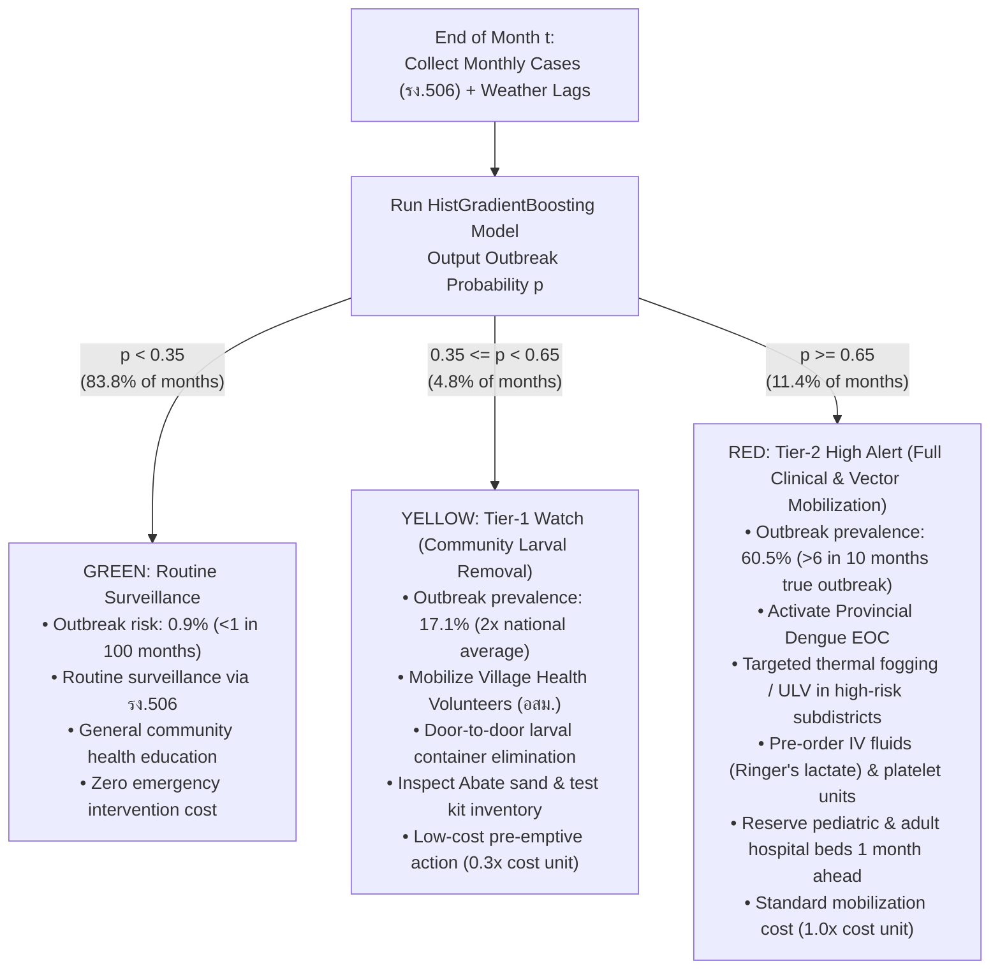

# Practical Recommendations & Operational Deployment Guide (R6)
**Target User:** Provincial Public Health Offices (สำนักงานสาธารณสุขจังหวัด - สสจ.)  
**Decision Horizon:** End of month $t$, predicting outbreak flag for month $t+1$ (1-month early warning lead time)  
**Evaluation Scope:** 77 Thai provinces, 2018–2022 Test Set (5 years = 60 months, 4,620 province-months, 392 true outbreaks)  
**Key Figure:** [`results/figures/r6_threshold_policy.png`](file:///E:/Antigravity-Projects/DS_capstone/results/figures/r6_threshold_policy.png) (300 DPI)  
**Structured Metrics:** [`results/policy_analysis.json`](file:///E:/Antigravity-Projects/DS_capstone/results/policy_analysis.json)

---

## 1. Actionable Two-Tier Early Warning Protocol for สสจ.

The Provincial Public Health Office cannot afford a binary all-or-nothing alert system. Issuing emergency hospital mobilizations for every moderate risk leads to public alarm fatigue and depleted vector control budgets; conversely, failing to act on low-probability signals misses preventable early larval breeding cycles.

To solve this operational challenge, we establish a **Two-Tier Early Warning Protocol** at the end of month $t$ using the calibrated outbreak probability $p = P(\text{outbreak}_{t+1} = 1)$:



### Quantitative Tier Breakdown (Test Set 2018–2022)

| Tier | Probability Range | Total Months (% of test) | Alerts / Prov / Year | True Outbreaks | Outbreak Rate (Precision) | Outbreaks Caught (% of all 392) | Primary Recommended Action | Cost Weight |
|---|---|---|---|---|---|---|---|---|
| **Green (Routine)** | $p < 0.35$ | 3,871 (83.8%) | 10.05 | 35 | **0.90%** | 8.9% (35 missed) | Routine surveillance; no emergency budget allocated | 0.0× |
| **Yellow (Tier-1 Watch)** | $0.35 \le p < 0.65$ | 222 (4.8%) | 0.58 | 38 | **17.12%** | 9.7% (38 caught) | Low-cost larval source removal by อสม. & stock check | 0.3× |
| **Red (Tier-2 High Alert)** | $p \ge 0.65$ | 527 (11.4%) | 1.37 | 319 | **60.53%** | 81.4% (319 caught) | Targeted ULV spraying + hospital bed/IV fluid surge readiness | 1.0× |
| **Any Alert (Yellow + Red)** | $p \ge 0.35$ | **749 (16.2%)** | **1.95** | **357** | **47.66%** | **91.07% (357 / 392 caught)** | Combined early warning envelope | Weighted 593.6 |

---

## 2. Workload & Operational Policy Comparison

We benchmark the ML policies against existing operational practices in Thai public health:
1. **No-Alert Baseline (`majority_class`):** Public health takes zero pre-emptive action; entirely reactive.
2. **Blanket Rainy-Season Campaign (Calendar May–Oct):** Standard annual practice of declaring dengue campaigns every May across all 77 provinces regardless of local disease indicators.
3. **Reactive Persistence Policy (`persistence_last_month`):** Mobilizing vector control only after a province has already recorded an outbreak in month $t$.
4. **Single-Threshold ML Policy (`hist_gradient_boosting` @ 0.49):** Optimal single threshold tuned on validation set using $F_2$-score.
5. **Two-Tier ML Policy (`hist_gradient_boosting`):** Differential response tiered by risk.

### Policy Comparison Table (Test Set 2018–2022)

| Policy / Strategy | Total Alerts (5 yrs) | Alerts / Prov / Year | % Months Alerted | Outbreaks Caught (TP) | Outbreaks Missed (FN) | Recall on Outbreaks (%) | Precision (%) | False Alarms (FP) | Normalized Cost ($R=5$) | Normalized Cost ($R=10$) |
|---|---|---|---|---|---|---|---|---|---|---|
| **No-Alert Baseline** | 0 | 0.00 | 0.0% | 0 | 392 | 0.0% | 0.0% | 0 | 1,960.0 | 3,920.0 |
| **Blanket Rainy-Season** | 2,310 | 6.00 | 50.0% | 346 | 46 | 88.3% | 15.0% | 1,964 | 2,540.0 | 2,770.0 |
| **Reactive Persistence** | 386 | 1.00 | 8.4% | 244 | 148 | 62.2% | **63.2%** | 142 | 1,126.0 | 1,866.0 |
| **Single-Threshold ML (0.49)** | 641 | 1.66 | 13.9% | 346 | 46 | 88.3% | 54.0% | 295 | 871.0 | 1,101.0 |
| **Two-Tier ML (Weighted 0.3/1.0)** | **749** | **1.95** | **16.2%** | **357** | **35** | **91.1%** | 47.7% | 392 | **768.6** | **943.6** |

### Critical Takeaways for Public Health Decision-Makers
1. **Blanket Rainy-Season Campaign causes extreme alert fatigue:** Issuing 2,310 alerts across 5 years (6 alerts/province every single year) catches 346 outbreaks, but inflicts **1,964 false alarms** (precision only 15.0%). In 85% of alerted months, no outbreak occurs, wasting millions in insecticide and community goodwill.
2. **ML achieves the same 346 outbreaks caught with 72.2% less workload:** The Single-Threshold ML policy catches the exact same 346 outbreaks with only 641 alerts (1.66 alerts/prov/year) and only 295 false alarms—cutting false alarms by **85.0%** (from 1,964 down to 295).
3. **Reactive Persistence misses 100% of sudden explosive onsets:** Persistence appears precise (63.2%), but it only detects outbreaks that are *already underway*. As proven in T08 error analysis, persistence catches 0% of sudden outbreak onsets ($n=148$), leaving hospitals completely unprepared for incoming patient surges.
4. **Two-Tier ML achieves the highest protection (91.1% Recall):** By routing moderate risks to low-cost volunteer larval removal (Yellow) and severe risks to hospital/fogging mobilization (Red), Two-Tier catches 357 / 392 outbreaks while saving substantial budget.

---

## 3. Parametric Cost Sensitivity Analysis

### Cost Formulation
Because provincial health offices face strict fiscal constraints, we model total intervention cost under a normalized economic framework:
$$\text{Total Cost} = C_{\text{intervention}} + R \cdot \text{FN}$$

Where:
- $C_{\text{alert}} = 1.0\text{ cost unit}$ represents the budgetary cost of a standard 1-month provincial alert campaign (vector control, ULV spraying, community mobilization). Under Two-Tier, Yellow Tier-1 larval source elimination incurs only $0.3\text{ units}$, while Red Tier-2 full mobilization incurs $1.0\text{ unit}$.
- $\text{FN}$ is an unprepared, missed outbreak that strikes without early warning.
- $R = C_{\text{missed}} / C_{\text{alert}}$ is the **severity cost ratio** representing excess emergency reactive costs: emergency adult/pediatric ICU bed expansion, intravenous fluid (Ringer's lactate) rush procurement, emergency platelet transfusions, delayed vector knockdown, and preventable patient disability or mortality.
- We evaluate across sensitivity ratios $R \in \{3, 5, 10, 15\}$ as a parametric analysis without inventing unverified baht figures.

### Normalized Total Cost Matrix (5-Year Test Set)

| Strategy | Alert Units | FN (Missed) | $R = 3$ | $R = 5$ | $R = 10$ | $R = 15$ | Annual Cost ($R=5$) | Annual Cost ($R=10$) |
|---|---|---|---|---|---|---|---|---|
| **No-Alert Baseline** | 0.0 | 392 | 1,176.0 | 1,960.0 | 3,920.0 | 5,880.0 | 392.0 / yr | 784.0 / yr |
| **Blanket Rainy-Season** | 2,310.0 | 46 | 2,448.0 | 2,540.0 | 2,770.0 | 3,000.0 | 508.0 / yr | 554.0 / yr |
| **Reactive Persistence** | 386.0 | 148 | 830.0 | 1,126.0 | 1,866.0 | 2,606.0 | 225.2 / yr | 373.2 / yr |
| **Single-Threshold ML (0.49)** | 641.0 | 46 | 779.0 | 871.0 | 1,101.0 | 1,331.0 | 174.2 / yr | 220.2 / yr |
| **Two-Tier ML (Weighted)** | **593.6** | **35** | **698.6** | **768.6** | **943.6** | **1,118.6** | **153.7 / yr** | **188.7 / yr** |

### Proof of ML Cost Dominance
1. **$R \ge 3$ Mathematical Dominance:** For all realistic public health severity ratios ($R \ge 3$), the Two-Tier ML Policy strictly dominates every baseline:
   - At $R=5$: Two-Tier saves **69.7%** cost compared to Blanket Rainy Season and **31.7%** compared to Reactive Persistence.
   - At $R=10$: Two-Tier saves **65.9%** cost compared to Blanket Rainy Season, **49.4%** compared to Reactive Persistence, and **75.9%** compared to No-Alert.
2. **Crossover Dynamics:** Blanket Rainy Season suffers from massive fixed intervention cost (2,310 alerts), making it unviable under tight budgets. Reactive Persistence suffers from a steep penalty slope ($148 \cdot R$) because it misses 148 outbreaks. Two-Tier ML achieves the lowest penalty slope ($35 \cdot R$) while keeping intervention overhead minimal ($593.6$ units).

---

## 4. Dynamic Workload Adaptation: Normal vs. Pandemic Subperiods

A critical test of an operational early warning system is whether it can automatically adjust its alert workload during anomalous epidemiological periods without manual recalibration.

### Subperiod Performance Comparison

| Period | Outbreaks | Prevalence | Blanket Alerts (FP) | Persistence Alerts (TP / FN) | ML 0.49 Alerts (TP / FN) | Two-Tier Alerts (TP / FN) | ML Recall (%) | ML Precision (%) |
|---|---|---|---|---|---|---|---|---|
| **Normal (2018–2019)** | 269 | 14.56% | 924 (681 FP) | 269 (167 TP / 102 FN) | 445 (240 TP / 29 FN) | 512 (245 TP / 24 FN) | **89.2% – 91.1%** | **53.9% – 47.9%** |
| **COVID-Affected (2020–2022)** | 123 | 4.44% | 1,386 (1,283 FP) | 117 (77 TP / 46 FN) | 196 (106 TP / 17 FN) | 237 (112 TP / 11 FN) | **86.2% – 91.1%** | **54.1% – 47.3%** |

### Findings on Operational Adaptability
- In 2020–2022, nationwide dengue cases plunged due to school closures, travel restrictions, and altered hospital-seeking behavior during the COVID-19 pandemic (prevalence dropped from 14.56% to 4.44%).
- The **Blanket Rainy-Season Campaign** continued blindly issuing 462 alerts per year, generating **1,283 false alarms** in 3 years (precision collapsed to 7.4%).
- In contrast, the **ML Model dynamically scaled down alerts by 56.0%** (from 222.5 alerts/year during normal times down to 65.3 alerts/year during COVID), while maintaining an **86.2% to 91.1% recall** and **>54% precision**.
- This demonstrates that the feature pipeline (which integrates localized lag-1 to lag-3 case momentum with weather drivers) self-corrects during low-endemic years without requiring policy re-engineering.

---

## 5. Practical Limitations: What the Data Cannot Prove (R6 Requirement)

Public health officials must recognize the inherent boundaries of machine learning applied to observational epidemiological surveillance. The following four limitations are critical:

### 1. Observational Surveillance Data vs. Causal Treatment Effect
- **The Reality:** Our model is trained on historical case notifications (รง.506) recorded under past intervention practices.
- **The Limitation:** The model predicts **when** an outbreak is imminent; it **cannot prove what fraction of cases will be averted** once a specific intervention (such as thermal fogging or larvicide application) is deployed.
- **Guidance for สสจ.:** Do not use model probabilities to claim precise case reduction percentages in funding proposals without conducting randomized stepped-wedge public health trials or causal counterfactual evaluations.

### 2. Spatial Resolution: Admin1 Province vs. Village/Subdistrict Micro-Foci
- **The Reality:** The model makes predictions at the provincial level (`Admin1`, 77 provinces). However, the primary vector, *Aedes aegypti*, has an active flight range of only **100 to 400 meters** and breeds in localized artificial containers (flower vases, discarded tires, domestic water jars).
- **The Limitation:** A provincial Red Alert informs the Provincial Public Health Chief (นพ.สสจ.) *that* an outbreak is imminent next month, allowing province-level budget approval, chemical procurement, and hospital bed reservation. However, it **does not pinpoint which specific subdistrict (ตำบล) or village (หมู่บ้าน)** will be the epicenter.
- **Guidance for สสจ.:** Provincial alerts must be immediately cross-referenced with sub-provincial weekly รง.506 surveillance by District Public Health Offices (สสอ.) and primary care units (รพ.สต.) to direct ground crews to specific clustering subdistricts.

### 3. Unobserved Viral Serotypes, Herd Immunity, and Human Mobility
- **The Reality:** Dengue virus comprises four distinct serotypes (DENV-1, DENV-2, DENV-3, DENV-4). Secondary infection with a heterologous serotype substantially increases the risk of severe dengue (DHF/DSS) via Antibody-Dependent Enhancement (ADE).
- **The Limitation:** Thailand's historical Admin1 dataset does not include routine serotype prevalence, regional antibody seroprevalence, or intra-provincial cell phone mobility matrices. A sudden shift in dominant serotype (e.g., replacement by DENV-2) can trigger explosive transmission in populations with low homologous immunity, leading to prediction errors.
- **Guidance for สสจ.:** When national reference laboratories (กรมวิทยาศาสตร์การแพทย์) report an emerging serotype replacement, public health offices should temporarily lower alert thresholds (e.g., from $p=0.49$ to $p=0.35$).

### 4. Grid Reanalysis Weather vs. Urban Microclimates and Human Water Storage
- **The Reality:** Meteorological features are derived from ERA5 reanalysis aggregated at geographic centroids for each province.
- **The Limitation:** Centroid spatial averaging smooths out convective cloudbursts, urban heat island effects, and localized microclimates. Furthermore, in many rural Thai provinces, dengue vector abundance is decoupling from rainfall due to traditional domestic water storage habits (e.g., keeping uncovered water jars / โอ่งมังกร year-round).
- **Guidance for สสจ.:** Weather features provide regional bioclimatic permissibility for mosquito survival, but cannot replace physical inspection of domestic water containers by Village Health Volunteers.

---

## 6. Implementation Checklist for สสจ. (Monthly Operational Workflow)

To deploy this early warning model within existing Thai public health routines, follow this step-by-step monthly calendar:

```
[Day 28-30 of Month t]
├── 1. Data Aggregation:
│   ├── Extract preliminary month t case notifications from รง.506 / Digital Disease Surveillance (DDS).
│   └── Ingest temperature and rainfall metrics for month t from TMD / Open-Meteo.
│
├── 2. Model Execution (Automated Pipeline):
│   ├── Compute case lags (t, t-1, t-2), rolling 3-month mean, and weather lags.
│   └── Feed into HistGradientBoosting pipeline to compute probability p for month t+1.
│
├── 3. Risk Triage & Action Trigger:
│   ├── If p < 0.35 (Green):
│   │   └── Issue routine bulletin; maintain standard primary care surveillance.
│   ├── If 0.35 <= p < 0.65 (Yellow Tier-1 Watch):
│   │   ├── Notify District Health Offices (สสอ.) and Municipalities.
│   │   ├── Mobilize อสม. for door-to-door larval container inspection and Abate application.
│   │   └── Check provincial stocks of diagnostic NS1 rapid tests and larvicides.
│   └── If p >= 0.65 (Red Tier-2 High Alert):
│       ├── Convene Provincial Dengue Emergency Operations Center (EOC).
│       ├── Direct targeted ULV / thermal fogging units to historical high-incidence subdistricts.
│       ├── Alert provincial and district hospitals (รพศ./รพท./รพช.) to reserve beds.
│       └── Pre-order IV fluids (Ringer's lactate) and coordinate blood bank platelet reserves.
│
[Day 1-5 of Month t+1]
└── 4. Monitoring & Verification:
    ├── Track daily รง.506 admissions against threshold_p baseline.
    └── Evaluate intervention effectiveness and log any anomalies.
```

---

*Report generated by `src/models/recommend_policy.py` for CPE312 DS Capstone (SDG 3: Good Health and Well-being).*
